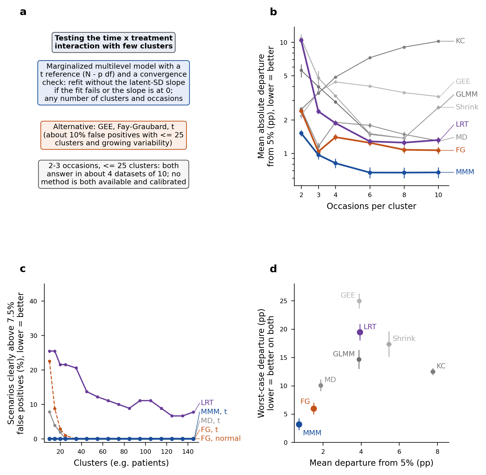
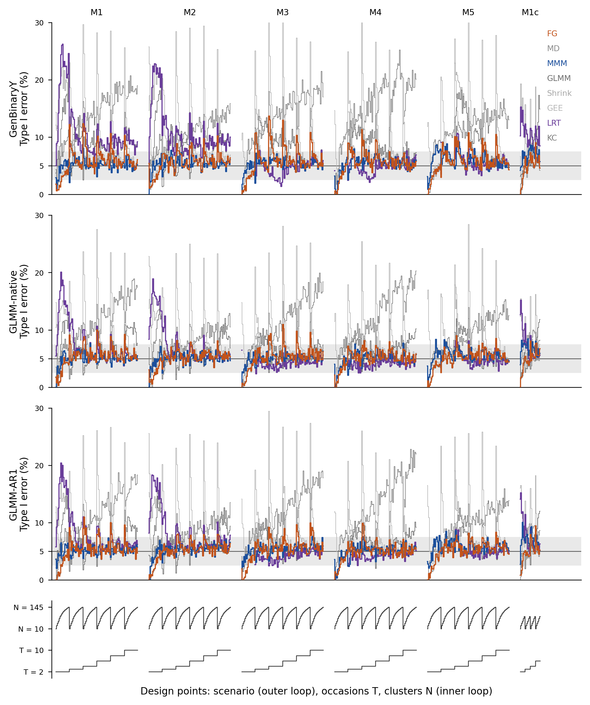

```{r setup}
.libPaths(path.expand("~/MMM/renv/library/linux-ubuntu-noble/R-4.6/x86_64-pc-linux-gnu"))
REG <- read.csv(path.expand("~/MMM/tables/V4_S7_numbers.csv"), colClasses = "character", na.strings = NULL)
TRACE <- nzchar(Sys.getenv("MMM_S7_TRACE"))
n <- function(id) {
  i <- which(REG$id == id)
  if (length(i) != 1) stop("registry id not found once: ", id)
  if (TRACE) "\u00a7" else REG$text[i]
}
```

## Abstract

Binary outcomes measured repeatedly on few subjects are analysed with generalized estimating equations (GEE), generalized linear mixed models or marginalized multilevel models. Small-sample corrections to the sandwich variance have been evaluated mainly by the number of clusters, with little attention to the number of measurement occasions. We compared eight analysis strategies over `r n("x:ndp_all")` simulated design points (10 to 145 clusters, 2 to 10 occasions, three data-generating mechanisms), including a scenario anchored to a neonatal lung-ultrasound cohort and four scenarios in which the latent variability grows strongly over time, and in subsamples of that cohort. The marginalized multilevel model was fitted with a convergence check that drops the time trend of the latent standard deviation when the fit reaches the boundary. With this check and a t reference distribution, it was the only strategy whose type I error was never clearly above 7.5% at any design point.<!-- claim: reg:ra as=descr --> With two or three occasions and up to 25 clusters no strategy was both available and calibrated.<!-- claim: reg:ra as=descr --> We recommend the marginalized model with the convergence check and a t reference, and GEE with the Fay-Graubard correction with a t reference as a simpler alternative.

**Keywords.** clustered binary data; few clusters; sandwich variance; small-sample correction; marginalized multilevel model; estimand; simulation study.

## 1. Introduction

Binary outcomes measured repeatedly within clusters, such as observations within patients or zones within a lung, are analysed in one of three ways. A generalized estimating equation (GEE) targets a population-averaged contrast and treats the dependence as a nuisance. A generalized linear mixed model (GLMM) targets a cluster-specific contrast and models the dependence explicitly. A marginalized multilevel model (MMM) specifies both: a marginal mean model of scientific interest and a conditional model that generates the dependence [1,2]. In applied work the choice usually follows the conventions of the field rather than evidence about the design at hand.<!-- noclaim: background -->

The three approaches target different quantities. Under a logit link the marginal and conditional contrasts differ. With a normal random intercept of variance $\sigma^2$, the marginal contrast is approximately the conditional one multiplied by

$$\left(1 + k^2\sigma^2\right)^{-1/2}, \qquad k = \frac{16\sqrt{3}}{15\pi},$$

so the gap widens with the variance of the random effects [3,4]. A further difference arises when the two are adjusted for different covariate sets, because the odds ratio is not collapsible [5]. Method comparisons nevertheless often score a mixed model against a marginal target it does not estimate.

This paper concerns designs with few clusters and short series, where the asymptotic arguments behind all three approaches are weakest. Cluster-randomized trials with ten to thirty clusters are common. Among `r n("x:k11_reviewed")` reviewed trials, the `r n("x:k11_reported")` that reported the number of clusters had a median of `r n("x:k11_median")` (interquartile range `r n("x:k11_q1")` to `r n("x:k11_q3")`) [6], and `r n("x:k12_pct")`% of stepped-wedge trials in another review had fewer than ten clusters [7]. Single-centre cohorts with two or three measurement occasions per subject are equally common in perinatal and paediatric research.<!-- noclaim: literature --> The sandwich variance estimator is anticonservative with few clusters, and a family of small-sample corrections exists to repair it [8-10]. These corrections have been evaluated on subjects followed over time, with as few as ten subjects and four occasions [11-15]. They have also been evaluated on parallel cluster-randomized trials, where the simulation evidence has been reviewed systematically [16,17]. In the clustered designs of these evaluations, the unit within a cluster is a site within a mouth [8], a patient within a general practice [10], a participant within a cluster [16,18] or a youth within a community [19]. It is never a subject measured on several occasions. Cluster sizes range from `r n("x:k9_size")` observations per cluster [19] to `r n("x:k8_size")` on average [16]. None of these studies fits a random slope, and only [10] generates random regression coefficients, as a misspecification check. Whether their recommendations hold with two or three occasions per subject has not been established.

We report a simulation study planned and reported following Morris, White and Crowther [20], and a clinical application. The study has three components. The first is a simulation over three data-generating mechanisms and a grid that extends to ten clusters and two occasions. One scenario takes its prevalence and between-subject variance from a neonatal lung-ultrasound cohort. The second is a recommendation stated as a decision rule that must hold at every simulated design point, because an analyst knows the number of clusters and occasions but not the mechanism that generated the data. The third is a plasmode application, in which the cohort is repeatedly subsampled into the few-cluster regime with the full-cohort estimate as reference. Three results are established elsewhere and are cited rather than claimed here: the uncorrected sandwich is anticonservative with few clusters [8,9], the corrections trade level for power [16,21], and marginal and conditional estimands differ [5].<!-- noclaim: aims and cited results -->

## 2. Methods

The study is reported in the order aims, data-generating mechanisms, estimands, methods and performance measures [20]. The revision reported here followed a protocol in this structure, versioned before any rerun and released with the code. Table 1 summarizes it. The full parameter table, extracted from the executed code, is in Table S1.

### 2.1 Aims

The aims concern the treatment-by-time interaction on the logit scale, in longitudinal binary data with few clusters and short series. We evaluated (i) the type I error of the test of no interaction; (ii) its power, raw and size-adjusted; (iii) bias, precision and confidence-interval coverage of the estimate against the estimand of each method; and (iv) the probability that a method returns a usable result. The clinical application and the decision rule of Section 2.6 build on these aims but are not simulation aims.

### 2.2 Data-generating mechanisms

The main grid crossed `r n("x:n_levels_N")` cluster counts, N ∈ {10, 15, 20, 25, 35, 45, 55, 65, 75, 85, 95, 105, 115, 125, 135, 145}, with `r n("x:n_levels_T")` maximum numbers of occasions, T ∈ {2, 3, 4, 6, 8, 10}. It also crossed five mean-model scenarios (M1-M5) and three mechanisms, giving `r n("x:ndp_grid")` design points. Each design point was simulated under the alternative (H1) and the null (H0), and the two arms differed only in the tested coefficient. T is a maximum. Each subject was observed at all T occasions with probability `r n("x:p_full")`, and otherwise at a number of occasions drawn uniformly from $1$ to $T-1$. At T = 2, between `r n("x:t2_single_lo")`% and `r n("x:t2_single_hi")`% of subjects therefore contributed a single observation. Treatment was assigned to subjects with probability `r n("x:p_trt")`.

The mean model of scenario M1 is $\mathrm{logit}\,\mu = \beta_0 + \beta_1 t + \beta_2 \mathrm{trt} + \beta_3\, t \times \mathrm{trt}$. Its marginal coefficients under H1 are (`r n("x:beta_m1")`), which give a marginal prevalence of about `r n("x:prev_m1_t2")` at T = 2. M2 adds a subject-level covariate (age). M3 and M4 add a random slope on time; in GenBinaryY its counterpart is a latent standard deviation that changes over time. M4 uses a smaller interaction (`r n("x:beta3_m4")`). M5 adds a second covariate that varies over time (dose), with its own random slope.

The three mechanisms differ in how the dependence is generated.

1. GenBinaryY is a marginalized model with a latent variable and a first-order transition term (R package MMLB) [1,2,22]. The latent standard deviation is a linear predictor, which in M3-M5 grows by `r n("x:gby_sigma_m3")` per occasion. This is the mechanism of the marginalized model.
2. GLMM-native is a logistic mixed model with normal random effects. The random intercept has variance `r n("x:glmm_d11")` and, in M3-M5, the random slope on time has variance `r n("x:glmm_d22")`. The conditional coefficients are the marginal ones multiplied by `r n("x:zeger_f")`. This is the mechanism of the mixed model.
3. GLMM-AR1 adds a latent first-order autoregressive process to the random effects of GLMM-native (ρ = `r n("x:ar1_rho")`, variance `r n("x:ar1_s2")`). Its conditional coefficients are calibrated on each replicate, so that the implied marginal coefficients equal the target. It is the mechanism of no method.

A sixth scenario, M1c, uses the mean model of M1 with the prevalence (`r n("x:m1c_prev")`) and the between-subject variance (`r n("x:m1c_var")`) of the clinical cohort of Section 2.7. It covers `r n("x:ndp_m1c")` design points, with N up to 45 and T up to 6. Four further scenarios, M6 and M7 on GenBinaryY and on GLMM-native, test the convergence check of Section 2.4 where the latent variability grows strongly over time. In GenBinaryY the latent standard deviation grew by `r n("x:m6_gby")` or `r n("x:m7_gby")` per occasion; in GLMM-native the random-slope variance was `r n("x:m6_nat")` or `r n("x:m7_nat")`. They cover the full grid (`r n("x:ndp_m67")` design points). With 10 occasions the latent standard deviation of GenBinaryY then grows from `r n("x:m3_sd0")` to `r n("x:m6_sd10")` or `r n("x:m7_sd10")`, against `r n("x:m3_sd10")` in M3.

The values of the main scenarios were compared with the clinical cohort of Section 2.7. Their marginal prevalence (`r n("x:prev_m1_t2")` at T = 2 and `r n("x:prev_m1_t10")` at T = 10 in M1) is much lower than in the cohort (`r n("x:lus_prev")`), and their random-intercept variance (`r n("x:glmm_d11")`) is lower than the patient variance of the cohort (`r n("x:lus_var_id")`); scenario M1c was added for this reason. The cohort has no treatment and few patients with repeated timepoints, so the interaction per occasion has no direct anchor in it. Its cumulative value at ten occasions (`r n("x:cum_int_t10")` on the logit scale) is of the order of the regional contrasts estimated in the cohort, for example `r n("x:lus_lateral")` between lateral and anterior zones. The autoregressive parameters of GLMM-AR1 were chosen to give a serial dependence that is detectable without dominating the cluster effect.<!-- noclaim: justification of parameter values -->

Each design point received `r n("x:nsim")` replicates per arm. In `r n("x:ndp_short")` design points, all in GLMM-AR1, only `r n("x:nrep_min")` to `r n("x:nrep_max_short")` datasets could be generated, because the per-replicate calibration met a singular system. Replicates in which one treatment arm was never observed after the first occasion were excluded from every denominator (`r n("x:n_degenerate")` per arm, the same in the three mechanisms). Replicate i of scenario m used the seed `r n("x:seed_rule")` under the L'Ecuyer-CMRG generator. The seed was the same for both arms and for every N, T and mechanism, so the datasets are common random numbers across cells [20].

### 2.3 Estimands and true values

The estimand is the coefficient of the treatment-by-time interaction on the logit scale. It is marginal for the marginalized model, the GEEs and the shrinkage estimator, and conditional on the random effects for the mixed model. In GenBinaryY the marginal true value is the generating coefficient. There is no conditional true value, so bias and coverage of the mixed model are not defined on that mechanism. In GLMM-native the conditional true value is the generating coefficient. The marginal value was obtained by Gauss-Hermite quadrature on the realized design; under H0 it is not exactly zero, and it ranges from `r n("x:nat_h0_min")` to `r n("x:nat_h0_max")` across scenarios and T. In GLMM-AR1 the marginal true value is the target, and the conditional value was computed for each replicate.

### 2.4 Methods compared

Eight strategies were applied to every dataset (Table 1). The marginalized multilevel model was fitted with `MMLB::mm` (`r n("x:mm_q")` quadrature points), with the latent-variable and transition formulas of the GenBinaryY generator. GEEs with exchangeable working correlation were fitted with `geepack` [23]. They were combined with the uncorrected sandwich variance and with the corrections of Mancl and DeRouen [8], Kauermann and Carroll [9] and Fay and Graubard [10], computed by `geesmv`. Each correction ran under a hard time limit of `r n("x:geesmv_timeout")` seconds, and a time-out counted as an unusable fit. The mixed model was fitted with `lme4::glmer` [24] (Laplace approximation). It had a random intercept in M1-M2 and the random slopes of the generating model in M3-M5. It was tested by Wald and by a likelihood-ratio test against the model without the interaction, with the same random effects. The shrinkage estimator rescales the mixed-model estimate and standard error by $(1 + k^2 D_{11})^{-1/2}$, with $D_{11}$ the random-intercept variance. Its Wald statistic therefore equals that of the mixed model, and only its interval differs. Software versions are in Table S2.

`MMLB::mm` writes the latent standard deviation as $\exp(a_0) + \exp(a_1)\,t$, so a slope of zero lies on the boundary of the parameter space. In the main scenarios with a latent standard deviation that changes over time (M3-M5), the generating slope is close to that boundary. In an earlier analysis of these data, two failure modes of the optimizer (`nlm`) produced excess rejections with long series: non-convergence with a shifted estimate, and convergence with a collapsed standard error. We therefore added a convergence check. A fit is declared at the boundary if `nlm` does not report convergence (return code other than `r n("x:nlm_ok")`) or if an estimated slope $\exp(a_k)$ is below `r n("x:cc_thr")`. Such a fit is replaced by the fit without the time trend of the latent standard deviation, and kept if that refit fails.<!-- noclaim: definition of the check --> The check was specified after the diagnosis and before the reanalysis of the `r n("x:cc_nfits")` fits of M3-M5 that returned an estimate. Thresholds of `r n("x:cc_thr_lo")` and `r n("x:cc_thr_hi")` were examined as sensitivity analyses, and scenarios M6-M7 were simulated afterwards to test the check. The marginalized model without the check is reported as a sensitivity analysis (Table S3).

Wald tests were referred to the standard normal in the primary tables and, as an alternative, to a t distribution with N - p degrees of freedom, p being the number of mean-model coefficients. The likelihood-ratio test was referred to a $\chi^2$ distribution with one degree of freedom.

### 2.5 Performance measures

A replicate was usable for a Wald-based method when the fit returned without error and the estimate, its standard error and its p-value were finite, with |estimate| < `r n("x:usab_max")` and $0 <$ SE < `r n("x:usab_max")`. Fits that returned with warnings were kept; excluding them is a sensitivity analysis (Table S13). For the likelihood-ratio test, both nested fits had to return and the p-value had to be finite. The probability of a usable result was reported for every method and cell, with every attempted replicate in the denominator.

Type I error was the rejection rate at the nominal 5% under H0. Over the grid we report the pooled rate and two summaries computed within each mechanism. For each of the `r n("x:n_levels_N")` cluster counts we took the departure from 5% of the replicate-weighted rate. The worst case is the largest of these departures, and the mean absolute departure is their mean. At each design point, a strategy was clearly above 7.5% when its rejection rate minus two Monte Carlo standard errors exceeded 7.5%. It was clearly below 2.5% when its rate plus two standard errors fell below 2.5%. These limits are Bradley's liberal criterion [25].<!-- noclaim: definitions --> Unconditional validity is the probability of a usable result multiplied by the probability of not rejecting a true null given one. Power was reported raw and size-adjusted. The size-adjusted critical value was the 95th percentile of |estimate/SE| over the usable null replicates of the same cell; for the likelihood-ratio test it was the 5th percentile of the null p-values. Bias, empirical and model-based standard errors, root mean squared error and coverage of the 95% interval were computed against the estimand of each method.

Monte Carlo standard errors (MCSE) were computed for every measure [20]. With `r n("x:nsim")` usable replicates, the MCSE of a rejection rate at 5% is `r n("x:mcse_5pct")` percentage points. This number of replicates was chosen so that a single cell resolves a departure from 5% of about `r n("x:mcse_5pct_2x")` points. The datasets are common random numbers across cells. The MCSE of every summary over cells, and of every difference between methods, was therefore obtained by a bootstrap that resamples replicate indices jointly across all cells (`r n("x:boot_B")` resamples). A comparison between methods is written as a difference only when its bootstrap interval, the estimate ± 2 MCSE, lies entirely beyond a relevance margin fixed in advance. The margin is one percentage point for differences in type I error or coverage averaged over cells, 2.5 points for a single cell, and two points for differences in power. Intervals entirely within the margin are reported as similar. Intervals that straddle it are reported as differences of about the size of the margin.<!-- noclaim: definitions --> Counts of miscalibrated cells used exact binomial tests with the Benjamini-Hochberg and Benjamini-Yekutieli corrections. In the text, values are given to two significant figures. Tables give the digit that the MCSE supports, with the MCSE in the caption.

### 2.6 Decision rule

The recommendation of Figure 1 comes from a rule applied to every strategy, a strategy being a method with its reference distribution. A strategy was excluded if its type I error was clearly above 7.5% at any design point. Among the remaining strategies, the one that returned a usable result most often was recommended.<!-- noclaim: definition of the rule --> The rule was applied to all `r n("x:ndp_all")` design points. It replaces the criterion of an earlier version of this work, which selected at each cluster count the method with the highest unconditional validity (Section 4.1).<!-- noclaim: description of the earlier criterion -->

### 2.7 Clinical application

The cohort comprises `r n("x:lus_npat")` neonates with ten lung-ultrasound zones scored at one to three timepoints. It gives `r n("x:lus_npt")` patient-timepoints and `r n("x:lus_nobs")` zone-level outcomes; `r n("x:lus_nmulti")` patients contribute more than one timepoint.<!-- noclaim: cohort description --> The outcome is severe loss of aeration (prevalence `r n("x:lus_prev")`). In a logistic mixed model of the outcome on zone region with a patient random intercept, the patient variance is `r n("x:lus_var_id")`. Adding a patient-timepoint level drives the patient variance to the boundary and places a variance of `r n("x:lus_var_pt")` at the new level (likelihood-ratio $\chi^2$ = `r n("x:lus_chi2")` on one degree of freedom). The contrast of interest is posterior against anterior zones, adjusted for disease, invasive ventilation and gestational age. It was estimated by the marginalized model, the GEEs and the mixed model. With `r n("x:lus_npat")` clusters the cohort lies above the simulated range, so it was used as a plasmode. We drew `r n("x:lus_nsub")` subsamples of whole patients at each of `r n("x:lus_Ns")` patients, with the full-cohort estimate of each method as its reference. Subsampling whole patients preserves the dependence structure exactly, and the covariate distribution only in expectation. Of the `r n("x:lus_ninv")` patients ventilated invasively, a draw of `r n("x:lus_N10")` contains none with probability `r n("x:lus_phyper")`, and the mean model is then not identifiable.

## 3. Results

### 3.1 Type I error on the main grid

Table 2 gives the type I error of the eight methods on the `r n("x:ndp_grid")` design points of the main grid, under a normal reference. The pooled rejection rate of the marginalized model with the convergence check ranged from `r n("v:rate|NAT|mmm")`% to `r n("v:rate|GB|mmm")`% across mechanisms. It ranged from `r n("v:rate|NAT|gee_fg")`% to `r n("v:rate|GB|gee_fg")`% for Fay-Graubard and from `r n("v:rate|NAT|gee_md")`% to `r n("v:rate|GB|gee_md")`% for Mancl-DeRouen. On GenBinaryY it reached `r n("v:rate|GB|gee_kc")`% for Kauermann-Carroll and `r n("v:rate|GB|gee")`% for the uncorrected GEE.<!-- noclaim: descriptive values per method -->

The marginalized model had the smallest worst-case departure from 5% on all three mechanisms: `r n("v:wc|GB|mmm")`, `r n("v:wc|NAT|mmm")` and `r n("v:wc|AR1|mmm")` percentage points on GenBinaryY, GLMM-native and GLMM-AR1. Its lead over the next method was `r n("cl:C01|GB:est")` points on GenBinaryY and about one point on the two random-effects mechanisms.<!-- claim: cl:C01|GB as=larger; cl:C01|NAT as=about1; cl:C01|AR1 as=about1 --> Its mean absolute departure (`r n("v:mad|NAT|mmm")` to `r n("v:mad|GB|mmm")` points) and that of Fay-Graubard (`r n("v:mad|NAT|gee_fg")` to `r n("v:mad|GB|gee_fg")`) were similar.<!-- claim: cl:C02|GB as=similar; cl:C02|NAT as=similar; cl:C02|AR1 as=similar --> On matched replicates usable for both methods, the two rejected a true null at similar rates.<!-- claim: cl:C03|GB as=similar; cl:C03|NAT as=similar; cl:C03|AR1 as=similar -->

Each method-cell was tested against 5% with the Benjamini-Hochberg correction within method. The marginalized model was detectably off nominal in `r n("v:flag|BH|mmm")`% of its cells, Fay-Graubard in `r n("v:flag|BH|gee_fg")`%, Mancl-DeRouen in `r n("v:flag|BH|gee_md")`% and Kauermann-Carroll in `r n("v:flag|BH|gee_kc")`% (Table S5).<!-- claim: cl:C10b|BH as=larger; cl:C10c|BH as=larger --> The uncorrected GEE was above 5% by `r n("cl:C12a|GB:est")` points at N = 10 on GenBinaryY. Its smallest excess over the cluster counts was under half a point on every mechanism.<!-- claim: cl:C12a|GB as=descr; cl:C12c|GB as=similar; cl:C12c|NAT as=similar; cl:C12c|AR1 as=similar --> Above 45 clusters, Fay-Graubard and the marginalized model were both within about half a point of 5% on the random-effects mechanisms.<!-- claim: cl:C25a|NAT as=descr; cl:C25b|NAT as=similar; cl:C25b|AR1 as=similar -->

The ordering of the methods was stable across mechanisms, with Spearman correlations of `r n("cl:C08|rate:est")` to `r n("cl:C08|wc:est")` between pairs of mechanisms. GLMM-AR1 differed from GLMM-native by `r n("cl:C09|all:est")` percentage points on average across methods.<!-- claim: cl:C08|rate as=descr; cl:C09|all as=descr --> The mean absolute departure of the marginalized model fell from `r n("v:madT|T2|mmm")` points at two occasions to `r n("v:madT|T4plus|mmm")` at four or more (Table S4). At two occasions the five marginal methods departed by `r n("v:madT|T2|mmm")` to `r n("v:madT|T2|gee_md")` points on average. The conditional methods departed by `r n("v:madT|T2|glmer")` (mixed model, Wald) to `r n("v:madT|T2|shrink")` points (shrinkage GLM).<!-- claim: cl:C13d|all as=larger -->

### 3.2 The convergence check of the marginalized model

In scenarios M3-M5 the check replaced `r n("x:cc_share_study")`% of the fits of the marginalized model with the fit without the time trend of the latent standard deviation. Without the check, the marginalized model was clearly above 7.5% at `r n("x:cc_hi_study")` of the `r n("x:cc_ndp_h0")` null design points of these scenarios, `r n("x:cc_hi_study_T810")` of them with eight or ten occasions. With the check it was clearly above 7.5% at `r n("x:cc_hi_cc")`.<!-- claim: reg:cc_hi_study as=descr; reg:cc_hi_cc as=descr --> Its mean absolute departure at ten occasions fell from `r n("s:madT1|mmm|10")` to `r n("v:madT1|mmm|10")` points. Size-adjusted power at eight or ten occasions changed by `r n("x:cc_p11")` points on average. The thresholds `r n("x:cc_thr_lo")` and `r n("x:cc_thr_hi")` in place of `r n("x:cc_thr")` changed the class of none of the `r n("x:n_subclaims")` comparisons classified for this paper. With either threshold, the marginalized model with a t reference was not clearly above 7.5% at any design point.<!-- claim: reg:thr_pa6_t4 as=descr; reg:thr_pa6_t2 as=descr -->

In scenarios M6-M7 the fit without the time trend is misspecified. There the check intervened in `r n("x:pb1_g7")`% to `r n("x:pb1_n6")`% of fits under H0, and in `r n("x:nsfb_T23_min")`% to `r n("x:nsfb_T23_max")`% at two or three occasions, where `nlm` most often failed to converge. With a t reference, the marginalized model with the check was never clearly above 7.5% at the `r n("x:ndp_m67")` design points. Under a normal reference its mean type I error was `r n("x:pb4_n6")`% to `r n("x:pb4_g7")`% across the four scenarios. Without the check, and with a t reference, it was clearly above 7.5% at `r n("x:ns_nocc_t_hi")` design points. Fay-Graubard with a t reference was clearly above 7.5% at `r n("x:ns_fgt_hi")` design points, all on GenBinaryY with the steeper slope (M7); its largest rate was `r n("x:ns_fgt_max")`% (Table S14).<!-- claim: reg:ns_mmmt_hi as=descr; reg:ns_nocc_t_hi as=descr; reg:ns_fgt_hi as=descr; reg:ns_fgt_g7_hi equals reg:ns_fgt_hi -->

### 3.3 Availability of a result

The probability of a usable result depended mostly on the number of occasions (Table 3). With random slopes and two occasions, the mixed model returned a usable Wald test in `r n("v:puT|RS|glmer|2")`% of attempts. The likelihood-ratio test with the same random effects was usable in `r n("v:puT|RS|glmer_lrt|2")`%, against `r n("v:puT|RS|mmm|2")`% for the marginalized model and `r n("v:puT|RS|gee_fg|2")`% for Fay-Graubard.<!-- claim: cl:C13a|all as=descr --> With a random intercept only, the likelihood-ratio test was usable in `r n("v:puT|RI|glmer_lrt|2")`% of attempts at two occasions, against `r n("v:puT|RI|glmer|2")`% for the Wald test.<!-- claim: cl:C13c|all as=larger --> From four occasions every method returned a usable result in more than `r n("x:pu_T4_min")`% of attempts.<!-- claim: reg:pu_T4_min as=descr -->

At 20 clusters or fewer, the likelihood-ratio test returned a usable result in `r n("v:use20|glmer_lrt")`% of attempts and the uncorrected GEE in `r n("v:use20|gee")`%. The marginalized model (`r n("v:use20|mmm")`%) and the three corrected sandwiches (each `r n("v:use20|gee_fg")`%) were similar.<!-- claim: cl:C14a|all as=larger; cl:C14d|all as=descr --> Unconditional validity ranged from `r n("v:val20|glmer_lrt")`% for the likelihood-ratio test to `r n("v:val20|glmer")`% for the Wald test of the mixed model.<!-- claim: cl:C14b|all as=larger -->

### 3.4 Reference distribution and the decision rule

Referring the Wald statistic to a t distribution with N - p degrees of freedom lowered every pooled rejection rate. The shift was `r n("v:tshift|NAT|glmer@abs")` to `r n("v:tshift|AR1|gee@abs")` percentage points over the grid and `r n("v:tsh25|glmer")` to `r n("v:tsh25|gee")` points at 25 clusters or fewer (Table S11).<!-- claim: cl:C17b|all as=larger --> Under the t reference the marginalized model became conservative at ten clusters. There it was clearly below 2.5% at `r n("x:rs_mmmt_N10_lo")` of `r n("x:rs_N10_ndp")` design points, against `r n("x:rs_fgt_N10_lo")` for Fay-Graubard.<!-- claim: reg:rs_mmmt_N10_lo as=descr; reg:rs_fgt_N10_lo as=descr --> Fay-Graubard also had the smaller worst-case departure under the t reference, `r n("v:wct|GB|gee_fg")` to `r n("v:wct|NAT|gee_fg")` points against `r n("v:wct|GB|mmm")` to `r n("v:wct|AR1|mmm")`.<!-- claim: cl:C17d|GB as=larger; cl:C17d|NAT as=larger; cl:C17d|AR1 as=larger -->

Table 4 applies the rule of Section 2.6 to the `r n("x:ndp_all")` design points of the main grid, M1c and M6-M7. The marginalized model with the check and a t reference was never clearly above 7.5%. Fay-Graubard with a t reference was clearly above 7.5% at `r n("x:ra_gee_fg_t_tutti_all_n_hi")` design points and Mancl-DeRouen with a t reference at `r n("x:ra_gee_md_t_tutti_all_n_hi")`. The likelihood-ratio test was clearly above 7.5% at `r n("x:ra_glmer_lrt_n_tutti_all_n_hi")` design points, and the Wald test of the mixed model with a t reference at `r n("x:ra_glmer_t_tutti_all_n_hi")`.<!-- claim: reg:ra as=descr --> The recommended strategy returned a usable result in `r n("x:ra_mmm_t_tutti_all_pu")`% of datasets, against `r n("x:ra_gee_fg_t_tutti_all_pu")`% for Fay-Graubard with a t reference. It was clearly below 2.5% at `r n("x:ra_mmm_t_tutti_all_n_lo")` design points, against `r n("x:ra_gee_fg_t_tutti_all_n_lo")`. With two or three occasions and at most 25 clusters, both returned a usable result in fewer than half of the datasets (`r n("x:ra_mmm_t_tutti_T2-3Nle25_pu")`% and `r n("x:ra_gee_fg_t_tutti_T2-3Nle25_pu")`%). Both rejected a false null in fewer than `r n("x:upow_T23_ceiling")`% of attempted datasets.<!-- claim: reg:ra as=descr; reg:upow_T23_ceiling as=descr -->

### 3.5 Power and coverage

Raw power was highest for Kauermann-Carroll (`r n("v:raw|GB|gee_kc")`% on GenBinaryY), which was also the most anticonservative method. The ordering by raw power did not survive size adjustment (Table 5).<!-- claim: cl:C16c|GB as=larger; cl:C16d|GB as=larger --> After size adjustment, power ranged from `r n("v:sa|GB|gee")`% to `r n("v:sa|AR1|glmer_lrt")`% across methods and mechanisms.<!-- noclaim: range --> On GenBinaryY the Wald test of the mixed model had more size-adjusted power than Fay-Graubard, by `r n("cl:C16a|GB:est")` points with the default optimizer of lme4 and by `r n("cl:C16a|GB:est_bobyqa")` points with bobyqa. On GLMM-AR1 the difference was about two points with the default optimizer, and the two were similar with bobyqa. On GLMM-native the two were similar with the default optimizer, and with bobyqa Fay-Graubard had more power, by about two points.<!-- claim: cl:C16a|GB as=larger; cl:C16a|GB:bobyqa as=larger; cl:C16a|AR1 as=about1; cl:C16a|AR1:bobyqa as=similar; cl:C16a|NAT as=similar; cl:C16a|NAT:bobyqa as=about1 -->

Coverage of the 95% interval was `r n("v:cov|GB|gee_md")`% to `r n("v:cov|NAT|gee_fg")`% for Fay-Graubard, Mancl-DeRouen and the marginalized model on every mechanism (Table S12). It was furthest from nominal for Kauermann-Carroll, at `r n("v:cov|GB|gee_kc")`% to `r n("v:cov|NAT|gee_kc")`%.<!-- claim: cl:C20a|GB as=similar; cl:C20a|NAT as=similar; cl:C20a|AR1 as=similar; cl:C20b|GB as=larger -->

### 3.6 Scenario anchored to the cohort

Scenario M1c has the prevalence and between-subject variance of the cohort (`r n("x:ndp_m1c")` design points). Two results of the main grid did not hold there. Under a normal reference the marginalized model rejected a true null in `r n("m:rate|NAT|mmm")`% to `r n("m:rate|GB|mmm")`% of usable replicates, against `r n("m:rate|NAT|gee_fg")`% to `r n("m:rate|GB|gee_fg")`% for Fay-Graubard. Its worst-case departure was larger than that of the best method by about one to two points.<!-- claim: cm:C03|GB as=larger; cm:C03|NAT as=larger; cm:C03|AR1 as=larger; cm:C01|GB as=about1; cm:C01|NAT as=about1; cm:C01|AR1 as=about1 --> Under a t reference its rate was `r n("m:ratet|NAT|mmm")`% to `r n("m:ratet|GB|mmm")`%, and that of Fay-Graubard `r n("m:ratet|AR1|gee_fg")`% to `r n("m:ratet|GB|gee_fg")`%.<!-- noclaim: descriptive values --> The size-adjusted power of the Wald test of the mixed model fell below that of Fay-Graubard, by `r n("cm:C16a|NAT:est@abs")` to `r n("cm:C16a|AR1:est@abs")` points with the default optimizer. With bobyqa the deficit was about two points on GenBinaryY and GLMM-AR1, and the two were similar on GLMM-native. The default optimizer returned degenerate fits with a near-zero standard error.<!-- claim: cm:C16a|GB as=larger; cm:C16a|NAT as=larger; cm:C16a|AR1 as=larger; cm:C16a|GB:bobyqa as=about1; cm:C16a|NAT:bobyqa as=similar; cm:C16a|AR1:bobyqa as=about1 --> Which method had the fewest or the most miscalibrated cells could not be distinguished in M1c.<!-- claim: cm:C10b|BH as=notdist; cm:C10c|BH as=notdist -->

### 3.7 Clinical application

In the full cohort the posterior-versus-anterior contrast was `r n("x:lus_est_mmm")` (SE `r n("x:lus_se_mmm")`) by the marginalized model and `r n("x:lus_est_gee")` by GEE. The mixed model gave `r n("x:lus_est_glmm")` (SE `r n("x:lus_se_glmm")`) on its conditional scale. In subsamples of `r n("x:lus_N10")` patients, `r n("x:lus_inv_none")`% of draws contained no invasively ventilated patient, so that the mean model could not be fitted (Table S15). Among the fits that were returned, a usable result was obtained by the mixed model in `r n("x:lus_ur_glmm")`%, by the marginalized model in `r n("x:lus_ur_mmm")`% and by the uncorrected GEE in `r n("x:lus_ur_gee")`%. It was obtained by Fay-Graubard in `r n("x:lus_ur_fg")`% and by Mancl-DeRouen in `r n("x:lus_ur_md")`%; most failures of the corrections returned a point estimate without a standard error.<!-- noclaim: descriptive values per method --> Across subsample sizes, the standard error of the mixed model was `r n("x:lus_ser_glmm_min")` to `r n("x:lus_ser_glmm_max")` times the empirical standard deviation of its estimates. The corresponding ratio was `r n("x:lus_ser_mmm_min")` to `r n("x:lus_ser_mmm_max")` for the marginalized model. The bias of the marginalized model against its full-cohort estimate fell from `r n("x:lus_bias_mmm_10")` at `r n("x:lus_N10")` patients to `r n("x:lus_bias_mmm_50")` at `r n("x:lus_N50")`.

## 4. Discussion

### 4.1 The recommendation

The rule of Section 2.6 selects the marginalized multilevel model with the convergence check and a t reference with N - p degrees of freedom, at every number of clusters and occasions (Figure 1). Across the `r n("x:ndp_all")` simulated design points it was the only strategy whose type I error was never clearly above 7.5%. It returned a usable result in `r n("x:ra_mmm_t_tutti_all_pu")`% of datasets.<!-- claim: reg:ra as=descr --> Fay-Graubard with a t reference returned a usable result about as often and needs no convergence check, so it is a reasonable alternative. It was clearly above 7.5% only with at most `r n("x:fgt_hi_Nmax")` clusters and a latent variability that grows steeply over time.<!-- claim: reg:fgt_hi_Nmax as=descr --> The two strategies are conservative in different places: the marginalized model at ten clusters, Fay-Graubard more often elsewhere (Table 4).<!-- claim: reg:rs_mmmt_N10_lo as=descr -->

The rule asks that a recommendation hold at every design point, because an analyst knows the number of clusters and occasions but not the mechanism that generated the data. It replaces a criterion that maximized unconditional validity at each cluster count. That criterion rewards a method for answering, whatever its level. On the present data it would have recommended the likelihood-ratio test of the mixed model up to `r n("x:switch_GB")` clusters, a test that was clearly above 7.5% at `r n("x:ra_glmer_lrt_n_tutti_all_n_hi")` design points.<!-- claim: reg:switch_GB as=descr; reg:ra as=descr --> The change of criterion also reverses the general recommendation of the earlier version, which was Fay-Graubard. The reason is that scenarios M6-M7 exposed design points at which Fay-Graubard with a t reference was clearly above 7.5%.<!-- noclaim: statement of the change of criterion -->

With two or three occasions and up to 25 clusters, no strategy was both available and calibrated. The recommended strategy and Fay-Graubard returned a usable result in fewer than half of the datasets and almost never detected the simulated effect.<!-- claim: reg:ra as=descr --> With a random slope and two occasions, the random-effects covariance of the mixed model is not identifiable, since two subject-level parameters saturate two observations, and its Wald test was essentially never usable. The case for the maximal random-effects structure [26] is thus bounded by power [27] and, with two occasions, by identifiability. In this corner the design determines what can be learned more than the analysis does. Four or more occasions per subject, or more clusters, should be planned where possible.<!-- noclaim: interpretation and design advice -->

### 4.2 The convergence check

The check addresses a property of the parametrization rather than of the marginalized model. `MMLB::mm` writes the latent standard deviation with an exponentiated slope, so a slope near zero lies on the boundary of the parameter space, and in all the main scenarios the generating slope was close to zero. At the boundary `nlm` either stopped without converging, with an estimate shifted by an amount that did not shrink with the standard error, or converged with a collapsed standard error. Both failures produced excess rejections that grew with the number of clusters and occasions. This is why the marginalized model appeared miscalibrated with long series in an earlier analysis. Replacing such fits with the fit without the time trend removed the excess.<!-- noclaim: interpretation of the mechanism --> The check intervened far more often than we had anticipated, mainly because `nlm` failed to converge with two or three occasions or few clusters.<!-- claim: reg:pb1_n6 as=descr --> Where it intervened, the type I error stayed close to nominal. It also remained calibrated in M6-M7, where the fit without the time trend is misspecified. Analysts who use the marginalized model with a latent standard deviation that changes over time should apply the check and report how often it intervened.<!-- noclaim: recommendation -->

### 4.3 Relation to previous work

We reproduce the anticonservatism of the uncorrected sandwich with few clusters [8,9]. Li and Redden found that Kauermann-Carroll attains the nominal level at ten clusters under a t reference [16]. In our data its rate at ten clusters was `r n("cl:C24a|AR1:est")`% to `r n("cl:C24a|GB:est")`%. Over the whole grid, however, it was clearly above 7.5% at `r n("x:ra_gee_kc_t_tutti_all_n_hi")` of `r n("x:ndp_all")` design points, so the finding does not extend beyond the cluster range in which it was established.<!-- claim: cl:C24a|AR1 as=descr; cl:C24a|GB as=descr; reg:ra as=descr --> Mancl and DeRouen reported sizes close to nominal with ten subjects [8], and Bie et al. favoured GEE with their correction [18]. Under a t reference its pooled rate was `r n("cl:C24c|NAT:est")`% to `r n("cl:C24c|GB:est")`%, inside their band. It was nevertheless clearly above 7.5% at `r n("x:ra_gee_md_t_tutti_all_n_hi")` design points, `r n("x:ra_gee_md_t_nuovi_all_n_hi")` of them in scenarios M6-M7.<!-- claim: cl:C24c|NAT as=descr; cl:C24c|GB as=descr; reg:ra as=descr --> The marginalized model has been studied for moderate to long series [22], and the short series studied here complement that work. Estimation methods for mixed logistic models with few clusters are reviewed by McNeish [28].

### 4.4 Limitations

In the main scenarios the random-slope variance and the time trend of the latent standard deviation were small. Conclusions about random slopes therefore rest mainly on scenarios M6-M7, which cover one structure (a slope on time) and two mechanisms. The working correlation of the GEEs was exchangeable throughout, and misspecified working correlations were not simulated. The degrees of freedom of the t reference were N - p and were not varied, whereas Li and Redden used K - 2 [16]. GLMM-AR1 behaved almost exactly like GLMM-native, so the study rests on two distinct mechanisms. Each of these is the home model of one method: GenBinaryY of the marginalized model and GLMM-native of the mixed model. In GLMM-native the marginal value under the null is not exactly zero. It ranges from `r n("x:nat_h0_min")` to `r n("x:nat_h0_max")` in the main scenarios and reaches `r n("x:m7_h0_min")` in M6-M7. The convergence check was introduced after part of the results had been seen, and was then tested on scenarios simulated afterwards. Small-sample corrections were computed with `geesmv`, whose numerical failures at small samples are documented in Section S4. An independent implementation, such as the CR2 estimator of `clubSandwich` [29,30], would avoid them. The clinical application uses one cohort and one outcome. The subsampling resamples whole patients, and the patient-timepoint level that carries most of the dependence is identified by only `r n("x:lus_nmulti")` patients measured more than once.<!-- noclaim: limitations -->

## 5. Conclusions

With few clusters and short series, the choice of analysis for a clustered binary outcome decides whether the test keeps its nominal level and whether it returns an answer at all. The marginalized multilevel model was the only strategy that kept its level at every simulated design point, provided that it was fitted with a check that drops the time trend of the latent standard deviation at the boundary and referred to a t distribution. With two or three occasions and up to 25 clusters, no strategy was both available and calibrated, so in that regime the design limits what any analysis can show.<!-- claim: reg:ra as=descr -->

We recommend the marginalized model with the convergence check and a t reference. GEE with the Fay-Graubard correction with a t reference is a simpler alternative, to be used with caution when clusters are few and the between-subject variability grows over time.<!-- noclaim: recommendation -->

## Code and data availability

The simulation code, the per-replicate results and the scripts that produce every number, table and figure of this paper are available at https://github.com/lucavd/MMM (commit `r n("x:git_commit")`). They will be archived on Zenodo with a DOI at submission. The manuscript source reads every number in the text from a registry of values, each with its source file and checksum. The clinical cohort cannot be shared publicly; the plasmode results are included as summary tables.

## Declarations

[Authors: funding, conflicts of interest, ethics approval of the cohort and an ICMJE-conformant statement on the use of any software tool in drafting, language editing or consistency checking are to be completed by the authors.]

## References

1. Heagerty PJ. Marginally specified logistic-normal models for longitudinal binary data. *Biometrics* 1999;55(3):688-698. doi:10.1111/j.0006-341X.1999.00688.x
2. Heagerty PJ, Zeger SL. Marginalized multilevel models and likelihood inference. *Statistical Science* 2000;15(1):1-26. doi:10.1214/ss/1009212671
3. Zeger SL, Liang KY, Albert PS. Models for longitudinal data: a generalized estimating equation approach. *Biometrics* 1988;44(4):1049-1060. doi:10.2307/2531734
4. Heagerty PJ, Kurland BF. Misspecified maximum likelihood estimates and generalised linear mixed models. *Biometrika* 2001;88(4):973-985. doi:10.1093/biomet/88.4.973
5. Daniel R, Zhang J, Farewell D. Making apples from oranges: comparing noncollapsible effect estimators and their standard errors after adjustment for different covariate sets. *Biometrical Journal* 2021;63(3):528-557. doi:10.1002/bimj.201900297
6. Kahan BC, Forbes G, Ali Y, et al. Increased risk of type I errors in cluster randomized trials with small or medium numbers of clusters: a review, reanalysis, and simulation study. *Trials* 2016;17:438. doi:10.1186/s13063-016-1571-2
7. Barker D, D'Este C, Campbell MJ, McElduff P. Minimum number of clusters and comparison of analysis methods for cross sectional stepped wedge cluster randomized trials with binary outcomes: a simulation study. *Trials* 2017;18:119. doi:10.1186/s13063-017-1862-2
8. Mancl LA, DeRouen TA. A covariance estimator for GEE with improved small-sample properties. *Biometrics* 2001;57(1):126-134. doi:10.1111/j.0006-341X.2001.00126.x
9. Kauermann G, Carroll RJ. A note on the efficiency of sandwich covariance matrix estimation. *Journal of the American Statistical Association* 2001;96(456):1387-1396. doi:10.1198/016214501753382309
10. Fay MP, Graubard BI. Small-sample adjustments for Wald-type tests using sandwich estimators. *Biometrics* 2001;57(4):1198-1206. doi:10.1111/j.0006-341X.2001.01198.x
11. Pan W, Wall MM. Small-sample adjustments in using the sandwich variance estimator in generalized estimating equations. *Statistics in Medicine* 2002;21(10):1429-1441. doi:10.1002/sim.1142
12. Morel JG, Bokossa MC, Neerchal NK. Small sample correction for the variance of GEE estimators. *Biometrical Journal* 2003;45(4):395-409. doi:10.1002/bimj.200390021
13. Westgate PM, Burchett WW. Improving power in small-sample longitudinal studies when using generalized estimating equations. *Statistics in Medicine* 2016;35(21):3733-3744. doi:10.1002/sim.6967
14. Ford WP, Westgate PM. A comparison of bias-corrected empirical covariance estimators with generalized estimating equations in small-sample longitudinal study settings. *Statistics in Medicine* 2018;37(28):4318-4329. doi:10.1002/sim.7917
15. Gosho M, Ishii R, Noma H, Maruo K. A comparison of bias-adjusted generalized estimating equations for sparse binary data in small-sample longitudinal studies. *Statistics in Medicine* 2023;42(15):2711-2727. doi:10.1002/sim.9744
16. Li P, Redden DT. Small sample performance of bias-corrected sandwich estimators for cluster-randomized trials with binary outcomes. *Statistics in Medicine* 2015;34(2):281-296. doi:10.1002/sim.6344
17. Hemming K, Thompson J, Kristunas C, Forbes A, Watson S, Bowden R, McKenzie JE, Kasza J. The performance of small sample correction methods for controlling type I error when analyzing parallel cluster randomized trials: a systematic review of simulation studies. *Journal of Clinical Epidemiology* 2025;185:111838. doi:10.1016/j.jclinepi.2025.111838
18. Bie R, Haneuse S, Huey N, Schildcrout J, Shepherd BE. Fitting marginal models in small samples: a simulation study of marginalized multilevel models and generalized estimating equations. *Statistics in Medicine* 2021;40(24):5298-5312. doi:10.1002/sim.9126
19. Lu B, Preisser JS, Qaqish BF, Suchindran C, Bangdiwala SI, Wolfson M. A comparison of two bias-corrected covariance estimators for generalized estimating equations. *Biometrics* 2007;63(3):935-941. doi:10.1111/j.1541-0420.2007.00764.x
20. Morris TP, White IR, Crowther MJ. Using simulation studies to evaluate statistical methods. *Statistics in Medicine* 2019;38(11):2074-2102. doi:10.1002/sim.8086
21. Leyrat C, Morgan KE, Leurent B, Kahan BC. Cluster randomized trials with a small number of clusters: which analyses should be used? *International Journal of Epidemiology* 2018;47(1):321-331. doi:10.1093/ije/dyx169
22. Schildcrout JS, Heagerty PJ. Marginalized models for moderate to long series of longitudinal binary response data. *Biometrics* 2007;63(2):322-331. doi:10.1111/j.1541-0420.2006.00680.x
23. Halekoh U, Højsgaard S, Yan J. The R package geepack for generalized estimating equations. *Journal of Statistical Software* 2006;15(2):1-11. doi:10.18637/jss.v015.i02
24. Bates D, Mächler M, Bolker B, Walker S. Fitting linear mixed-effects models using lme4. *Journal of Statistical Software* 2015;67(1):1-48. doi:10.18637/jss.v067.i01
25. Bradley JV. Robustness? *British Journal of Mathematical and Statistical Psychology* 1978;31(2):144-152. doi:10.1111/j.2044-8317.1978.tb00581.x
26. Barr DJ, Levy R, Scheepers C, Tily HJ. Random effects structure for confirmatory hypothesis testing: keep it maximal. *Journal of Memory and Language* 2013;68(3):255-278. doi:10.1016/j.jml.2012.11.001
27. Matuschek H, Kliegl R, Vasishth S, Baayen H, Bates D. Balancing type I error and power in linear mixed models. *Journal of Memory and Language* 2017;94:305-315. doi:10.1016/j.jml.2017.01.001
28. McNeish D. Estimation methods for mixed logistic models with few clusters. *Multivariate Behavioral Research* 2016;51(6):790-804. doi:10.1080/00273171.2016.1236237
29. Pustejovsky JE, Tipton E. Small-sample methods for cluster-robust variance estimation and hypothesis testing in fixed effects models. *Journal of Business & Economic Statistics* 2018;36(4):672-683. doi:10.1080/07350015.2016.1247004
30. Pustejovsky JE, Tipton E. Corrigendum: small sample methods for cluster-robust variance estimation and hypothesis testing in fixed effects models. *Journal of Business & Economic Statistics* 2023;41(2):650-652. doi:10.1080/07350015.2023.2174123

## Tables and figures

**Table 1.** Summary of the simulation study in the ADEMP structure [20].

| | |
|---|---|
| Aims | Type I error and power of the test of no treatment-by-time interaction, bias and coverage of its estimate, and probability of a usable result, with few clusters and short series |
| Data-generating mechanisms | GenBinaryY (marginalized latent-variable transition model), GLMM-native (logistic mixed model), GLMM-AR1 (mixed model with latent first-order autoregression); scenarios M1-M5 on the full grid of `r n("x:n_levels_N")` cluster counts (10 to 145) and `r n("x:n_levels_T")` series lengths (2 to 10), `r n("x:ndp_grid")` design points; M1c anchored to the clinical cohort (`r n("x:ndp_m1c")` design points); M6-M7 with a steep time trend of the latent variability (`r n("x:ndp_m67")` design points); null and alternative arm for each, `r n("x:nsim")` replicates per arm |
| Estimands | Interaction coefficient on the logit scale: marginal (marginalized model, GEEs, shrinkage GLM) or conditional on the random effects (GLMM) |
| Methods | Marginalized multilevel model (`MMLB::mm`) with convergence check; GEE with uncorrected sandwich and with the Mancl-DeRouen, Kauermann-Carroll and Fay-Graubard corrections (`geepack`, `geesmv`); GLMM with Wald and likelihood-ratio tests (`lme4`); shrinkage-rescaled GLMM. Wald tests with normal and t (N - p degrees of freedom) reference |
| Performance measures | Probability of a usable result; type I error (pooled, worst case and mean absolute departure over cluster counts, clearly above 7.5% or below 2.5% per design point); raw and size-adjusted power; bias, empirical and model standard error, coverage; Monte Carlo standard errors by block bootstrap over replicates |

**Table 2.** Type I error at the nominal 5% on the main grid (`r n("x:ndp_grid")` design points), normal reference. Rate: pooled rejection rate (%). Worst: largest absolute departure from 5% over the `r n("x:n_levels_N")` cluster counts (percentage points). MAD: mean absolute departure over the cluster counts. GB = GenBinaryY, NAT = GLMM-native, AR1 = GLMM-AR1. Monte Carlo standard errors (block bootstrap) at most `r n("x:t2_mcse_rate")` for rates and MAD and at most `r n("x:t2_mcse_wc")` for the worst case; values of the marginalized model without the check in Table S3.

| Method | Rate GB | Rate NAT | Rate AR1 | Worst GB | Worst NAT | Worst AR1 | MAD GB | MAD NAT | MAD AR1 |
|---|---|---|---|---|---|---|---|---|---|
| GEE, Fay-Graubard | `r n("v:rate|GB|gee_fg@tab")` | `r n("v:rate|NAT|gee_fg@tab")` | `r n("v:rate|AR1|gee_fg@tab")` | `r n("v:wc|GB|gee_fg@tab")` | `r n("v:wc|NAT|gee_fg@tab")` | `r n("v:wc|AR1|gee_fg@tab")` | `r n("v:mad|GB|gee_fg@tab")` | `r n("v:mad|NAT|gee_fg@tab")` | `r n("v:mad|AR1|gee_fg@tab")` |
| GEE, Mancl-DeRouen | `r n("v:rate|GB|gee_md@tab")` | `r n("v:rate|NAT|gee_md@tab")` | `r n("v:rate|AR1|gee_md@tab")` | `r n("v:wc|GB|gee_md@tab")` | `r n("v:wc|NAT|gee_md@tab")` | `r n("v:wc|AR1|gee_md@tab")` | `r n("v:mad|GB|gee_md@tab")` | `r n("v:mad|NAT|gee_md@tab")` | `r n("v:mad|AR1|gee_md@tab")` |
| Marginalized model, with check | `r n("v:rate|GB|mmm@tab")` | `r n("v:rate|NAT|mmm@tab")` | `r n("v:rate|AR1|mmm@tab")` | `r n("v:wc|GB|mmm@tab")` | `r n("v:wc|NAT|mmm@tab")` | `r n("v:wc|AR1|mmm@tab")` | `r n("v:mad|GB|mmm@tab")` | `r n("v:mad|NAT|mmm@tab")` | `r n("v:mad|AR1|mmm@tab")` |
| GLMM, Wald | `r n("v:rate|GB|glmer@tab")` | `r n("v:rate|NAT|glmer@tab")` | `r n("v:rate|AR1|glmer@tab")` | `r n("v:wc|GB|glmer@tab")` | `r n("v:wc|NAT|glmer@tab")` | `r n("v:wc|AR1|glmer@tab")` | `r n("v:mad|GB|glmer@tab")` | `r n("v:mad|NAT|glmer@tab")` | `r n("v:mad|AR1|glmer@tab")` |
| Shrinkage GLM | `r n("v:rate|GB|shrink@tab")` | `r n("v:rate|NAT|shrink@tab")` | `r n("v:rate|AR1|shrink@tab")` | `r n("v:wc|GB|shrink@tab")` | `r n("v:wc|NAT|shrink@tab")` | `r n("v:wc|AR1|shrink@tab")` | `r n("v:mad|GB|shrink@tab")` | `r n("v:mad|NAT|shrink@tab")` | `r n("v:mad|AR1|shrink@tab")` |
| GEE, uncorrected | `r n("v:rate|GB|gee@tab")` | `r n("v:rate|NAT|gee@tab")` | `r n("v:rate|AR1|gee@tab")` | `r n("v:wc|GB|gee@tab")` | `r n("v:wc|NAT|gee@tab")` | `r n("v:wc|AR1|gee@tab")` | `r n("v:mad|GB|gee@tab")` | `r n("v:mad|NAT|gee@tab")` | `r n("v:mad|AR1|gee@tab")` |
| GLMM, likelihood ratio | `r n("v:rate|GB|glmer_lrt@tab")` | `r n("v:rate|NAT|glmer_lrt@tab")` | `r n("v:rate|AR1|glmer_lrt@tab")` | `r n("v:wc|GB|glmer_lrt@tab")` | `r n("v:wc|NAT|glmer_lrt@tab")` | `r n("v:wc|AR1|glmer_lrt@tab")` | `r n("v:mad|GB|glmer_lrt@tab")` | `r n("v:mad|NAT|glmer_lrt@tab")` | `r n("v:mad|AR1|glmer_lrt@tab")` |
| GEE, Kauermann-Carroll | `r n("v:rate|GB|gee_kc@tab")` | `r n("v:rate|NAT|gee_kc@tab")` | `r n("v:rate|AR1|gee_kc@tab")` | `r n("v:wc|GB|gee_kc@tab")` | `r n("v:wc|NAT|gee_kc@tab")` | `r n("v:wc|AR1|gee_kc@tab")` | `r n("v:mad|GB|gee_kc@tab")` | `r n("v:mad|NAT|gee_kc@tab")` | `r n("v:mad|AR1|gee_kc@tab")` |

**Table 3.** Replicates returning a usable result (%), by structure of the random effects and number of occasions T, pooled over mechanisms and cluster counts, every attempted replicate in the denominator. LR = likelihood-ratio test with the random-effects structure of the Wald test. Monte Carlo standard errors at most `r n("x:t3_mcse")` points. All methods in Table S7.

| Random effects | Occasions | GLMM, Wald | GLMM, LR | Marginalized model | GEE, Fay-Graubard | GEE, uncorrected |
|---|---|---|---|---|---|---|
| Intercept (M1-M2) | T = 2 | `r n("v:puT|RI|glmer|2@tab")` | `r n("v:puT|RI|glmer_lrt|2@tab")` | `r n("v:puT|RI|mmm|2@tab")` | `r n("v:puT|RI|gee_fg|2@tab")` | `r n("v:puT|RI|gee|2@tab")` |
|  | T = 3 | `r n("v:puT|RI|glmer|3@tab")` | `r n("v:puT|RI|glmer_lrt|3@tab")` | `r n("v:puT|RI|mmm|3@tab")` | `r n("v:puT|RI|gee_fg|3@tab")` | `r n("v:puT|RI|gee|3@tab")` |
|  | T = 4 | `r n("v:puT|RI|glmer|4@tab")` | `r n("v:puT|RI|glmer_lrt|4@tab")` | `r n("v:puT|RI|mmm|4@tab")` | `r n("v:puT|RI|gee_fg|4@tab")` | `r n("v:puT|RI|gee|4@tab")` |
|  | T = 6 | `r n("v:puT|RI|glmer|6@tab")` | `r n("v:puT|RI|glmer_lrt|6@tab")` | `r n("v:puT|RI|mmm|6@tab")` | `r n("v:puT|RI|gee_fg|6@tab")` | `r n("v:puT|RI|gee|6@tab")` |
|  | T = 10 | `r n("v:puT|RI|glmer|10@tab")` | `r n("v:puT|RI|glmer_lrt|10@tab")` | `r n("v:puT|RI|mmm|10@tab")` | `r n("v:puT|RI|gee_fg|10@tab")` | `r n("v:puT|RI|gee|10@tab")` |
| Intercept and slopes (M3-M5) | T = 2 | `r n("v:puT|RS|glmer|2@tab")` | `r n("v:puT|RS|glmer_lrt|2@tab")` | `r n("v:puT|RS|mmm|2@tab")` | `r n("v:puT|RS|gee_fg|2@tab")` | `r n("v:puT|RS|gee|2@tab")` |
|  | T = 3 | `r n("v:puT|RS|glmer|3@tab")` | `r n("v:puT|RS|glmer_lrt|3@tab")` | `r n("v:puT|RS|mmm|3@tab")` | `r n("v:puT|RS|gee_fg|3@tab")` | `r n("v:puT|RS|gee|3@tab")` |
|  | T = 4 | `r n("v:puT|RS|glmer|4@tab")` | `r n("v:puT|RS|glmer_lrt|4@tab")` | `r n("v:puT|RS|mmm|4@tab")` | `r n("v:puT|RS|gee_fg|4@tab")` | `r n("v:puT|RS|gee|4@tab")` |
|  | T = 6 | `r n("v:puT|RS|glmer|6@tab")` | `r n("v:puT|RS|glmer_lrt|6@tab")` | `r n("v:puT|RS|mmm|6@tab")` | `r n("v:puT|RS|gee_fg|6@tab")` | `r n("v:puT|RS|gee|6@tab")` |
|  | T = 10 | `r n("v:puT|RS|glmer|10@tab")` | `r n("v:puT|RS|glmer_lrt|10@tab")` | `r n("v:puT|RS|mmm|10@tab")` | `r n("v:puT|RS|gee_fg|10@tab")` | `r n("v:puT|RS|gee|10@tab")` |

**Table 4.** The decision rule applied to `r n("x:ndp_all")` design points: the main grid and M1c (`r n("x:ndp_study")`) and scenarios M6-M7 (`r n("x:ndp_new")`). Clearly above 7.5%: rejection rate minus two Monte Carlo standard errors above 7.5% under the null; clearly below 2.5%: rate plus two standard errors below 2.5%; design points with fewer than `r n("x:min_obs_dp")` usable replicates are not assessed. Usable: replicates returning a usable result (%), averaged over design points; power: rejections of a false null per attempted dataset (%). The column at ten clusters covers the main grid and M1c (`r n("x:rs_N10_ndp")` design points); the last column covers two or three occasions and at most 25 clusters.

| Strategy | Above 7.5%, main and M1c | Above 7.5%, M6-M7 | Below 2.5%, all | Below 2.5%, ten clusters | Usable (%) | Power (%) | Usable, T ≤ 3 and N ≤ 25 (%) |
|---|---|---|---|---|---|---|---|
| Marginalized model with check, t | `r n("x:ra_mmm_t_studio_all_n_hi")` | `r n("x:ra_mmm_t_nuovi_all_n_hi")` | `r n("x:ra_mmm_t_tutti_all_n_lo")` | `r n("x:rs_mmm_t_N10_lo")` | `r n("x:ra_mmm_t_tutti_all_pu@tab")` | `r n("x:ra_mmm_t_tutti_all_upow@tab")` | `r n("x:ra_mmm_t_tutti_T2-3Nle25_pu@tab")` |
| Marginalized model with check, normal | `r n("x:ra_mmm_n_studio_all_n_hi")` | `r n("x:ra_mmm_n_nuovi_all_n_hi")` | `r n("x:ra_mmm_n_tutti_all_n_lo")` | `r n("x:rs_mmm_n_N10_lo")` | `r n("x:ra_mmm_n_tutti_all_pu@tab")` | `r n("x:ra_mmm_n_tutti_all_upow@tab")` | `r n("x:ra_mmm_n_tutti_T2-3Nle25_pu@tab")` |
| GEE, Fay-Graubard, t | `r n("x:ra_gee_fg_t_studio_all_n_hi")` | `r n("x:ra_gee_fg_t_nuovi_all_n_hi")` | `r n("x:ra_gee_fg_t_tutti_all_n_lo")` | `r n("x:rs_gee_fg_t_N10_lo")` | `r n("x:ra_gee_fg_t_tutti_all_pu@tab")` | `r n("x:ra_gee_fg_t_tutti_all_upow@tab")` | `r n("x:ra_gee_fg_t_tutti_T2-3Nle25_pu@tab")` |
| GEE, Fay-Graubard, normal | `r n("x:ra_gee_fg_n_studio_all_n_hi")` | `r n("x:ra_gee_fg_n_nuovi_all_n_hi")` | `r n("x:ra_gee_fg_n_tutti_all_n_lo")` | `r n("x:rs_gee_fg_n_N10_lo")` | `r n("x:ra_gee_fg_n_tutti_all_pu@tab")` | `r n("x:ra_gee_fg_n_tutti_all_upow@tab")` | `r n("x:ra_gee_fg_n_tutti_T2-3Nle25_pu@tab")` |
| GEE, Mancl-DeRouen, t | `r n("x:ra_gee_md_t_studio_all_n_hi")` | `r n("x:ra_gee_md_t_nuovi_all_n_hi")` | `r n("x:ra_gee_md_t_tutti_all_n_lo")` | `r n("x:rs_gee_md_t_N10_lo")` | `r n("x:ra_gee_md_t_tutti_all_pu@tab")` | `r n("x:ra_gee_md_t_tutti_all_upow@tab")` | `r n("x:ra_gee_md_t_tutti_T2-3Nle25_pu@tab")` |
| GEE, Kauermann-Carroll, t | `r n("x:ra_gee_kc_t_studio_all_n_hi")` | `r n("x:ra_gee_kc_t_nuovi_all_n_hi")` | `r n("x:ra_gee_kc_t_tutti_all_n_lo")` | `r n("x:rs_gee_kc_t_N10_lo")` | `r n("x:ra_gee_kc_t_tutti_all_pu@tab")` | `r n("x:ra_gee_kc_t_tutti_all_upow@tab")` | `r n("x:ra_gee_kc_t_tutti_T2-3Nle25_pu@tab")` |
| GLMM, Wald, t | `r n("x:ra_glmer_t_studio_all_n_hi")` | `r n("x:ra_glmer_t_nuovi_all_n_hi")` | `r n("x:ra_glmer_t_tutti_all_n_lo")` | `r n("x:rs_glmer_t_N10_lo")` | `r n("x:ra_glmer_t_tutti_all_pu@tab")` | `r n("x:ra_glmer_t_tutti_all_upow@tab")` | `r n("x:ra_glmer_t_tutti_T2-3Nle25_pu@tab")` |
| GLMM, likelihood ratio | `r n("x:ra_glmer_lrt_n_studio_all_n_hi")` | `r n("x:ra_glmer_lrt_n_nuovi_all_n_hi")` | `r n("x:ra_glmer_lrt_n_tutti_all_n_lo")` | `r n("x:rs_glmer_lrt_n_N10_lo")` | `r n("x:ra_glmer_lrt_n_tutti_all_pu@tab")` | `r n("x:ra_glmer_lrt_n_tutti_all_upow@tab")` | `r n("x:ra_glmer_lrt_n_tutti_T2-3Nle25_pu@tab")` |

**Table 5.** Raw and size-adjusted power (%) at the interaction contrast on the main grid, pooled over design points, by mechanism. Size adjustment uses the 95th percentile of |estimate/SE| under the null of the same cell (for the likelihood-ratio test, the 5th percentile of the null p-values). Monte Carlo standard errors at most `r n("x:t5_mcse")` points.

| Method | Raw GB | Raw NAT | Raw AR1 | Adjusted GB | Adjusted NAT | Adjusted AR1 |
|---|---|---|---|---|---|---|
| GEE, Fay-Graubard | `r n("v:raw|GB|gee_fg@tab")` | `r n("v:raw|NAT|gee_fg@tab")` | `r n("v:raw|AR1|gee_fg@tab")` | `r n("v:sa|GB|gee_fg@tab")` | `r n("v:sa|NAT|gee_fg@tab")` | `r n("v:sa|AR1|gee_fg@tab")` |
| GEE, Mancl-DeRouen | `r n("v:raw|GB|gee_md@tab")` | `r n("v:raw|NAT|gee_md@tab")` | `r n("v:raw|AR1|gee_md@tab")` | `r n("v:sa|GB|gee_md@tab")` | `r n("v:sa|NAT|gee_md@tab")` | `r n("v:sa|AR1|gee_md@tab")` |
| Marginalized model, with check | `r n("v:raw|GB|mmm@tab")` | `r n("v:raw|NAT|mmm@tab")` | `r n("v:raw|AR1|mmm@tab")` | `r n("v:sa|GB|mmm@tab")` | `r n("v:sa|NAT|mmm@tab")` | `r n("v:sa|AR1|mmm@tab")` |
| GLMM, Wald | `r n("v:raw|GB|glmer@tab")` | `r n("v:raw|NAT|glmer@tab")` | `r n("v:raw|AR1|glmer@tab")` | `r n("v:sa|GB|glmer@tab")` | `r n("v:sa|NAT|glmer@tab")` | `r n("v:sa|AR1|glmer@tab")` |
| Shrinkage GLM | `r n("v:raw|GB|shrink@tab")` | `r n("v:raw|NAT|shrink@tab")` | `r n("v:raw|AR1|shrink@tab")` | `r n("v:sa|GB|shrink@tab")` | `r n("v:sa|NAT|shrink@tab")` | `r n("v:sa|AR1|shrink@tab")` |
| GEE, uncorrected | `r n("v:raw|GB|gee@tab")` | `r n("v:raw|NAT|gee@tab")` | `r n("v:raw|AR1|gee@tab")` | `r n("v:sa|GB|gee@tab")` | `r n("v:sa|NAT|gee@tab")` | `r n("v:sa|AR1|gee@tab")` |
| GLMM, likelihood ratio | `r n("v:raw|GB|glmer_lrt@tab")` | `r n("v:raw|NAT|glmer_lrt@tab")` | `r n("v:raw|AR1|glmer_lrt@tab")` | `r n("v:sa|GB|glmer_lrt@tab")` | `r n("v:sa|NAT|glmer_lrt@tab")` | `r n("v:sa|AR1|glmer_lrt@tab")` |
| GEE, Kauermann-Carroll | `r n("v:raw|GB|gee_kc@tab")` | `r n("v:raw|NAT|gee_kc@tab")` | `r n("v:raw|AR1|gee_kc@tab")` | `r n("v:sa|GB|gee_kc@tab")` | `r n("v:sa|NAT|gee_kc@tab")` | `r n("v:sa|AR1|gee_kc@tab")` |

{width=100%}

**Figure 1.** Recommended analysis for the test of the treatment-by-time interaction with few clusters. (a) The rule: the marginalized multilevel model with the convergence check and a t reference (N - p degrees of freedom) at any number of clusters and occasions, with Fay-Graubard and a t reference as alternative; N = number of clusters, p = number of mean-model coefficients. (b) Mean absolute departure from the nominal 5% (percentage points) by number of occasions, averaged over scenarios M1-M5, cluster counts and mechanisms, logarithmic axis; bars are estimate ± 2 Monte Carlo standard errors. (c) Percentage of design points at which each strategy is clearly above 7.5%, by number of clusters, over the `r n("x:ndp_study")` design points of the main grid and M1c; scenarios M6-M7 are not drawn (Table 4). (d) Worst-case against mean departure from 5% on GenBinaryY, over the `r n("x:n_nt_comb")` combinations of N and T, normal reference. FG = Fay-Graubard, MD = Mancl-DeRouen, LRT = likelihood-ratio test of the GLMM, KC = Kauermann-Carroll, MMM = marginalized multilevel model.

{width=100%}

**Figure 2.** Type I error at every design point of the main grid and M1c (nested-loop plot), normal reference, marginalized model with the convergence check. Design points are ordered by scenario (outer loop), number of occasions T and number of clusters N (inner loop, bottom panel); rows are the mechanisms. Grey band: 2.5% to 7.5%; line: nominal 5%. Points with fewer than `r n("x:min_obs_dp")` usable replicates are not drawn and the axis is truncated at `r n("x:nl_trunc")`%.
