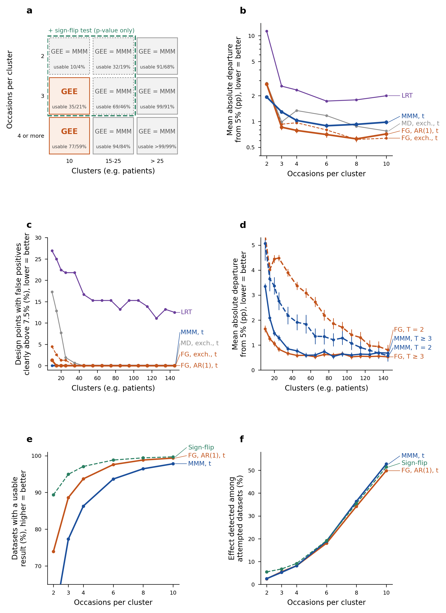
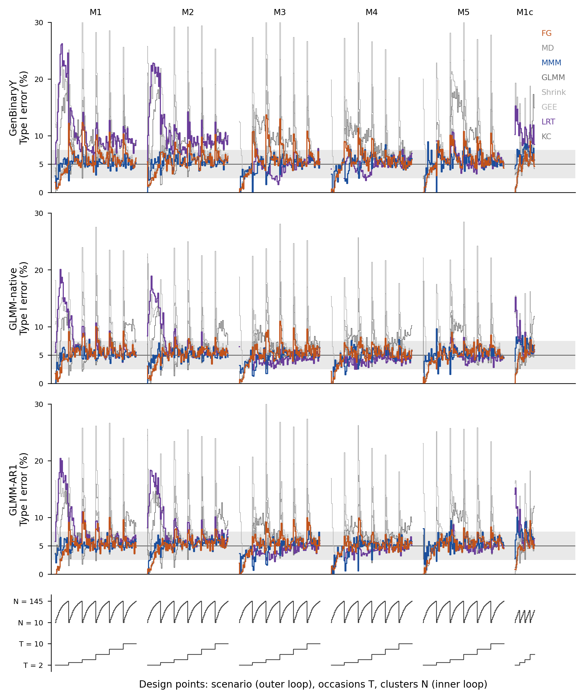

```{r setup}
.libPaths(path.expand("~/MMM/renv/library/linux-ubuntu-noble/R-4.6/x86_64-pc-linux-gnu"))
REG <- read.csv(path.expand("~/MMM/tables/V5_S7f_numbers.csv"), colClasses = "character", na.strings = NULL)
TRACE <- nzchar(Sys.getenv("MMM_S7_TRACE"))
n <- function(id) {
  i <- which(REG$id == id)
  if (length(i) != 1) stop("registry id not found once: ", id)
  if (TRACE) "\u00a7" else sub("^-(0(\\.0+)?)$", "\\1", REG$text[i])  # S8b: a rounded negative zero prints as 0
}
```

## Abstract

For binary outcomes measured repeatedly on few subjects, small-sample sandwich corrections have been evaluated mainly by number of clusters, rarely by number of occasions. We compared strategies for a within-subject treatment-by-time interaction over `r n("f:x|ndp_all5")` design points (10-145 clusters, 2-10 occasions, four mechanisms, one purely serial) and in subsamples of two clinical datasets. With t references, only the marginalized multilevel model with a convergence check had no design point clearly above 7.5% type I error among strategies with an interval, although a replication could flag a few; it answered in `r n("f:t4|mmm_cc|pu")`% of datasets.<!-- claim: reg:t4 as=descr; reg:s37 as=descr --> Generalized estimating equations (GEE) with first-order autoregressive working correlation and the Fay-Graubard correction answered in `r n("f:t4|gee_ar1_fg|pu")`% and were closer to nominal at ten clusters with more occasions, but were clearly above 7.5% at `r n("f:t4|gee_ar1_fg|hi_all")` design points with ten clusters and two occasions; every false positive there came from a plausible estimate on separated data, on which the marginalized model rarely answered.<!-- claim: reg:t4 as=descr; reg:hb as=descr --> The mixed-model Wald test was anticonservative; with adaptive quadrature (random intercept) only with ten occasions.<!-- claim: reg:t4 as=descr; reg:agq as=descr --> With two or three occasions and up to 25 clusters both answered in under half of datasets; a sign-flip score test answered in `r n("f:t4|flip|pu_small")`% and kept its level, without an estimate.<!-- claim: reg:t4 as=descr --> We recommend the marginalized model; Fay-Graubard corrected GEE, preceded by a check for separation, is a simpler alternative except with ten clusters and two occasions.<!-- noclaim: recommendation -->

**Keywords.** clustered binary data; few clusters; sandwich variance; small-sample correction; marginalized multilevel model; estimand; simulation study.

## 1. Introduction

Binary outcomes measured repeatedly within clusters, such as observations within patients or zones within a lung, are analysed in one of three ways. A generalized estimating equation (GEE) targets a population-averaged contrast and treats the dependence as a nuisance. A generalized linear mixed model (GLMM) targets a cluster-specific contrast and models the dependence explicitly. A marginalized multilevel model (MMM) specifies both: a marginal mean model of scientific interest and a conditional model that generates the dependence [1,2]. In applied work the choice may follow the conventions of the field rather than evidence about the design at hand.<!-- noclaim: background -->

The three approaches target different quantities. Under a logit link the marginal and conditional contrasts differ. With a normal random intercept of variance $\sigma^2$, the marginal contrast is approximately the conditional one multiplied by

$$\left(1 + k^2\sigma^2\right)^{-1/2}, \qquad k = \frac{16\sqrt{3}}{15\pi},$$

so the gap widens with the variance of the random effects [3]. A further difference arises when the two are adjusted for different covariate sets, because the odds ratio is not collapsible [4]. A method comparison can nevertheless score a mixed model against a marginal target it does not estimate.

This paper concerns designs with few clusters and short series, where the asymptotic arguments behind all three approaches are weakest. Cluster-randomized trials with ten to thirty clusters are common [5], and many stepped-wedge trials have fewer than ten [6].<!-- noclaim: literature --> The sandwich variance estimator is anticonservative with few clusters, and a family of small-sample corrections exists to repair it [7-9]. These corrections have been evaluated on clustered and longitudinal data [10-14], with as few as ten subjects and four occasions [12]. They have also been evaluated on parallel cluster-randomized trials [15], where the simulation evidence has been reviewed systematically [16] and whole analysis strategies have been compared [17], and on stepped-wedge trials with binary outcomes [18]. In the original evaluations of the corrections and in the cluster-randomized comparisons [7,9,15,19,20], the unit within a cluster is never a subject measured on several occasions. None of these studies fits a random slope, and only Fay and Graubard [9] generate random regression coefficients, as a misspecification check. Whether their recommendations hold with two or three occasions per subject has not been established.

We report a simulation study planned and reported following Morris, White and Crowther [21], and two clinical applications. The study has three components. The first is a simulation over four data-generating mechanisms and a grid that extends to ten clusters and two occasions. Three mechanisms contain a component that is constant within subject, as the methods compared assume, and the fourth has only serial dependence. One scenario takes its prevalence and between-subject variance from a neonatal lung-ultrasound cohort [22]. The second is a recommendation stated as a decision rule that must hold at every simulated design point. The third is a plasmode application to the cohort and to a public respiratory trial, each repeatedly subsampled into the few-cluster regime with the full-data estimate as reference.<!-- noclaim: aims -->

## 2. Methods

The study is reported in the order aims, data-generating mechanisms, estimands, methods and performance measures (ADEMP) [21]. The analysis reported here followed a protocol in this structure, versioned before any rerun and released with the code. Table 1 summarizes it. The full parameter table, extracted from the executed code, is in Table S1.

### 2.1 Aims

The aims concern the treatment-by-time interaction on the logit scale, in longitudinal binary data with few clusters and short series. We evaluated (i) the type I error of the test of no interaction; (ii) its power, raw and size-adjusted; (iii) bias, precision and confidence-interval coverage of the estimate against the estimand of each method; and (iv) the probability that a method returns a usable result. We also evaluated a sign-flip score test, which returns a p-value only, and the interval obtained by inverting it. The clinical applications and the decision rule of Section 2.6 build on these aims but are not simulation aims.

### 2.2 Data-generating mechanisms

Table 2 summarizes the four mechanisms and the scenarios; the full parameters are in Table S1. The main grid crossed `r n("x:n_levels_N")` cluster counts, N ∈ {10, 15, 20, 25, 35, 45, 55, 65, 75, 85, 95, 105, 115, 125, 135, 145}, with `r n("x:n_levels_T")` maximum numbers of occasions, T ∈ {2, 3, 4, 6, 8, 10}. It also crossed five mean-model scenarios (M1-M5) and the first three mechanisms below, giving `r n("x:ndp_grid")` design points, and the same five scenarios with the fourth mechanism (`r n("f:x|ndp_cop")` design points). Each design point was simulated under the alternative (H1) and the null (H0), and the two hypotheses differed only in the tested marginal coefficient. T is a maximum. Each subject was observed at all T occasions with probability `r n("x:p_full")`, and otherwise at a number of occasions drawn uniformly from $1$ to $T-1$. At T = 2, between `r n("x:t2_single_lo")`% and `r n("x:t2_single_hi")`% of subjects therefore contributed a single observation. Treatment was assigned to subjects with probability `r n("x:p_trt")`.

The mean model of scenario M1 is $\mathrm{logit}\,\mu = \beta_0 + \beta_1 t + \beta_2 \mathrm{trt} + \beta_3\, t \times \mathrm{trt}$. Its marginal coefficients under H1 are (`r n("x:beta_m1")`), which give a marginal prevalence of about `r n("x:prev_m1_t2")` at T = 2. M2 adds a subject-level covariate (age). M3 and M4 add a random slope on time; in GenBinaryY its counterpart is a latent standard deviation that changes over time. M4 uses a smaller interaction (`r n("x:beta3_m4")`). M5 adds a second covariate that varies over time (dose), with its own random slope.

The four mechanisms differ in how the dependence is generated.

1. GenBinaryY is a marginalized model with a latent variable and a first-order transition term [1,2,23], simulated with the function *GenBinaryY* of the R package *MMLB* [24]. The latent standard deviation is a linear predictor, which in M3-M5 grows by `r n("x:gby_sigma_m3")` per occasion. This is the mechanism of the marginalized model.
2. GLMM-native is a logistic mixed model with normal random effects. The random intercept has variance `r n("x:glmm_d11")` and, in M3-M5, the random slope on time has variance `r n("x:glmm_d22")`. The conditional coefficients are the marginal ones multiplied by `r n("x:zeger_f")` (`r n("f:n11|zeger_f_m1c")` in M1c). This is the mechanism of the mixed model.
3. GLMM-AR1 adds a latent first-order autoregressive process to the random effects of GLMM-native (ρ = `r n("x:ar1_rho")`, variance `r n("x:ar1_s2")`). Its random intercept is still constant within subject.
4. Copula-AR1 is a Gaussian copula with logistic margins. The latent normal scores of a subject have correlation $\rho^{|t_j - t_k|}$, with ρ = `r n("f:x|cop_rho")`, and no component is constant within subject. None of the likelihood-based methods compared models this mechanism.

A sixth scenario, M1c, simulated with the first three mechanisms, uses the mean model of M1 with the prevalence (`r n("x:m1c_prev")`) and the between-subject variance (`r n("x:m1c_var")`) of the clinical cohort of Section 2.7. It covers `r n("x:ndp_m1c")` design points, with N up to 45 and T up to 6. Four further scenarios, M6 and M7 on GenBinaryY and on GLMM-native, test the convergence check of Section 2.4 where the latent variability grows strongly over time. They cover the full grid (`r n("x:ndp_m67")` design points).

The values of the main scenarios were compared with the clinical cohort of Section 2.7. Their marginal prevalence (`r n("x:prev_m1_t2")` at T = 2 and `r n("x:prev_m1_t10")` at T = 10 in M1) is much lower than in the cohort (`r n("x:lus_prev")`), and their random-intercept variance (`r n("x:glmm_d11")`) is lower than the patient variance of the cohort (`r n("x:lus_var_id")`); scenario M1c was added for this reason. The cohort has no treatment and few patients with repeated timepoints, so the interaction per occasion has no direct anchor in it. The cumulative value of the simulated interaction at ten occasions (`r n("x:cum_int_t10")` on the logit scale) is of the order of the regional contrasts estimated in the cohort, for example `r n("x:lus_lateral")` between lateral and anterior zones.<!-- noclaim: justification of parameter values -->

Each design point received `r n("x:nsim")` replicates per hypothesis. Replicates in which one treatment arm was never observed after the first occasion were excluded from every denominator (`r n("x:n_degenerate")` per hypothesis on the main grid of each mechanism, `r n("f:s8|deg_m1c")` in M1c, and `r n("f:s8|deg_m6")` and `r n("f:s8|deg_m7")` in M6 and M7). Replicate i of scenario m used the seed `r n("x:seed_rule")` under the L'Ecuyer-CMRG generator. The seed was the same for both hypotheses and for every N, T and mechanism, so the datasets are common random numbers across cells [21].

### 2.3 Estimands and true values

The estimand is the coefficient of the treatment-by-time interaction on the logit scale. It is marginal for the marginalized model, the GEEs and the shrinkage GLM, and conditional on the random effects for the mixed model. In GenBinaryY the marginal true value is the generating coefficient. There is no conditional true value, so bias and coverage of the mixed model are not defined on that mechanism. In GLMM-native the conditional true value is the generating coefficient. The marginal value was obtained by Gauss-Hermite quadrature on the realized design; under H0 it is not exactly zero, ranging from `r n("x:nat_h0_min")` to `r n("x:nat_h0_max")` across scenarios M1-M5 and T, and under H1 it ranges from `r n("f:s8|nat_h1_min")` to `r n("f:s8|nat_h1_max")` (`r n("f:s8|nat_h1_m1c_min")` to `r n("f:s8|nat_h1_m1c_max")` in M1c). In GLMM-AR1 the marginal true value is the target, and the conditional value was computed for each replicate. In Copula-AR1 the marginal true value is the generating coefficient, and there is no conditional true value.

### 2.4 Methods compared

The eight methods of Table 3 and the further strategies of Table 1 were applied to every dataset. The marginalized multilevel model was fitted with *MMLB::mm* [24] (`r n("x:mm_q")` quadrature points), with the latent-variable and transition formulas of the GenBinaryY generator. GEEs were fitted with *geepack* [25] with exchangeable, independence and first-order autoregressive (AR(1)) working correlations. They were combined with the uncorrected sandwich variance and with the corrections of Mancl and DeRouen [7], Kauermann and Carroll [8] and Fay and Graubard [9] (bound b = `r n("f:x|fg_bound")`, as in [9]), computed with the R package *fewclust* (Table S2), written for this study and released with the code, which implements the published formulas and agreed with a computation by hand (Section S4). With exchangeable correlation, the Mancl-DeRouen and Fay-Graubard values in Table 3 and Table 4 were computed with *geesmv* [26], and those in Table 5 with *fewclust* (Section S4). The CR2 estimator of *clubSandwich* [27,28] was added with exchangeable and independence correlations. The mixed model was fitted with *lme4::glmer* [29] (Laplace approximation). After the main run, the mixed model with a random intercept was refitted by adaptive Gauss-Hermite quadrature with `r n("f:gq|nodes")` nodes on a subset of null design points (Section 3.10). It had a random intercept in M1-M2 and the random slopes of the generating model in M3-M5. It was tested by a Wald test and by a likelihood-ratio test against the model without the interaction, with the same random effects. The shrinkage GLM rescales the mixed-model estimate and standard error by $(1 + k^2 D_{11})^{-1/2}$, with $D_{11}$ the random-intercept variance. Software versions are in Table S2.

*MMLB::mm* writes the latent standard deviation as $\exp(a_0) + \exp(a_1)\,t$, so a slope of zero lies on the boundary of the parameter space. In the main scenarios with a latent standard deviation that changes over time (M3-M5), the generating slope is close to that boundary. Without a check, two failure modes of the optimizer (*nlm*) produced excess rejections with long series: non-convergence, and convergence with a collapsed standard error. We therefore added a convergence check. A fit was declared at the boundary if *nlm* did not report convergence (return code other than `r n("x:nlm_ok")`) or if an estimated slope $\exp(a_k)$ was below `r n("x:cc_thr")`. Such a fit was replaced by the fit without the time trend of the latent standard deviation only if *nlm* reported convergence for that refit and its estimate and standard error were finite; otherwise the dataset gave no usable result for the marginalized model with the check. Section S20 compares this rule with versions that keep the original fit or accept a refit that did not converge.<!-- noclaim: definition of the check -->

Wald tests were referred to the standard normal in the primary tables and, as an alternative, to a t distribution with N - p degrees of freedom, p being the number of mean-model coefficients. The likelihood-ratio test was referred to a $\chi^2$ distribution with one degree of freedom.

A sign-flip score test [30] was applied to every dataset. It treats subjects as independent units. With the other coefficients estimated, as here, the effective-score version is asymptotically exact and robust to differences in variance between subjects [30]; it is exact in finite samples only when no nuisance parameter is estimated and the contributions are symmetric. The test was declared not computable, and returned no answer, when the model without the interaction diverged (a coefficient of at least `r n("f:x|guard_div")` in absolute value) or every score contribution was below $10^{-6}$ in absolute value, because the interaction is then not identified. The test gives a p-value and no Wald interval; its computation and the interval obtained by inverting it are described in Section S7.

### 2.5 Performance measures

A replicate was usable for a Wald-based method when the fit returned without error and the estimate, its standard error and its p-value were finite, with |estimate| < `r n("x:usab_max")` and $0 <$ SE < `r n("x:usab_max")`. The likelihood-ratio test was usable when both fits converged and its p-value was finite, and the sign-flip test when it returned a finite p-value. A dataset in which every outcome took the same value, with no events or only events, gave no usable result for any method, whatever the fit returned; there were `r n("f:n9|const_n")` such datasets among `r n("f:n9|datasets_n")`, `r n("f:n9|const_small_pct")`% of them with two or three occasions and at most 25 clusters. Separated datasets, in which the maximum likelihood estimate of the mean model does not exist [31], were kept and judged by the same rule, because whether a method signals such data is a property an analyst needs to know; unlike a constant outcome, separation is not visible without a dedicated check. Detected by linear programming [32,33], they were `r n("f:n11|sep|S_pct")`% of the datasets with an estimable design and a non-constant outcome, `r n("f:n11|sep|S_pct_small")`% with two or three occasions and at most 25 clusters (Section S19). The probability of a usable result was computed under the null, at each design point, with every replicate with an estimable design (Section 2.2) in the denominator, including those whose fit failed; Table 4, Table 5 and the supplementary tables report its mean over design points. Fits that returned with warnings were kept (Table S13). Rates under the null and the alternative were computed on each method's usable replicates, so a method that fails on difficult datasets is assessed on easier ones; the exception is the power of Table 5 and Table S31, computed per attempted dataset. Table S6 repeats the type I error on the replicates usable for all methods, and Table S9 by stratum of estimability.<!-- noclaim: definitions -->

Type I error was the rejection rate at the nominal 5% under H0. Over the grid we report the pooled rate and two summaries computed within each mechanism. A design point is a combination of scenario, mechanism, number of clusters and number of occasions; a cell is a design point under one hypothesis. For each of the `r n("x:n_levels_N")` cluster counts we took the absolute departure from 5% of the replicate-weighted rate. The worst case is the largest of these absolute departures, and the mean absolute departure is their mean. By number of occasions (Section 3.1, Table S4) and in the direct comparison of the two strategies of the rule (Section 3.4, Figure 1, Table S31), the absolute departure is instead averaged over design points. At each design point, a strategy was clearly above 7.5% when the lower limit of the exact (Clopper-Pearson) 95% interval of its rejection rate exceeded 7.5%, and clearly below 2.5% when the upper limit fell below 2.5%; a design point with fewer than `r n("x:min_obs_dp")` usable null replicates was not assessed. These limits are Bradley's liberal criterion, `r n("f:gt|brad_lo")` to `r n("f:gt|brad_hi")` times the nominal level [34]; for the coverage of 95% intervals they were applied to the rate of non-coverage.<!-- noclaim: definitions --> Unconditional validity is the probability of a usable result multiplied by the probability of not rejecting a true null given one. Power was reported raw and size-adjusted. Bias, empirical and model-based standard errors and coverage of the 95% interval were computed against the estimand of each method (Table S36).

Monte Carlo standard errors (MCSE) were computed for every measure [21]. With `r n("x:nsim")` usable replicates, the MCSE of a rejection rate at 5% is `r n("x:mcse_5pct")` percentage points. This number of replicates was chosen so that a single cell resolves a departure from 5% of about `r n("x:mcse_5pct_2x")` points. The datasets are common random numbers across cells. The MCSE of every summary over cells, and of every difference between methods, was therefore obtained by a bootstrap that resamples replicate indices jointly across all cells (`r n("x:boot_B")` resamples). A comparison between methods is written as a difference only when its bootstrap interval, the estimate ± 2 MCSE, lies entirely beyond a relevance margin fixed in advance. The margin is one percentage point for differences in type I error or coverage averaged over cells, 2.5 points for a single cell, two points for differences in power and 2.5 points for differences in usable shares. Intervals entirely within the margin are reported as similar. Intervals that straddle it are reported as differences of about the size of the margin.<!-- noclaim: definitions -->

### 2.6 Decision rule

The recommendation of Figure 1 comes from a rule applied to every strategy that returns an estimate and an interval, a strategy being a method with its reference distribution. A strategy was excluded if its type I error was clearly above 7.5% at any design point. With `r n("x:nsim")` usable replicates a design point is flagged only from an observed rate of `r n("f:g7|cal_thr1000")`%, and with half as many from `r n("f:g7|cal_thr500")`%: a strategy never clearly above 7.5% is one in which no excess was detected, not one shown to be calibrated. Among the remaining strategies, the one that returned a usable result most often was recommended.<!-- noclaim: definition of the rule --> The rule was applied to all `r n("f:x|ndp_all5")` design points of the four mechanisms. The likelihood-ratio test and the sign-flip test give no interval and are reported for comparison. The strategy selected by the rule was then compared post hoc with GEE with an AR(1) working correlation, the Fay-Graubard correction and a t reference, which failed the rule at few design points (Section 3.4).<!-- noclaim: definition of the rule -->

### 2.7 Clinical applications

The cohort comes from a prospective physiological study of neonates admitted to intensive care with respiratory failure [22]. It comprises `r n("x:lus_npat")` neonates with ten lung-ultrasound zones scored at one to three timepoints. It gives `r n("x:lus_npt")` patient-timepoints and `r n("x:lus_nobs")` zone-level outcomes; `r n("x:lus_nmulti")` patients contribute more than one timepoint.<!-- noclaim: cohort description --> The outcome is severe loss of aeration (prevalence `r n("x:lus_prev")`). In a logistic mixed model of the outcome on zone region with a patient random intercept, the patient variance is `r n("x:lus_var_id")`. Adding a patient-timepoint level drives the patient variance to the boundary and places a variance of `r n("x:lus_var_pt")` at the new level (likelihood-ratio $\chi^2$ = `r n("x:lus_chi2")` on one degree of freedom). The contrast of interest is posterior against anterior zones, adjusted for disease, invasive ventilation and gestational age. It was estimated by the marginalized model, with a latent variable with an intercept only as in scenario M1 and a first-order transition term over the zones of each patient, by the GEEs and by the mixed model. With `r n("x:lus_npat")` clusters the cohort lies above the simulated range, so it was used as a plasmode. We drew `r n("x:lus_nsub")` subsamples of whole patients at each of `r n("x:lus_Ns")` patients, with the full-cohort estimate of each method as its reference. In both applications the ratio of the mean standard error (model-based for the marginalized model and the mixed model, sandwich for the GEEs) to the standard deviation of the estimates over subsamples was multiplied by $\sqrt{1 - N/P}$, with P the number of patients in the full dataset, because subsamples drawn without replacement from a finite cohort vary less than independent samples.<!-- noclaim: definition -->

The same analysis was repeated on the respiratory trial distributed with *geepack* [25] (`r n("f:rs|P")` patients, four visits, active treatment against placebo). The contrast of interest was the treatment effect, adjusted for baseline status, visit, age, sex and centre.

## 3. Results

### 3.1 Type I error on the main grid

Table 3 gives the type I error of the eight methods on the `r n("x:ndp_grid")` design points of the main grid with the first three mechanisms, under a normal reference, and Figure 2 shows the type I error of the eight methods at every design point, with the marginalized model highlighted. The pooled rejection rate of the marginalized model with the convergence check ranged from `r n("v:rate|NAT|mmm")`% to `r n("v:rate|GB|mmm")`% across mechanisms. It ranged from `r n("v:rate|NAT|gee_fg")`% to `r n("v:rate|GB|gee_fg")`% for Fay-Graubard and from `r n("v:rate|NAT|gee_md")`% to `r n("v:rate|GB|gee_md")`% for Mancl-DeRouen. On GenBinaryY it reached `r n("v:rate|GB|gee_kc")`% for Kauermann-Carroll and `r n("v:rate|GB|gee")`% for the uncorrected GEE.<!-- noclaim: descriptive values per method -->

The marginalized model had the smallest worst-case departure from 5% on all three mechanisms: `r n("v:wc|GB|mmm")`, `r n("v:wc|NAT|mmm")` and `r n("v:wc|AR1|mmm")` percentage points on GenBinaryY, GLMM-native and GLMM-AR1, respectively. Its worst-case departure was smaller than that of the next method by `r n("cl:C01|GB:est")` points on GenBinaryY and by about one point on the two random-effects mechanisms.<!-- claim: cl:C01|GB as=larger; cl:C01|NAT as=about1; cl:C01|AR1 as=about1 --> Its mean absolute departure (`r n("v:mad|NAT|mmm")` to `r n("v:mad|GB|mmm")` points) and that of Fay-Graubard (`r n("v:mad|NAT|gee_fg")` to `r n("v:mad|GB|gee_fg")`) were similar.<!-- claim: cl:C02|GB as=similar; cl:C02|NAT as=similar; cl:C02|AR1 as=similar --> On matched replicates usable for both methods, the two rejected a true null at similar rates.<!-- claim: cl:C03|GB as=similar; cl:C03|NAT as=similar; cl:C03|AR1 as=similar -->

The mean absolute departure of the marginalized model fell from `r n("v:madT|T2|mmm")` points at two occasions to `r n("v:madT|T4plus|mmm")` at four or more (Table S4). At two occasions the five marginal methods of Table 3 other than the shrinkage GLM departed by `r n("f:n11|madT2|marg|min")` to `r n("f:n11|madT2|marg|max")` points on average. The Wald test of the mixed model departed by `r n("v:madT|T2|glmer")` points, and the shrinkage GLM, which rescales it to a marginal estimand, by `r n("v:madT|T2|shrink")`.<!-- claim: cl:C13d|all as=larger -->

### 3.2 The convergence check of the marginalized model

In scenarios M3-M5 the check declared `r n("f:n11|cc|main|boundary")`% of the null fits of the marginalized model at the boundary; it replaced `r n("f:n11|cc|main|replaced")`% with the converged fit without the time trend of the latent standard deviation and left `r n("f:n11|cc|main|no_result")`% (`r n("f:n11|cc|main|no_result|T23")`% at two or three occasions) without a result. Without the check, the marginalized model was clearly above 7.5% at `r n("x:cc_hi_study")` of the `r n("x:cc_ndp_h0")` null design points of these scenarios, `r n("x:cc_hi_study_T810")` of them with eight or ten occasions. With the check it was clearly above 7.5% at `r n("x:cc_hi_cc")`.<!-- claim: reg:cc_hi_study as=descr; reg:cc_hi_cc as=descr --> Its mean absolute departure at ten occasions fell from `r n("s:madT1|mmm|10")` to `r n("v:madT1|mmm|10")` points.<!-- noclaim: descriptive values -->

In scenarios M6-M7 the fit without the time trend is misspecified. There the check declared `r n("f:n11|cc|m67|boundary")`% of the null fits at the boundary (`r n("f:n11|cc|m67|boundary|T23")`% at two or three occasions, where *nlm* most often failed to converge) and left `r n("f:n11|cc|m67|no_result")`% (`r n("f:n11|cc|m67|no_result|T23")`%) without a result. With a t reference, the marginalized model with the check was never clearly above 7.5% at the `r n("x:ndp_m67")` design points. Without the check, and with a t reference, it was clearly above 7.5% at `r n("x:ns_nocc_t_hi")` design points.<!-- claim: reg:ns_mmmt_hi as=descr; reg:ns_nocc_t_hi as=descr --> Bias, standard errors and coverage of the marginalized model with the check in these scenarios are in Section S13.<!-- noclaim: pointer to the supplement -->

### 3.3 Availability of a result

The probability of a usable result depended mostly on the number of occasions (Table 4). With random slopes and two occasions, the mixed model returned a usable Wald test in `r n("v:puT|RS|glmer|2")`% of attempts. The likelihood-ratio test with the same random effects was usable in `r n("v:puT|RS|glmer_lrt|2")`%, against `r n("v:puT|RS|mmm|2")`% for the marginalized model and `r n("v:puT|RS|gee_fg|2")`% for Fay-Graubard.<!-- claim: cl:C13a|all as=descr --> With random slopes the marginalized model returned a usable result in `r n("v:puT|RS|mmm|3@tab")`%, `r n("v:puT|RS|mmm|4@tab")`% and `r n("v:puT|RS|mmm|6@tab")`% of attempts at three, four and six occasions, against `r n("v:puT|RI|mmm|3@tab")`%, `r n("v:puT|RI|mmm|4@tab")`% and `r n("v:puT|RI|mmm|6@tab")`% with a random intercept only; a refit of its convergence check that does not converge leaves no result (Section 2.4).<!-- noclaim: descriptive values of Table 4 --> With a random intercept only, the likelihood-ratio test was usable in `r n("v:puT|RI|glmer_lrt|2")`% of attempts at two occasions, against `r n("v:puT|RI|glmer|2")`% for the Wald test.<!-- claim: cl:C13c|all as=larger --> From four occasions every method returned a usable result in more than `r n("x:pu_T4_min")`% of attempts.<!-- claim: reg:pu_T4_min as=descr -->

At 20 clusters or fewer, unconditional validity ranged from `r n("v:val20|glmer")`% for the Wald test of the mixed model to `r n("v:val20|glmer_lrt")`% for the likelihood-ratio test (Table S8).<!-- claim: cl:C14b|all as=larger --> A criterion that maximized unconditional validity at each cluster count would have selected the likelihood-ratio test up to `r n("x:switch_GB")` clusters on each of the three study mechanisms.<!-- claim: reg:switch_GB as=descr -->

### 3.4 Reference distribution and the decision rule

Referring the Wald statistic to a t distribution with N - p degrees of freedom lowered every pooled rejection rate. The shift was `r n("v:tshift|NAT|glmer@abs")` to `r n("v:tshift|AR1|gee@abs")` percentage points over the grid and `r n("v:tsh25|glmer")` to `r n("v:tsh25|gee")` points at 25 clusters or fewer (Table S11).<!-- claim: cl:C17b|all as=larger --> Under the t reference the marginalized model became conservative at ten clusters. There it was clearly below 2.5% at `r n("x:rs_mmmt_N10_lo")` of `r n("x:rs_N10_ndp")` design points, against `r n("x:rs_fgt_N10_lo")` for Fay-Graubard.<!-- claim: reg:rs_mmmt_N10_lo as=descr; reg:rs_fgt_N10_lo as=descr -->

Table 5 applies the rule of Section 2.6 to the `r n("f:x|ndp_all5")` design points of the four mechanisms. Among the strategies with an interval, only the marginalized model with the check and a t reference was never clearly above 7.5%, and the rule selected it; it returned a usable result in `r n("f:t4|mmm_cc|pu")`% of datasets.<!-- claim: reg:t4 as=descr --> GEE with AR(1) working correlation, Fay-Graubard and a t reference (the GEE strategy) returned a usable result more often, in `r n("f:t4|gee_ar1_fg|pu")`%, a difference beyond the margin for usable shares (Section 2.5), but was clearly above 7.5% at `r n("f:t4|gee_ar1_fg|hi_all")` design points, both in scenario M2 with N = `r n("f:n9|fgpt|1|N")` and T = `r n("f:n9|fgpt|1|T")`, on GLMM-AR1 and GLMM-native.<!-- claim: reg:t4 as=descr; reg:hb as=descr --> There it rejected a true null in `r n("f:n9|fgpt|1|k")` of `r n("f:n9|fgpt|1|n")` and `r n("f:n9|fgpt|2|k")` of `r n("f:n9|fgpt|2|n")` usable replicates, the marginalized model in `r n("f:n9|fgpt|1|mmm_k")` of `r n("f:n9|fgpt|1|mmm_n")` and `r n("f:n9|fgpt|2|mmm_k")` of `r n("f:n9|fgpt|2|mmm_n")` (Section S10). Every one of these rejections fell on one of the `r n("f:n11|sep|fgpt|1|gee_ar1_fg|n_si")` and `r n("f:n11|sep|fgpt|2|gee_ar1_fg|n_si")` usable datasets with an infinite estimate of the interaction; on its other usable datasets it rejected `r n("f:n11|sep|fgpt|1|gee_ar1_fg|k_ns")` of `r n("f:n11|sep|fgpt|1|gee_ar1_fg|n_ns")` and `r n("f:n11|sep|fgpt|2|gee_ar1_fg|k_ns")` of `r n("f:n11|sep|fgpt|2|gee_ar1_fg|n_ns")`. There the GEE estimate is where its iterations stopped: with `r n("f:n11|sep|iter_hi")` instead of `r n("f:n11|sep|iter_lo")` iterations it moved further from zero in `r n("f:n11|sep|iter_out")` of `r n("f:n11|sep|iter_n")`. The marginalized model returned `r n("f:n11|sep|mmm_cc|usable_Si")` usable results on such datasets in the whole study. If separated datasets gave no result to the strategies with an interval, the GEE strategy would be clearly above 7.5% at `r n("f:n11|sepv|a|gee_ar1_fg|hi_all")` design points and the rule would select it (Section S19).<!-- noclaim: descriptive values of the separated datasets and of the sensitivity analysis --> The choice rests on these two design points: with usability limits of `r n("f:gt|lim_lo")` instead of `r n("x:usab_max")` the GEE strategy was never clearly above 7.5% and the rule would have selected it, and with `r n("f:gt|lim_hi")` it was clearly above 7.5% at `r n("f:gt|flt|gee_ar1_fg|20|hi")` design points (Section S11).<!-- noclaim: descriptive values of the two design points and of the sensitivity analysis --> The GEE strategy was clearly below 2.5% at `r n("f:t4|gee_ar1_fg|lo_all")` design points and the marginalized model at `r n("f:t4|mmm_cc|lo_all")`, `r n("f:t4|mmm_cc|lo_N10")` of them at ten clusters.<!-- claim: reg:t4 as=descr -->

With exchangeable or independence working correlation, Fay-Graubard with a t reference was clearly above 7.5% at `r n("f:t4|gee_exch_fg|hi_all")` and `r n("f:t4|gee_ind_fg|hi_all")` design points, `r n("f:t4|gee_exch_fg|hi_main")` and `r n("f:t4|gee_ind_fg|hi_main")` of them in the main grid, all with ten clusters and among them the two design points of the GEE strategy. Mancl-DeRouen with a t reference was clearly above 7.5% at `r n("f:t4|gee_ar1_md|hi_all")` to `r n("f:t4|gee_exch_md|hi_all")` design points across working correlations, Kauermann-Carroll at `r n("f:t4|gee_ar1_kc|hi_all")` to `r n("f:t4|gee_exch_kc|hi_all")`, and the Wald test of the mixed model at `r n("f:t4|glmer|hi_all")`, `r n("f:x|glmer_hi_native")` of them on data generated by its own model (GLMM-native). The likelihood-ratio test was clearly above 7.5% at `r n("f:t4|glmer_lrt|hi_all")` design points.<!-- claim: reg:t4 as=descr -->

With two or three occasions and at most 25 clusters, the GEE strategy and the marginalized model returned a usable result in fewer than half of the datasets (`r n("f:t4|gee_ar1_fg|pu_small")`% and `r n("f:t4|mmm_cc|pu_small")`%) and detected the simulated effect in fewer than `r n("f:x|upow_small_ceiling")`% of attempted datasets (Table S31).<!-- claim: reg:t4 as=descr; reg:upow_small_ceiling as=descr --> With N - 2 degrees of freedom [15], on the `r n("f:x|ndp_three")` design points of the three study mechanisms, the rule selected the same strategy; the marginalized model was again never clearly above 7.5%, and clearly below 2.5% at `r n("f:t2|mmm_cc|N - 2|n_lo")` instead of `r n("f:t2|mmm_cc|N - p|n_lo")` design points, and the GEE strategy was clearly above 7.5% at `r n("f:t2|gee_ar1_fg|N - 2|n_hi")` (Table S26).<!-- claim: reg:t2 as=descr -->

Compared directly, with the block bootstrap and the margins of Section 2.5 (Figure 1, Table S31), the marginalized model and the GEE strategy had similar mean absolute departures from 5% over all design points (`r n("f:hb|all|mad_mmm")` and `r n("f:hb|all|mad_gee")` percentage points) and similar power (difference `r n("f:hb|all|upow_mmm_minus_gee")` points), and the GEE strategy returned a usable result more often (difference `r n("f:hb|all|pu_gee_minus_mmm")` points).<!-- claim: reg:hb as=descr --> The GEE strategy was closer to 5% at ten clusters with three or more occasions (`r n("f:hb|N10_T3p|mad_gee")` against `r n("f:hb|N10_T3p|mad_mmm")` points), where the marginalized model was conservative (mean type I error `r n("f:hb|N10_T3p|rate_mmm")`% against `r n("f:hb|N10_T3p|rate_gee")`%).<!-- claim: reg:hb as=descr --> With two occasions and 15 or more clusters the GEE strategy was conservative (`r n("f:hb|N15p_T2|rate_gee")`%), the two had similar mean absolute departures (difference `r n("f:hb|N15p_T2|mad_gee_minus_mmm")` points), and the GEE strategy returned a usable result more often, by `r n("f:hb|N15p_T2|pu_gee_minus_mmm")` points. With 15 or more clusters and three or more occasions the two were similar in level, and the GEE strategy answered more often by `r n("f:hb|N15p_T3p|pu_gee_minus_mmm")` points. With ten clusters and two occasions both answered rarely (in `r n("f:hb|map|10|2|pu_gee")`% and `r n("f:hb|map|10|2|pu_mmm")`% of datasets) and both were far from 5% (mean absolute departures `r n("f:hb|map|10|2|mad_gee")` and `r n("f:hb|map|10|2|mad_mmm")` points).<!-- claim: reg:hb as=descr -->

### 3.5 Working correlation and implementation of the corrections

Changing the working correlation of Fay-Graubard from exchangeable to independence or AR(1) changed its type I error by `r n("f:cv|wc_ind|est")` and `r n("f:cv|wc_ar1|est")` percentage points on average over the `r n("f:x|ndp_three")` design points of the three study mechanisms, within the one-point margin.<!-- claim: cv:wc_ind as=similar; cv:wc_ar1 as=similar --> The two implementations of the corrections are compared in Section S4.<!-- noclaim: pointer to the supplement -->

### 3.6 The fourth mechanism

On Copula-AR1 (`r n("f:x|ndp_cop")` design points) neither the GEE strategy nor the marginalized model with the check was clearly above 7.5% at any design point (Table 5). Their mean type I errors with a t reference were `r n("f:s7e|gee_ar1_fg|mean_type1")`% and `r n("f:s7e|mmm_cc|mean_type1")`%, respectively.<!-- claim: reg:t4 as=descr --> For both, the difference from the three study mechanisms was within the one-point margin.<!-- claim: cv:cop_gee as=similar; cv:cop_mmm as=similar --> The Wald test of the mixed model (Laplace approximation) with a t reference rejected a true null in `r n("f:s7e|glmer|mean_type1")`% of usable replicates on average, `r n("f:cv|cop_glmm|est")` points more than on the three study mechanisms, and was clearly above 7.5% at `r n("f:s7e|glmer|clearly_above")` of the `r n("f:x|ndp_cop")` design points.<!-- claim: cv:cop_glmm as=larger --> GEE with exchangeable working correlation and Fay-Graubard was clearly above 7.5% at `r n("f:s7e|gee_exch_fg|clearly_above")` design points, `r n("f:x|cop_exfg_nT")` with T = `r n("f:x|cop_exfg_T")` and N = `r n("f:s8|cop_exfg4_Nmin")` to `r n("f:s8|cop_exfg4_Nmax")`, and `r n("f:s8|cop_exfg_oth_n")` with N = `r n("f:s8|cop_exfg_oth_N")` and T = `r n("f:s8|cop_exfg_oth_T")` or `r n("f:s8|cop_exfg_oth2_T")`.

### 3.7 Sign-flip score test

Over the `r n("f:x|ndp_all5")` design points the sign-flip test rejected a true null in `r n("f:fl|all|H0|mean_rate")`% of datasets on average, and it was clearly above 7.5% or clearly below 2.5% at no design point.<!-- claim: reg:flip as=descr --> It answered in `r n("f:t4|flip|pu")`% of datasets with an estimable design and, with two or three occasions and at most 25 clusters, in `r n("f:t4|flip|pu_small")`%, against `r n("f:t4|gee_ar1_fg|pu_small")`% for the GEE strategy (Table 5).<!-- claim: reg:t4 as=descr --> Its type I error in those small designs was `r n("f:fl|small|H0|mean_rate")`%, and its power per attempted dataset was `r n("f:x|flip_upow_small")`% there and `r n("f:t4|flip|upow")`% over all design points.<!-- claim: reg:flip_upow_small as=descr --> Inverted, the test gave an interval that covered the true value under the alternative in `r n("f:s8|flipci_cov_h1")`% of datasets, against `r n("f:ci|PG8")`% for the GEE strategy. In the small designs both of its ends were finite in `r n("f:ci|PG6")`% of datasets; its non-coverage was clearly below 2.5% at `r n("f:s8|flipci_lo_h1")` design points, `r n("f:s8|flipci_lo_h1_T2")` of them with two occasions; and where both intervals existed it was `r n("f:x|ci_width_pct")`% wider than the GEE interval on average over design points, less over datasets (Section S7, Table S27).<!-- claim: reg:flipci as=descr; reg:ci as=descr -->

### 3.8 Power and coverage

Raw and size-adjusted power of the eight methods are in Table S10.<!-- noclaim: description -->

Coverage of the 95% interval was `r n("v:cov|GB|gee_md")`% to `r n("v:cov|NAT|gee_fg")`% for Fay-Graubard, Mancl-DeRouen and the marginalized model on every mechanism, and `r n("v:cov|GB|gee_kc")`% to `r n("v:cov|NAT|gee_kc")`% for Kauermann-Carroll (Table S12).<!-- claim: cl:C20a|GB as=similar; cl:C20a|NAT as=similar; cl:C20a|AR1 as=similar -->

### 3.9 Scenario anchored to the cohort

Scenario M1c has the prevalence and between-subject variance of the cohort (`r n("x:ndp_m1c")` design points). Under a normal reference the marginalized model rejected a true null in `r n("m:rate|NAT|mmm")`% to `r n("m:rate|GB|mmm")`% of usable replicates, against `r n("m:rate|NAT|gee_fg")`% to `r n("m:rate|GB|gee_fg")`% for Fay-Graubard. Its worst-case departure was larger than that of the best method by about the one-point margin.<!-- claim: cm:C03|GB as=larger; cm:C03|NAT as=larger; cm:C03|AR1 as=larger; cm:C01|GB as=about1; cm:C01|NAT as=about1; cm:C01|AR1 as=about1 --> Under a t reference its rate was `r n("m:ratet|NAT|mmm")`% to `r n("m:ratet|GB|mmm")`%, and that of Fay-Graubard `r n("m:ratet|AR1|gee_fg")`% to `r n("m:ratet|GB|gee_fg")`%.<!-- noclaim: descriptive values -->

### 3.10 Adaptive quadrature for the mixed model

The refit covered `r n("f:gq|npts")` null design points: N ∈ {10, 25, 55, 145} and T ∈ {2, 4, 10} in M1 and M2, and N ∈ {10, 25, 45} and T ∈ {2, 4, 6} in M1c (Section S12, Table S34).<!-- noclaim: description of a sensitivity analysis added after the main run --> With a t reference, on the replicates usable under both fits, quadrature lowered the rejection rate under the null by `r n("f:gq|diff_min")` to `r n("f:gq|diff_max")` percentage points on average, depending on the mechanism. The Wald test was clearly above 7.5% at `r n("f:gq|hi_lap")` of these design points under the Laplace approximation and at `r n("f:gq|hi_agq")` with quadrature, all with T = `r n("f:gq|hi_agq_T")`: `r n("f:gq|hi_agq_cop")` on Copula-AR1 (`r n("f:gq|hi_cop_min")`% to `r n("f:gq|hi_cop_max")`%) and `r n("f:gq|hi_agq_gb")` on GenBinaryY (`r n("f:gq|hi_gb_min")`% and `r n("f:gq|hi_gb_max")`%). On data generated by its own model it was no longer clearly above 7.5% at any of them. Quadrature also made the test conservative, mostly with few clusters: it was clearly below 2.5% at `r n("f:gq|lo_agq")` design points, against `r n("f:gq|lo_lap")` under the Laplace approximation (Table S34).<!-- noclaim: descriptive values of the sensitivity analysis -->

### 3.11 Clinical applications

In the full cohort the posterior-versus-anterior contrast was `r n("x:lus_est_mmm")` (SE `r n("x:lus_se_mmm")`) by the marginalized model and `r n("x:lus_est_gee")` (SE `r n("x:lus_se_gee")`) by GEE with an exchangeable working correlation and the uncorrected sandwich. The mixed model gave `r n("x:lus_est_glmm")` (SE `r n("x:lus_se_glmm")`) on its conditional scale. In subsamples of `r n("x:lus_N10")` patients, `r n("x:lus_inv_none")`% of draws contained no invasively ventilated patient, so that the mean model could not be fitted (Table S15). Over all subsamples of this size, including those, a usable result was obtained by the mixed model in `r n("f:g7|lus_u500_GLMM")`%, by the marginalized model in `r n("f:g7|lus_u500_MMM")`%, by the uncorrected GEE in `r n("f:g7|lus_u500_GEE")`%, by Fay-Graubard in `r n("f:g7|lus_u500_GEE-FG")`% and by Mancl-DeRouen in `r n("f:g7|lus_u500_GEE-MD")`%. Most failures of the corrections returned a point estimate without a standard error (Table S15).<!-- noclaim: descriptive values per method --> Across subsample sizes, after the finite-population correction, the standard error of the mixed model was `r n("f:sr|neo|GLMM|min")` to `r n("f:sr|neo|GLMM|max")` times the empirical standard deviation of its estimates.<!-- noclaim: descriptive --> The corresponding ratio was `r n("f:sr|neo|MMM|min")` to `r n("f:sr|neo|MMM|max")` for the marginalized model, and `r n("f:s8|rob_neo_min")` to `r n("f:s8|rob_neo_max")` with its robust standard error (Section S9).

In the respiratory trial the treatment effect was `r n("f:rr|MMM|estimate")` (SE `r n("f:rr|MMM|se")`) by the marginalized model and `r n("f:rr|GEE|estimate")` by GEE with an exchangeable working correlation (SE `r n("f:rr|GEE|se")` uncorrected, `r n("f:rr|GEE-FG|se")` to `r n("f:rr|GEE-MD|se")` with the three corrections; Table S29), and `r n("f:rr|GLMM|estimate")` on the conditional scale of the mixed model. In subsamples of `r n("f:ru|Nmin")` patients, with the full mean model, a usable result was returned by the mixed model in `r n("f:ru|GLMM|10")`% of draws, by the marginalized model in `r n("f:ru|MMM|10")`%, by the uncorrected GEE in `r n("f:ru|GEE|10")`%, by Fay-Graubard in `r n("f:ru|GEE-FG|10")`% and by Mancl-DeRouen in `r n("f:ru|GEE-MD|10")`%; as in the cohort, the corrections mostly failed with an estimate but no standard error (Table S30).<!-- noclaim: descriptive values per method -->

## 4. Discussion

### 4.1 The recommendation

One strategy met the rule of Section 2.6: the marginalized model with the convergence check and a t reference (Figure 1). Across the `r n("f:x|ndp_all5")` design points of the four mechanisms it was never clearly above 7.5%, and it returned a usable result in `r n("f:t4|mmm_cc|pu")`% of datasets.<!-- claim: reg:t4 as=descr --> GEE with an AR(1) working correlation, the Fay-Graubard correction and a t reference with N - p degrees of freedom failed the rule at `r n("f:t4|gee_ar1_fg|hi_all")` design points, both with ten clusters and two occasions, and returned a usable result more often, in `r n("f:t4|gee_ar1_fg|pu")`% (with an independence working correlation Fay-Graubard was clearly above 7.5% at `r n("f:t4|gee_ind_fg|hi_all")` design points).<!-- claim: reg:t4 as=descr --> The margin between the two is narrow: the failure rests on two design points where both answered rarely, on datasets in which the estimate does not exist, and it disappears with a stricter usability limit (Section 3.4). In the direct comparison, which was not pre-specified, the two had similar level and power, and the GEE strategy answered more often.<!-- claim: reg:hb as=descr --> We therefore present it as a simpler alternative, which needs no convergence check, outside designs with ten clusters and two occasions and after a check for separation. Where the two differed in level beyond the margin, at ten clusters with three or more occasions, it was the one closer to nominal; with two occasions and 15 or more clusters it is conservative.<!-- claim: reg:hb as=descr --> Because the fourth mechanism has AR(1) dependence on the latent scale, it could favour the AR(1) working correlation. The working correlation changed the level of Fay-Graubard by less than half a point on average, and the rule made the same choice on the three study mechanisms alone (Table S26).<!-- claim: cv:wc_ar1 as=similar; reg:t2 as=descr --> The R package *fewclust* (version `r n("f:n11|fc|version")`), written for this study, applies this recommendation: it fits the marginalized model with the convergence check and a t reference, and the GEE strategy when the marginalized model returns no usable result, and it stops with an explanation when the mean model is separated. By default it also treats as not converged a fit with a trend of the latent standard deviation whose log-likelihood is below that of the fit without the trend; this condition is not part of the rule, and on `r n("f:n11|fc|n_cmp")` datasets regenerated from the study it changed the reported fit in `r n("f:n11|fc|n_coh")`.<!-- noclaim: description of the package -->

The two failures of the GEE strategy came from data without information about the interaction, which are common in small designs (Section 2.5). There GEE returned a plausible estimate and standard error with no sign of the problem, whereas the marginalized model almost never returned a result (Section 3.4). We therefore advise checking for separation before reporting a GEE analysis with few clusters, for example with the R package *detectseparation* [33], and, when the data are separated, not reporting a Wald test of the separated coefficient or using a penalized likelihood [31].<!-- noclaim: interpretation and advice -->

The rule asks that a recommendation hold at every design point, because an analyst knows the number of clusters and occasions but not the mechanism that generated the data. It replaces a criterion that maximized unconditional validity at each cluster count. That criterion rewards a method for answering, whatever its level. On the present data it would have recommended the likelihood-ratio test of the mixed model up to `r n("x:switch_GB")` clusters, a test that was clearly above 7.5% at `r n("f:t4|glmer_lrt|hi_all")` design points.<!-- claim: reg:switch_GB as=descr; reg:t4 as=descr --> Fay-Graubard with an exchangeable working correlation would not have met the rule: with a t reference it was clearly above 7.5% at `r n("f:t4|gee_exch_fg|hi_all")` design points, `r n("f:t4|gee_exch_fg|hi_m67")` in scenarios M6-M7 and `r n("f:t4|gee_exch_fg|hi_copula")` on the fourth mechanism (Table 5).<!-- claim: reg:t4 as=descr -->

With two or three occasions and up to 25 clusters, no strategy with an interval among those evaluated was both available and calibrated. The recommended strategy and the GEE strategy returned a usable result in fewer than half of the datasets and detected the simulated effect in fewer than `r n("f:x|upow_small_ceiling")`% of attempted datasets.<!-- claim: reg:t4 as=descr; reg:upow_small_ceiling as=descr --> The sign-flip test answered in `r n("f:t4|flip|pu_small")`% of those datasets and kept its level, but it detected the simulated effect in only `r n("f:x|flip_upow_small")`% of attempted datasets: it gives a valid test where the estimators return nothing, not a powerful one.<!-- claim: reg:flip as=descr; reg:flip_upow_small as=descr --> Inverting it gives an interval whose coverage rests on unbounded intervals in those designs (Section 3.7). We therefore do not propose it as an interval to use.<!-- claim: reg:flipci as=descr; reg:ci as=descr --> With a random slope and two occasions, the random-effects covariance of the mixed model is not identifiable, since two subject-level parameters saturate two observations, and its Wald test was essentially never usable. The case for the maximal random-effects structure [35] is thus bounded by power [36] and, with two occasions, by identifiability. In these designs, what can be learned depends more on the number of occasions and clusters than on the analysis. Four or more occasions per subject, or more clusters, should be planned where possible.<!-- noclaim: interpretation and design advice -->

### 4.2 The convergence check

The check addresses a property of the parametrization rather than of the marginalized model. Because the slope is exponentiated, a slope near zero lies on the boundary, where *nlm* fails in the two ways described in Section 2.4. Replacing such fits with the converged fit without the time trend, and giving no result when that fit did not converge, removed the excess.<!-- claim: reg:cc_hi_study as=descr; reg:cc_hi_cc as=descr --> The cost is availability (Section 3.2): accepting a refit that did not converge would raise the usable share in Table 5 to `r n("f:n11|ccv|i|pu")`%, and keeping the original fit would leave the model clearly above 7.5% at `r n("f:n11|ccv|ii|hi_all")` design points (Section S20).<!-- noclaim: descriptive values of the variants of the check --> In M6-M7, where the reasons were recorded, the check intervened with two or three occasions mostly because *nlm* did not converge.<!-- claim: reg:pb1_n6 as=descr --> Where it intervened, the type I error stayed close to nominal. It also remained calibrated in M6-M7, where the fit without the time trend is misspecified. Analysts who use the marginalized model with a latent standard deviation that changes over time should apply the check and report how often it intervened and how often it left no result.<!-- noclaim: recommendation -->

### 4.3 Relation to previous work

We reproduce the anticonservatism of the uncorrected sandwich with few clusters [7,8]. As in stepped-wedge trials with binary outcomes, where Fay-Graubard and an approximation to Kauermann-Carroll performed best [18], Fay-Graubard with a t reference was the correction that best kept the level here. A systematic review of parallel cluster-randomized trials recommended it for continuous outcomes, and for binary outcomes the mixed model with a between-within correction or Mancl-DeRouen [16]. Li and Redden found that Kauermann-Carroll attains the nominal level at ten clusters under a t reference [15]. In our data, with the correction computed from its published formula, its rate at ten clusters under a t reference was `r n("f:cv|kc10_NAT|est")`% to `r n("f:cv|kc10_GB|est")`%, above Bradley's limit, and over the four mechanisms it was clearly above 7.5% at `r n("f:t4|gee_ar1_kc|hi_all")` to `r n("f:t4|gee_exch_kc|hi_all")` of `r n("f:x|ndp_all5")` design points across working correlations.<!-- claim: cv:kc10_NAT as=descr; cv:kc10_GB as=descr; cv:kc10_AR1 as=descr; reg:t4 as=descr --> Their trials had low intracluster correlation, large clusters, a cluster-level treatment and K - 2 degrees of freedom [15], so the difference may reflect the design rather than the estimator. Our Kauermann-Carroll values come from *fewclust*, which agreed with a computation by hand (Section S4); *geesmv* computes a different quantity (Section S4), and Thompson et al. also reported unstable Kauermann-Carroll standard errors from it [18], so published values obtained with it are not directly comparable with ours.<!-- noclaim: interpretation --> Mancl and DeRouen reported sizes close to nominal with ten subjects [7], and Bie et al. favoured GEE with the Mancl-DeRouen correction [19]. Under a t reference its pooled rate here was `r n("cl:C24c|NAT:est")`% to `r n("cl:C24c|GB:est")`%, inside Bradley's limits. With exchangeable working correlation it was nevertheless clearly above 7.5% at `r n("f:t4|gee_exch_md|hi_all")` design points, `r n("f:t4|gee_exch_md|hi_m67")` of them in scenarios M6-M7 and `r n("f:t4|gee_exch_md|hi_copula")` on the fourth mechanism.<!-- claim: cl:C24c|NAT as=descr; cl:C24c|GB as=descr; reg:t4 as=descr --> With few clusters, Bie et al. found the standard error of the marginalized model nearly correct for within-cluster contrasts, as here, but too small for between-cluster ones [19]. McNeish preferred restricted penalized quasi-likelihood with a Kenward-Roger correction to quadrature for mixed logistic models with few clusters, especially with many observations per cluster [37]; it was not evaluated here.

### 4.4 The clinical applications and the fourth mechanism

In both applications the model-based standard errors of the mixed model and of the marginalized model fell short of the spread of their estimates at every subsample size, by similar amounts (Section 3.11, Section S9, Table S30). The robust standard error of the marginalized model was close to the spread in the cohort but not in the trial with few patients (Section S9).<!-- claim: reg:pb5_neo as=descr; reg:pb5_resp as=descr --> In the trial, with seven mean-model coefficients and few patients, the estimates are unstable, and their spread may be inflated by large estimates that the usability filter keeps. On the fourth mechanism with ten occasions, the excess rejection of the mixed model persisted under adaptive quadrature. It is consistent with its standard error, which under the Laplace approximation, with a random intercept and 85 or more clusters, was on average `r n("f:x|cop_glmm_ser_min")` to `r n("f:x|cop_glmm_ser_max")` times the spread of its estimates under the null (Section S8), and with a random intercept that ignores the stronger correlation between neighbouring occasions.<!-- claim: reg:cop_glmm_ser_min as=descr; reg:agq as=descr --> Elsewhere much of its excess came from the Laplace approximation, which is inaccurate with few binary observations per cluster [37].<!-- noclaim: interpretation of Sections 3.6 and 3.10 -->

### 4.5 Limitations

In the main scenarios the random-slope variance and the time trend of the latent standard deviation were small. Conclusions about random slopes therefore rest mainly on scenarios M6-M7, which cover one structure (a slope on time) and two mechanisms. Trends of the latent standard deviation between those of the main scenarios (`r n("x:gby_sigma_m3")` per occasion) and of M6 (`r n("x:m6_gby")`) were not simulated; reporting how often the check intervenes (Section 4.2) is the safeguard. The number of occasions observed did not depend on the outcomes, so informative dropout was not studied, and the results concern a linear treatment-by-time interaction. Three working correlations were compared; a misspecified variance function was not simulated. The AR(1) working correlation is safe here because the mean at each occasion depended only on the current values of time and dose; when it depends on covariate values at other occasions, for example through lagged effects of a time-varying exposure, a working correlation other than independence can bias the GEE estimate [38,39]. Three of the four mechanisms contain a component that is constant within subject, and two of them are the home models of the marginalized model and of the mixed model. No mechanism had a random-effect variance that differed between arms, under which the marginalized model was biased in a previous study, where it was robust to non-normal random effects [19]. The fourth has only serial dependence (Section 4.1). In a replication of the study, the marginalized model could be clearly above 7.5% at one or more design points (in `r n("f:s9|s37|mmm_pfail_boot")`% of bootstrap resamples), and the GEE strategy almost always would be (in `r n("f:s9|s37|fg_pfail_boot")`%). In the bootstrap, in the plug-in calculation and with the rates shrunk by empirical Bayes (Table S37), the marginalized model had the fewest expected design points clearly above 7.5% (Section S11).<!-- claim: reg:s37 as=descr --> In GLMM-native the marginal value under the null is not exactly zero. The excess rejection it can cause is at most `r n("f:x|null_exc_main")` percentage points in the main scenarios and `r n("f:x|null_exc_m67")` in M6-M7 for the marginalized model and the GEEs, and subtracting it changes none of the flags clearly above 7.5% or clearly below 2.5% of these methods.<!-- claim: reg:null_flips as=descr --> The convergence check was introduced after part of the results had been seen, and was then tested on scenarios simulated afterwards. The decision rule itself replaced the criterion of an earlier version after that version's results had been seen, and the direct comparison of the marginalized model with the GEE strategy was not pre-specified. The tables report the mixed model fitted by the Laplace approximation, the default of *lme4*; adaptive quadrature, which *lme4* offers only with a single random intercept, was examined after the main run on a subset of design points (Section 3.10) and could not be examined with random slopes. Penalized GEE [14], the Morel correction [11], the degrees of freedom proposed with the Fay-Graubard correction [9] and penalized quasi-likelihood for the mixed model [37] were not evaluated; the average of the Mancl-DeRouen and Kauermann-Carroll variances [13] was evaluated and failed the rule (Section S6). Treatment was assigned by simple randomization with probability one half, so with ten subjects some datasets had unbalanced arms, and datasets with a degenerate design were excluded. The AR(1) and independence versions of the corrections, including the GEE strategy, and Kauermann-Carroll rest on one implementation (*fewclust*), checked against a computation by hand (Section S4). The clinical applications use two datasets with one outcome each. The subsampling resamples whole patients, and in the neonatal cohort the patient-timepoint level that carries most of the dependence is identified by only `r n("x:lus_nmulti")` patients measured more than once.<!-- noclaim: limitations -->

## 5. Conclusions

With few clusters and short series, the choice of analysis for a clustered binary outcome decides whether the test keeps its nominal level and whether it returns an answer at all. The marginalized multilevel model fitted with a convergence check and a t reference was never clearly above 7.5% at any simulated design point of four mechanisms. GEE with an AR(1) working correlation, the Fay-Graubard correction and a t reference was clearly above 7.5% only at two design points with ten clusters and two occasions, where all its false positives came from separated datasets on which it returned plausible estimates. Elsewhere its calibration differed from that of the marginalized model beyond the relevance margin only at ten clusters, where it was closer to nominal. The Wald test of the mixed model fitted by the Laplace approximation was anticonservative; with adaptive quadrature, examined for a random intercept, the excess remained only with ten occasions, mainly under serial dependence, and with few clusters the test became conservative. With two or three occasions and up to 25 clusters, neither strategy returned a usable result in half of the datasets. A sign-flip score test can still test for an effect there, with little power, and none of the analyses evaluated estimates the effect reliably; in that regime the design limits what any analysis can show.<!-- claim: reg:t4 as=descr; reg:hb as=descr; cv:cop_glmm as=larger -->

In the designs studied, for a within-subject treatment-by-time interaction, we recommend the marginalized multilevel model with the convergence check and a t reference with N - p degrees of freedom, the only strategy that met the decision rule. GEE with an AR(1) working correlation, the Fay-Graubard correction and a t reference is a simpler alternative, which needs no convergence check, returns a result more often and was closer to nominal at ten clusters with three or more occasions, but not with ten clusters and two occasions; it should be preceded by a check for separation.<!-- claim: reg:hb as=descr -->

## Code and data availability

The simulation code, the per-replicate results and the scripts that produce every number, table and figure of this paper are available in a public repository, together with the R package *fewclust* written for this study, which implements the recommended strategy (Section 4.1); the link and the archived version are withheld for anonymized review and given on the title page. The manuscript source reads every number in the text from a registry of values, each with its source file and checksum. The clinical cohort cannot be shared publicly; the plasmode results are included as summary tables. The respiratory trial data are distributed with the R package *geepack* [25].

## References

1. Heagerty PJ. Marginally specified logistic-normal models for longitudinal binary data. Biometrics 1999; 55: 688-698. DOI: 10.1111/j.0006-341X.1999.00688.x.
2. Heagerty PJ and Zeger SL. Marginalized multilevel models and likelihood inference. Stat Sci 2000; 15: 1-26. DOI: 10.1214/ss/1009212671.
3. Zeger SL, Liang KY and Albert PS. Models for longitudinal data: a generalized estimating equation approach. Biometrics 1988; 44: 1049-1060. DOI: 10.2307/2531734.
4. Daniel R, Zhang J and Farewell D. Making apples from oranges: comparing noncollapsible effect estimators and their standard errors after adjustment for different covariate sets. Biom J 2021; 63: 528-557. DOI: 10.1002/bimj.201900297.
5. Kahan BC, Forbes G, Ali Y, et al. Increased risk of type I errors in cluster randomised trials with small or medium numbers of clusters: a review, reanalysis, and simulation study. Trials 2016; 17: 438. DOI: 10.1186/s13063-016-1571-2.
6. Barker D, D'Este C, Campbell MJ, et al. Minimum number of clusters and comparison of analysis methods for cross sectional stepped wedge cluster randomised trials with binary outcomes: a simulation study. Trials 2017; 18: 119. DOI: 10.1186/s13063-017-1862-2.
7. Mancl LA and DeRouen TA. A covariance estimator for GEE with improved small-sample properties. Biometrics 2001; 57: 126-134. DOI: 10.1111/j.0006-341X.2001.00126.x.
8. Kauermann G and Carroll RJ. A note on the efficiency of sandwich covariance matrix estimation. J Am Stat Assoc 2001; 96: 1387-1396. DOI: 10.1198/016214501753382309.
9. Fay MP and Graubard BI. Small-sample adjustments for Wald-type tests using sandwich estimators. Biometrics 2001; 57: 1198-1206. DOI: 10.1111/j.0006-341X.2001.01198.x.
10. Pan W and Wall MM. Small-sample adjustments in using the sandwich variance estimator in generalized estimating equations. Stat Med 2002; 21: 1429-1441. DOI: 10.1002/sim.1142.
11. Morel JG, Bokossa MC and Neerchal NK. Small sample correction for the variance of GEE estimators. Biom J 2003; 45: 395-409. DOI: 10.1002/bimj.200390021.
12. Westgate PM and Burchett WW. Improving power in small-sample longitudinal studies when using generalized estimating equations. Stat Med 2016; 35: 3733-3744. DOI: 10.1002/sim.6967.
13. Ford WP and Westgate PM. A comparison of bias-corrected empirical covariance estimators with generalized estimating equations in small-sample longitudinal study settings. Stat Med 2018; 37: 4318-4329. DOI: 10.1002/sim.7917.
14. Gosho M, Ishii R, Noma H, et al. A comparison of bias-adjusted generalized estimating equations for sparse binary data in small-sample longitudinal studies. Stat Med 2023; 42: 2711-2727. DOI: 10.1002/sim.9744.
15. Li P and Redden DT. Small sample performance of bias-corrected sandwich estimators for cluster-randomized trials with binary outcomes. Stat Med 2015; 34: 281-296. DOI: 10.1002/sim.6344.
16. Hemming K, Thompson J, Kristunas C, et al. The performance of small sample correction methods for controlling type I error when analyzing parallel cluster randomized trials: a systematic review of simulation studies. J Clin Epidemiol 2025; 185: 111838. DOI: 10.1016/j.jclinepi.2025.111838.
17. Leyrat C, Morgan KE, Leurent B, et al. Cluster randomized trials with a small number of clusters: which analyses should be used? Int J Epidemiol 2018; 47: 321-331. DOI: 10.1093/ije/dyx169.
18. Thompson JA, Hemming K, Forbes A, et al. Comparison of small-sample standard-error corrections for generalised estimating equations in stepped wedge cluster randomised trials with a binary outcome: a simulation study. Stat Methods Med Res 2021; 30: 425-439. DOI: 10.1177/0962280220958735.
19. Bie R, Haneuse S, Huey N, et al. Fitting marginal models in small samples: a simulation study of marginalized multilevel models and generalized estimating equations. Stat Med 2021; 40: 5298-5312. DOI: 10.1002/sim.9126.
20. Lu B, Preisser JS, Qaqish BF, et al. A comparison of two bias-corrected covariance estimators for generalized estimating equations. Biometrics 2007; 63: 935-941. DOI: 10.1111/j.1541-0420.2007.00764.x.
21. Morris TP, White IR and Crowther MJ. Using simulation studies to evaluate statistical methods. Stat Med 2019; 38: 2074-2102. DOI: 10.1002/sim.8086.
22. Loi B, Sartorius V, Vivalda L, et al. Global and regional heterogeneity of lung aeration in neonates with different respiratory disorders: a physiologic observational study. Anesthesiology 2024; 141: 719-731. DOI: 10.1097/ALN.0000000000005026.
23. Schildcrout JS and Heagerty PJ. Marginalized models for moderate to long series of longitudinal binary response data. Biometrics 2007; 63: 322-331. DOI: 10.1111/j.1541-0420.2006.00680.x.
24. Mercaldo N and Schildcrout J. MMLB: marginalized models for longitudinal binary data. R package version 1.0, https://github.com/mercaldo/MMLB (2017, accessed 2 November 2026).
25. Halekoh U, Højsgaard S and Yan J. The R package geepack for generalized estimating equations. J Stat Softw 2006; 15: 1-11. DOI: 10.18637/jss.v015.i02.
26. Wang M. geesmv: modified variance estimators for generalized estimating equations. R package version 1.3, https://CRAN.R-project.org/package=geesmv (2015, accessed 2 November 2026).
27. Pustejovsky JE and Tipton E. Small-sample methods for cluster-robust variance estimation and hypothesis testing in fixed effects models. J Bus Econ Stat 2018; 36: 672-683. DOI: 10.1080/07350015.2016.1247004.
28. Pustejovsky JE and Tipton E. Corrigendum: small sample methods for cluster-robust variance estimation and hypothesis testing in fixed effects models. J Bus Econ Stat 2023; 41: 650-652. DOI: 10.1080/07350015.2023.2174123.
29. Bates D, Mächler M, Bolker B, et al. Fitting linear mixed-effects models using lme4. J Stat Softw 2015; 67: 1-48. DOI: 10.18637/jss.v067.i01.
30. Hemerik J, Goeman JJ and Finos L. Robust testing in generalized linear models by sign flipping score contributions. J R Stat Soc Series B Stat Methodol 2020; 82: 841-864. DOI: 10.1111/rssb.12369.
31. Heinze G and Schemper M. A solution to the problem of separation in logistic regression. Stat Med 2002; 21: 2409-2419. DOI: 10.1002/sim.1047.
32. Konis K. Linear programming algorithms for detecting separated data in binary logistic regression models. DPhil thesis, University of Oxford, UK, 2007.
33. Kosmidis I, Schumacher D, Schwendinger F, et al. detectseparation: detect and check for separation and infinite maximum likelihood estimates. R package version 0.4.0, https://CRAN.R-project.org/package=detectseparation (accessed 3 November 2026).
34. Bradley JV. Robustness? Br J Math Stat Psychol 1978; 31: 144-152. DOI: 10.1111/j.2044-8317.1978.tb00581.x.
35. Barr DJ, Levy R, Scheepers C, et al. Random effects structure for confirmatory hypothesis testing: keep it maximal. J Mem Lang 2013; 68: 255-278. DOI: 10.1016/j.jml.2012.11.001.
36. Matuschek H, Kliegl R, Vasishth S, et al. Balancing type I error and power in linear mixed models. J Mem Lang 2017; 94: 305-315. DOI: 10.1016/j.jml.2017.01.001.
37. McNeish D. Estimation methods for mixed logistic models with few clusters. Multivariate Behav Res 2016; 51: 790-804. DOI: 10.1080/00273171.2016.1236237.
38. Pepe MS and Anderson GL. A cautionary note on inference for marginal regression models with longitudinal data and general correlated response data. Commun Stat Simul Comput 1994; 23: 939-951. DOI: 10.1080/03610919408813210.
39. Schildcrout JS and Heagerty PJ. Regression analysis of longitudinal binary data with time-dependent environmental covariates: bias and efficiency. Biostatistics 2005; 6: 633-652. DOI: 10.1093/biostatistics/kxi033.

## Tables and figures

**Table 1.** Summary of the simulation study in the ADEMP structure [21].

| | |
|---|---|
| Aims | Type I error and power of the test of no treatment-by-time interaction, bias and coverage of its estimate, and probability of a usable result, with few clusters and short series |
| Data-generating mechanisms | GenBinaryY (marginalized latent-variable transition model), GLMM-native (logistic mixed model), GLMM-AR1 (mixed model with latent first-order autoregression), Copula-AR1 (Gaussian copula with logistic margins and serial correlation only); scenarios M1-M5 on the full grid of `r n("x:n_levels_N")` cluster counts (10 to 145) and `r n("x:n_levels_T")` series lengths (2 to 10), `r n("x:ndp_grid")` design points with the first three mechanisms and `r n("f:x|ndp_cop")` with the fourth; M1c anchored to the clinical cohort (`r n("x:ndp_m1c")` design points); M6-M7 with a steep time trend of the latent variability (`r n("x:ndp_m67")` design points); null and alternative arm for each, `r n("x:nsim")` replicates per arm |
| Estimands | Interaction coefficient on the logit scale: marginal (marginalized model, GEEs, shrinkage GLM) or conditional on the random effects (GLMM) |
| Methods | Marginalized multilevel model (*MMLB::mm*) with convergence check; GEE with exchangeable, independence and AR(1) working correlation, with uncorrected sandwich and the Mancl-DeRouen, Kauermann-Carroll and Fay-Graubard corrections (*geepack*, *fewclust*, *geesmv*) and CR2 (*clubSandwich*); GLMM with Wald and likelihood-ratio tests (*lme4*); shrinkage GLM (rescaled GLMM); sign-flip score test. Wald tests with normal and t (N - p degrees of freedom) reference |
| Performance measures | Probability of a usable result; type I error (pooled, worst case and mean absolute departure over cluster counts, clearly above 7.5% or below 2.5% per design point); raw and size-adjusted power; bias, empirical and model standard error, coverage; Monte Carlo standard errors by block bootstrap over replicates |

**Table 2.** Data-generating mechanisms and scenarios. A design point is a combination of scenario, mechanism, number of clusters N and maximum number of occasions T; the full grid has `r n("x:n_levels_N")` values of N (10 to 145) and `r n("x:n_levels_T")` of T (2 to 10), that is `r n("x:n_dp_ns_scen")` design points per scenario and mechanism. Every design point was simulated under the null and the alternative, with `r n("x:nsim")` replicates each. Coefficients are marginal, under the alternative, in the order intercept, time, treatment, covariate (if any), time by treatment; under the null the last is zero. GLMM-native uses them multiplied by `r n("x:zeger_f")` (`r n("f:n11|zeger_f_m1c")` in M1c, whose random-intercept variance is larger) as conditional coefficients. SD = standard deviation. Full parameters in Table S1.

**(a) Mechanisms**

| Mechanism | How the dependence is generated | Component constant within subject | Same model as | True value: marginal; conditional | Scenarios (design points) |
|------|--------------------|-----|------|----------|----------|
| GenBinaryY | Marginalized model with a latent variable and a first-order transition term (*MMLB*); latent SD constant, or growing over time in M3-M7 | Yes | Marginalized model | Generating coefficient; not defined | M1-M5 (`r n("f:n9|ndp|GenBinaryY|M1-M5")`), M1c (`r n("f:n9|ndp|GenBinaryY|M1c")`), M6-M7 (`r n("f:n9|ndp|GenBinaryY|M6-M7")`) |
| GLMM-native | Logistic mixed model with a normal random intercept (variance `r n("x:glmm_d11")`); random slopes in M3-M7 | Yes | Mixed model | Gauss-Hermite quadrature on the realized design; generating coefficient | M1-M5 (`r n("f:n9|ndp|GLMM-native|M1-M5")`), M1c (`r n("f:n9|ndp|GLMM-native|M1c")`), M6-M7 (`r n("f:n9|ndp|GLMM-native|M6-M7")`) |
| GLMM-AR1 | GLMM-native plus a latent first-order autoregressive process (ρ = `r n("x:ar1_rho")`, variance `r n("x:ar1_s2")`) | Yes | None | Generating target; computed for each replicate | M1-M5 (`r n("f:n9|ndp|GLMM-AR1|M1-M5")`), M1c (`r n("f:n9|ndp|GLMM-AR1|M1c")`) |
| Copula-AR1 | Gaussian copula with logistic margins; latent correlation $\rho^{\lvert t_j - t_k \rvert}$, ρ = `r n("f:x|cop_rho")` | No | None | Generating coefficient; not defined | M1-M5 (`r n("f:x|ndp_cop")`) |
| Total | | | | | `r n("f:x|ndp_all5")` |

**(b) Scenarios**

| Scenario | Mean model (marginal coefficients) | Dependence beyond the random intercept or constant latent SD | Grid | Mechanisms |
|-----|---------------|--------------------|-------|-------|
| M1 | time, treatment, time by treatment (`r n("x:beta_m1")`) | None | Full | All four |
| M2 | M1 plus age, per subject (`r n("x:par_GenBinaryY_2_H1_beta")`) | None | Full | All four |
| M3 | As M1 | Random slope on time (variance `r n("x:glmm_d22")`); latent SD grows by `r n("x:gby_sigma_m3")` per occasion | Full | All four |
| M4 | time, treatment, time by treatment, with a smaller interaction than M1 (`r n("x:par_GenBinaryY_4_H1_beta")`) | As M3; in GenBinaryY the transition term also depends on treatment | Full | All four |
| M5 | M1 plus dose, per occasion (`r n("x:par_GenBinaryY_5_H1_beta")`) | Random slopes on time and dose (variance `r n("x:glmm_d22")` each); latent SD grows by `r n("x:gby_sigma_m3")` per occasion and per unit of dose; in GenBinaryY the transition term depends on treatment and steroids | Full | All four |
| M1c | As M1, with the prevalence (`r n("x:m1c_prev")`) and between-subject variance (`r n("x:m1c_var")`) of the clinical cohort | None | N up to 45, T up to 6 | First three |
| M6, M7 | As M3 | Random-slope variance `r n("x:m6_nat")` (M6) or `r n("x:m7_nat")` (M7); latent SD grows by `r n("x:m6_gby")` (M6) or `r n("x:m7_gby")` (M7) per occasion | Full | GenBinaryY, GLMM-native |

Copula-AR1 takes only the mean model of each scenario.

**Table 3.** Type I error at the nominal 5% on the main grid (`r n("x:ndp_grid")` design points), normal reference, first three mechanisms; GEEs with exchangeable working correlation, Kauermann-Carroll computed with *fewclust*. Rate: pooled rejection rate (%). Worst: largest absolute departure from 5% over the `r n("x:n_levels_N")` cluster counts (percentage points). MAD: mean absolute departure over the cluster counts (percentage points). GB = GenBinaryY, NAT = GLMM-native, AR1 = GLMM-AR1. Monte Carlo standard errors (block bootstrap) at most `r n("x:t2_mcse_rate")` percentage points for rates and MAD and at most `r n("x:t2_mcse_wc")` for the worst case; values of the marginalized model without the check in Table S3.

| Method | Rate GB | Rate NAT | Rate AR1 | Worst GB | Worst NAT | Worst AR1 | MAD GB | MAD NAT | MAD AR1 |
|---|---|---|---|---|---|---|---|---|---|
| GEE, Fay-Graubard | `r n("v:rate|GB|gee_fg@tab")` | `r n("v:rate|NAT|gee_fg@tab")` | `r n("v:rate|AR1|gee_fg@tab")` | `r n("v:wc|GB|gee_fg@tab")` | `r n("v:wc|NAT|gee_fg@tab")` | `r n("v:wc|AR1|gee_fg@tab")` | `r n("v:mad|GB|gee_fg@tab")` | `r n("v:mad|NAT|gee_fg@tab")` | `r n("v:mad|AR1|gee_fg@tab")` |
| GEE, Mancl-DeRouen | `r n("v:rate|GB|gee_md@tab")` | `r n("v:rate|NAT|gee_md@tab")` | `r n("v:rate|AR1|gee_md@tab")` | `r n("v:wc|GB|gee_md@tab")` | `r n("v:wc|NAT|gee_md@tab")` | `r n("v:wc|AR1|gee_md@tab")` | `r n("v:mad|GB|gee_md@tab")` | `r n("v:mad|NAT|gee_md@tab")` | `r n("v:mad|AR1|gee_md@tab")` |
| Marginalized model, with check | `r n("v:rate|GB|mmm@tab")` | `r n("v:rate|NAT|mmm@tab")` | `r n("v:rate|AR1|mmm@tab")` | `r n("v:wc|GB|mmm@tab")` | `r n("v:wc|NAT|mmm@tab")` | `r n("v:wc|AR1|mmm@tab")` | `r n("v:mad|GB|mmm@tab")` | `r n("v:mad|NAT|mmm@tab")` | `r n("v:mad|AR1|mmm@tab")` |
| GLMM, Wald | `r n("v:rate|GB|glmer@tab")` | `r n("v:rate|NAT|glmer@tab")` | `r n("v:rate|AR1|glmer@tab")` | `r n("v:wc|GB|glmer@tab")` | `r n("v:wc|NAT|glmer@tab")` | `r n("v:wc|AR1|glmer@tab")` | `r n("v:mad|GB|glmer@tab")` | `r n("v:mad|NAT|glmer@tab")` | `r n("v:mad|AR1|glmer@tab")` |
| Shrinkage GLM | `r n("v:rate|GB|shrink@tab")` | `r n("v:rate|NAT|shrink@tab")` | `r n("v:rate|AR1|shrink@tab")` | `r n("v:wc|GB|shrink@tab")` | `r n("v:wc|NAT|shrink@tab")` | `r n("v:wc|AR1|shrink@tab")` | `r n("v:mad|GB|shrink@tab")` | `r n("v:mad|NAT|shrink@tab")` | `r n("v:mad|AR1|shrink@tab")` |
| GEE, uncorrected | `r n("v:rate|GB|gee@tab")` | `r n("v:rate|NAT|gee@tab")` | `r n("v:rate|AR1|gee@tab")` | `r n("v:wc|GB|gee@tab")` | `r n("v:wc|NAT|gee@tab")` | `r n("v:wc|AR1|gee@tab")` | `r n("v:mad|GB|gee@tab")` | `r n("v:mad|NAT|gee@tab")` | `r n("v:mad|AR1|gee@tab")` |
| GLMM, likelihood ratio | `r n("v:rate|GB|glmer_lrt@tab")` | `r n("v:rate|NAT|glmer_lrt@tab")` | `r n("v:rate|AR1|glmer_lrt@tab")` | `r n("v:wc|GB|glmer_lrt@tab")` | `r n("v:wc|NAT|glmer_lrt@tab")` | `r n("v:wc|AR1|glmer_lrt@tab")` | `r n("v:mad|GB|glmer_lrt@tab")` | `r n("v:mad|NAT|glmer_lrt@tab")` | `r n("v:mad|AR1|glmer_lrt@tab")` |
| GEE, Kauermann-Carroll | `r n("v:rate|GB|gee_kc@tab")` | `r n("v:rate|NAT|gee_kc@tab")` | `r n("v:rate|AR1|gee_kc@tab")` | `r n("v:wc|GB|gee_kc@tab")` | `r n("v:wc|NAT|gee_kc@tab")` | `r n("v:wc|AR1|gee_kc@tab")` | `r n("v:mad|GB|gee_kc@tab")` | `r n("v:mad|NAT|gee_kc@tab")` | `r n("v:mad|AR1|gee_kc@tab")` |

**Table 4.** Replicates returning a usable result (%), by structure of the random effects and number of occasions T, under the null, averaged over design points (mechanisms and cluster counts), every replicate with an estimable design in the denominator; Kauermann-Carroll computed with *fewclust*. LR = likelihood-ratio test with the random-effects structure of the Wald test. Monte Carlo standard errors at most `r n("x:t3_mcse")` points. T = 8 is omitted for space; all methods and all T are in Table S7.

| Random effects | Occasions | GLMM, Wald | GLMM, LR | Marginalized model | GEE, Fay-Graubard | GEE, uncorrected |
|---|---|---|---|---|---|---|
| Intercept (M1-M2) | T = 2 | `r n("v:puT|RI|glmer|2@tab")` | `r n("v:puT|RI|glmer_lrt|2@tab")` | `r n("v:puT|RI|mmm|2@tab")` | `r n("v:puT|RI|gee_fg|2@tab")` | `r n("v:puT|RI|gee|2@tab")` |
|  | T = 3 | `r n("v:puT|RI|glmer|3@tab")` | `r n("v:puT|RI|glmer_lrt|3@tab")` | `r n("v:puT|RI|mmm|3@tab")` | `r n("v:puT|RI|gee_fg|3@tab")` | `r n("v:puT|RI|gee|3@tab")` |
|  | T = 4 | `r n("v:puT|RI|glmer|4@tab")` | `r n("v:puT|RI|glmer_lrt|4@tab")` | `r n("v:puT|RI|mmm|4@tab")` | `r n("v:puT|RI|gee_fg|4@tab")` | `r n("v:puT|RI|gee|4@tab")` |
|  | T = 6 | `r n("v:puT|RI|glmer|6@tab")` | `r n("v:puT|RI|glmer_lrt|6@tab")` | `r n("v:puT|RI|mmm|6@tab")` | `r n("v:puT|RI|gee_fg|6@tab")` | `r n("v:puT|RI|gee|6@tab")` |
|  | T = 10 | `r n("v:puT|RI|glmer|10@tab")` | `r n("v:puT|RI|glmer_lrt|10@tab")` | `r n("v:puT|RI|mmm|10@tab")` | `r n("v:puT|RI|gee_fg|10@tab")` | `r n("v:puT|RI|gee|10@tab")` |
| Intercept and slopes (M3-M5) | T = 2 | `r n("v:puT|RS|glmer|2@tab")` | `r n("v:puT|RS|glmer_lrt|2@tab")` | `r n("v:puT|RS|mmm|2@tab")` | `r n("v:puT|RS|gee_fg|2@tab")` | `r n("v:puT|RS|gee|2@tab")` |
|  | T = 3 | `r n("v:puT|RS|glmer|3@tab")` | `r n("v:puT|RS|glmer_lrt|3@tab")` | `r n("v:puT|RS|mmm|3@tab")` | `r n("v:puT|RS|gee_fg|3@tab")` | `r n("v:puT|RS|gee|3@tab")` |
|  | T = 4 | `r n("v:puT|RS|glmer|4@tab")` | `r n("v:puT|RS|glmer_lrt|4@tab")` | `r n("v:puT|RS|mmm|4@tab")` | `r n("v:puT|RS|gee_fg|4@tab")` | `r n("v:puT|RS|gee|4@tab")` |
|  | T = 6 | `r n("v:puT|RS|glmer|6@tab")` | `r n("v:puT|RS|glmer_lrt|6@tab")` | `r n("v:puT|RS|mmm|6@tab")` | `r n("v:puT|RS|gee_fg|6@tab")` | `r n("v:puT|RS|gee|6@tab")` |
|  | T = 10 | `r n("v:puT|RS|glmer|10@tab")` | `r n("v:puT|RS|glmer_lrt|10@tab")` | `r n("v:puT|RS|mmm|10@tab")` | `r n("v:puT|RS|gee_fg|10@tab")` | `r n("v:puT|RS|gee|10@tab")` |

**Table 5.** The decision rule applied to the `r n("f:x|ndp_all5")` design points of the four mechanisms: main grid and M1c (`r n("x:ndp_study")`), scenarios M6-M7 (`r n("x:ndp_new")`) and Copula-AR1 (`r n("f:x|ndp_cop")`). Wald tests with a t reference (N - p degrees of freedom); likelihood-ratio test with a $\chi^2$ reference. Clearly above 7.5% and clearly below 2.5%: lower limit of the exact 95% interval of the rejection rate under the null above 7.5%, upper limit below 2.5%; design points with fewer than `r n("x:min_obs_dp")` usable replicates are not assessed. Usable: replicates returning a usable result under the null (%), averaged over design points, denominator the replicates with an estimable design; power: rejections of a false null per attempted dataset (%). The column at ten clusters covers `r n("f:t4|gee_ar1_fg|n_N10")` design points; the last column covers two or three occasions and at most 25 clusters (`r n("f:t4|gee_ar1_fg|n_small")` design points). The rule considers only strategies with an interval. Monte Carlo standard errors are at most `r n("f:s9|cap|t4|pu")` points for the usable share, `r n("f:s9|cap|t4|upow")` for power and `r n("f:s9|cap|t4|pu_small")` for the usable share at T ≤ 3 and N ≤ 25. These are upper bounds: the mean over design points of the binomial standard error. Counts of design points rest on the exact interval of each design point.

| Strategy | Above 7.5%, main and M1c | Above 7.5%, M6-M7 | Above 7.5%, Copula-AR1 | Below 2.5%, all | Below 2.5%, ten clusters | Usable (%) | Power (%) | Usable, T ≤ 3 and N ≤ 25 (%) |
|---|---|---|---|---|---|---|---|---|
| Marginalized model with check | `r n("f:t4|mmm_cc|hi_main")` | `r n("f:t4|mmm_cc|hi_m67")` | `r n("f:t4|mmm_cc|hi_copula")` | `r n("f:t4|mmm_cc|lo_all")` | `r n("f:t4|mmm_cc|lo_N10")` | `r n("f:t4|mmm_cc|pu@tab")` | `r n("f:t4|mmm_cc|upow@tab")` | `r n("f:t4|mmm_cc|pu_small@tab")` |
| GEE AR(1), Fay-Graubard | `r n("f:t4|gee_ar1_fg|hi_main")` | `r n("f:t4|gee_ar1_fg|hi_m67")` | `r n("f:t4|gee_ar1_fg|hi_copula")` | `r n("f:t4|gee_ar1_fg|lo_all")` | `r n("f:t4|gee_ar1_fg|lo_N10")` | `r n("f:t4|gee_ar1_fg|pu@tab")` | `r n("f:t4|gee_ar1_fg|upow@tab")` | `r n("f:t4|gee_ar1_fg|pu_small@tab")` |
| GEE independence, Fay-Graubard | `r n("f:t4|gee_ind_fg|hi_main")` | `r n("f:t4|gee_ind_fg|hi_m67")` | `r n("f:t4|gee_ind_fg|hi_copula")` | `r n("f:t4|gee_ind_fg|lo_all")` | `r n("f:t4|gee_ind_fg|lo_N10")` | `r n("f:t4|gee_ind_fg|pu@tab")` | `r n("f:t4|gee_ind_fg|upow@tab")` | `r n("f:t4|gee_ind_fg|pu_small@tab")` |
| GEE exchangeable, Fay-Graubard | `r n("f:t4|gee_exch_fg|hi_main")` | `r n("f:t4|gee_exch_fg|hi_m67")` | `r n("f:t4|gee_exch_fg|hi_copula")` | `r n("f:t4|gee_exch_fg|lo_all")` | `r n("f:t4|gee_exch_fg|lo_N10")` | `r n("f:t4|gee_exch_fg|pu@tab")` | `r n("f:t4|gee_exch_fg|upow@tab")` | `r n("f:t4|gee_exch_fg|pu_small@tab")` |
| GEE AR(1), Mancl-DeRouen | `r n("f:t4|gee_ar1_md|hi_main")` | `r n("f:t4|gee_ar1_md|hi_m67")` | `r n("f:t4|gee_ar1_md|hi_copula")` | `r n("f:t4|gee_ar1_md|lo_all")` | `r n("f:t4|gee_ar1_md|lo_N10")` | `r n("f:t4|gee_ar1_md|pu@tab")` | `r n("f:t4|gee_ar1_md|upow@tab")` | `r n("f:t4|gee_ar1_md|pu_small@tab")` |
| GEE exchangeable, Mancl-DeRouen | `r n("f:t4|gee_exch_md|hi_main")` | `r n("f:t4|gee_exch_md|hi_m67")` | `r n("f:t4|gee_exch_md|hi_copula")` | `r n("f:t4|gee_exch_md|lo_all")` | `r n("f:t4|gee_exch_md|lo_N10")` | `r n("f:t4|gee_exch_md|pu@tab")` | `r n("f:t4|gee_exch_md|upow@tab")` | `r n("f:t4|gee_exch_md|pu_small@tab")` |
| GEE AR(1), Kauermann-Carroll | `r n("f:t4|gee_ar1_kc|hi_main")` | `r n("f:t4|gee_ar1_kc|hi_m67")` | `r n("f:t4|gee_ar1_kc|hi_copula")` | `r n("f:t4|gee_ar1_kc|lo_all")` | `r n("f:t4|gee_ar1_kc|lo_N10")` | `r n("f:t4|gee_ar1_kc|pu@tab")` | `r n("f:t4|gee_ar1_kc|upow@tab")` | `r n("f:t4|gee_ar1_kc|pu_small@tab")` |
| GEE exchangeable, Kauermann-Carroll | `r n("f:t4|gee_exch_kc|hi_main")` | `r n("f:t4|gee_exch_kc|hi_m67")` | `r n("f:t4|gee_exch_kc|hi_copula")` | `r n("f:t4|gee_exch_kc|lo_all")` | `r n("f:t4|gee_exch_kc|lo_N10")` | `r n("f:t4|gee_exch_kc|pu@tab")` | `r n("f:t4|gee_exch_kc|upow@tab")` | `r n("f:t4|gee_exch_kc|pu_small@tab")` |
| GEE exchangeable, CR2 | `r n("f:t4|gee_exch_cr2|hi_main")` | `r n("f:t4|gee_exch_cr2|hi_m67")` | `r n("f:t4|gee_exch_cr2|hi_copula")` | `r n("f:t4|gee_exch_cr2|lo_all")` | `r n("f:t4|gee_exch_cr2|lo_N10")` | `r n("f:t4|gee_exch_cr2|pu@tab")` | `r n("f:t4|gee_exch_cr2|upow@tab")` | `r n("f:t4|gee_exch_cr2|pu_small@tab")` |
| GEE exchangeable, uncorrected | `r n("f:t4|gee_exch_unc|hi_main")` | `r n("f:t4|gee_exch_unc|hi_m67")` | `r n("f:t4|gee_exch_unc|hi_copula")` | `r n("f:t4|gee_exch_unc|lo_all")` | `r n("f:t4|gee_exch_unc|lo_N10")` | `r n("f:t4|gee_exch_unc|pu@tab")` | `r n("f:t4|gee_exch_unc|upow@tab")` | `r n("f:t4|gee_exch_unc|pu_small@tab")` |
| Shrinkage GLM | `r n("f:t4|shrink|hi_main")` | `r n("f:t4|shrink|hi_m67")` | `r n("f:t4|shrink|hi_copula")` | `r n("f:t4|shrink|lo_all")` | `r n("f:t4|shrink|lo_N10")` | `r n("f:t4|shrink|pu@tab")` | `r n("f:t4|shrink|upow@tab")` | `r n("f:t4|shrink|pu_small@tab")` |
| GLMM, Wald | `r n("f:t4|glmer|hi_main")` | `r n("f:t4|glmer|hi_m67")` | `r n("f:t4|glmer|hi_copula")` | `r n("f:t4|glmer|lo_all")` | `r n("f:t4|glmer|lo_N10")` | `r n("f:t4|glmer|pu@tab")` | `r n("f:t4|glmer|upow@tab")` | `r n("f:t4|glmer|pu_small@tab")` |
| GLMM, likelihood ratio (no interval) | `r n("f:t4|glmer_lrt|hi_main")` | `r n("f:t4|glmer_lrt|hi_m67")` | `r n("f:t4|glmer_lrt|hi_copula")` | `r n("f:t4|glmer_lrt|lo_all")` | `r n("f:t4|glmer_lrt|lo_N10")` | `r n("f:t4|glmer_lrt|pu@tab")` | `r n("f:t4|glmer_lrt|upow@tab")` | `r n("f:t4|glmer_lrt|pu_small@tab")` |
| Sign-flip score test (no interval) | `r n("f:t4|flip|hi_main")` | `r n("f:t4|flip|hi_m67")` | `r n("f:t4|flip|hi_copula")` | `r n("f:t4|flip|lo_all")` | `r n("f:t4|flip|lo_N10")` | `r n("f:t4|flip|pu@tab")` | `r n("f:t4|flip|upow@tab")` | `r n("f:t4|flip|pu_small@tab")` |

{width=100%}

**Figure 1.** Recommended analysis for the test of the treatment-by-time interaction with few clusters. (a) Comparison of the two strategies in each region of clusters and occasions, by the difference in mean absolute departure from the nominal 5% (block bootstrap; Table S31): the strategy is named where it is closer by more than the one-point margin of Section 2.5 over the whole interval, "GEE = MMM" elsewhere, with a dotted frame where the interval crosses the margin; "usable": datasets returning a usable result (%), GEE/MMM. MMM = marginalized multilevel model with the convergence check and a t reference with N - p degrees of freedom, the recommended strategy; GEE = AR(1) working correlation, Fay-Graubard correction and a t reference, the simpler alternative, clearly above 7.5% at two design points with ten clusters and two occasions; N = number of clusters, p = number of mean-model coefficients. Dashed frame: two or three occasions and at most 25 clusters, where on average both answer in fewer than half the datasets (Table 5) and the sign-flip test is a complement. (b) Mean absolute departure from the nominal 5% (percentage points) by number of occasions, over the `r n("f:x|ndp_all5")` design points of the four mechanisms (likelihood-ratio test: the `r n("f:hh|glmer_lrt|all|all|n_ok")` design points at which it returned at least one usable result), logarithmic axis. (c) Percentage of design points at which each strategy is clearly above 7.5% (exact 95% interval), by number of clusters (Table 5). (d) Mean absolute departure from 5% of the two strategies by number of clusters, with two occasions (dashed) and three or more (solid). (e) Datasets returning a usable result (%) and (f) datasets in which the simulated effect was detected, among those attempted (%), by number of occasions, for the two strategies and the sign-flip test. Wald tests with a t reference, likelihood-ratio test with a $\chi^2$ reference. Bars in (b) and (d): estimate ± 2 Monte Carlo standard errors by block bootstrap, for the two strategies. AR(1) = first-order autoregressive working correlation, exch. = exchangeable, FG = Fay-Graubard, MD = Mancl-DeRouen, LRT = likelihood-ratio test of the GLMM, MMM = marginalized multilevel model.

{width=100%}

**Figure 2.** Type I error at every design point of the main grid and M1c (nested-loop plot) for the eight methods of Table 3, Wald tests with a normal reference and the likelihood-ratio test with a $\chi^2$ reference. Highlighted: the marginalized model with the convergence check (MMM), GEE with exchangeable working correlation and the Fay-Graubard correction (FG) and the likelihood-ratio test of the GLMM (LRT); grey: the uncorrected GEE (GEE), the Mancl-DeRouen (MD) and Kauermann-Carroll (KC) corrections, the Wald test of the GLMM (GLMM) and the shrinkage GLM (Shrink). Design points are ordered by scenario (outer loop), number of occasions T and number of clusters N (inner loop, bottom panel); rows are the mechanisms. Grey band: 2.5% to 7.5%; line: nominal 5%. Points with fewer than `r n("x:min_obs_dp")` usable replicates are not drawn and the axis is truncated at `r n("x:nl_trunc")`%. The Monte Carlo standard error of a rate of 5% is `r n("x:mcse_5pct")` points with `r n("x:nsim")` usable replicates and at most `r n("f:s9|cap|fig2|mcse_max")` points at any drawn design point.
