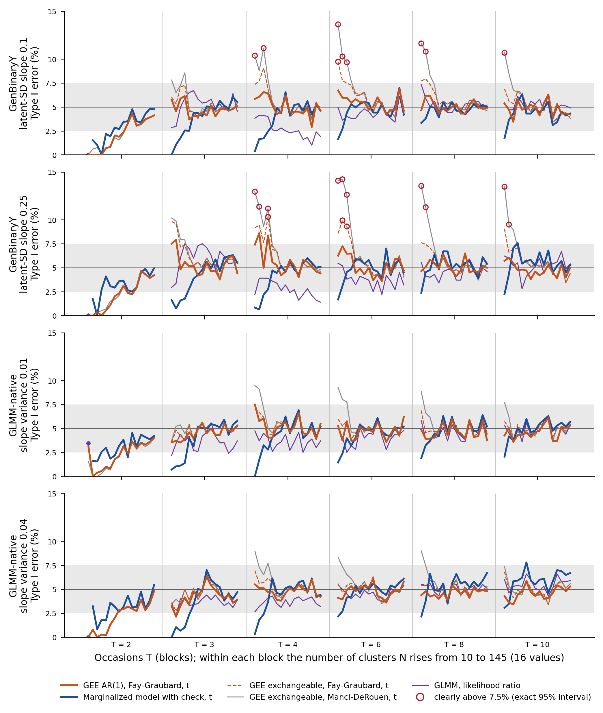

# Supplementary material for: Choosing an analysis for clustered binary
outcomes when clusters are few and series are short: a simulation study
and two clinical applications

This supplement accompanies the manuscript. Every number is read from
the same registry of values as the main text. GB = GenBinaryY, NAT =
GLMM-native, AR1 = GLMM-AR1, COP = Copula-AR1; MMM = marginalized
multilevel model. In every table the Kauermann-Carroll correction is
computed with *fewclust* (Section S4). Numbers in square brackets refer
to the reference list of the main text.

## S1. Parameters of the data-generating mechanisms

**Table S1.** Parameters under the alternative, read from the table
extracted from the executed code. Under the null only the interaction
coefficient is set to zero. Coefficients are in the order (Intercept),
time, trt, covariate if any, time:trt; they are marginal for GenBinaryY,
conditional for GLMM-native and the marginal target for GLMM-AR1, whose
conditional coefficients are calibrated on each replicate.

| Mechanism | Scenario | Mean model | Coefficients | Dependence |
|----|----|----|----|----|
| GenBinaryY | M1 | § | § | lv §, σ = (§); transition §, γ = (§) |
| GenBinaryY | M2 | § | § | lv §, σ = (§); transition §, γ = (§) |
| GenBinaryY | M3 | § | § | lv §, σ = (§); transition §, γ = (§) |
| GenBinaryY | M4 | § | § | lv §, σ = (§); transition §, γ = (§) |
| GenBinaryY | M5 | § | § | lv §, σ = (§); transition §, γ = (§) |
| GLMM-native | M1 | § | § | random effects §, D = \[§\] |
| GLMM-native | M2 | § | § | random effects §, D = \[§\] |
| GLMM-native | M3 | § | § | random effects §, D = \[§\] |
| GLMM-native | M4 | § | § | random effects §, D = \[§\] |
| GLMM-native | M5 | § | § | random effects §, D = \[§\] |
| GLMM-AR1 | M1 | § | § | random effects §, D = \[§\]; AR(1) ρ = §, variance § |
| GLMM-AR1 | M2 | § | § | random effects §, D = \[§\]; AR(1) ρ = §, variance § |
| GLMM-AR1 | M3 | § | § | random effects §, D = \[§\]; AR(1) ρ = §, variance § |
| GLMM-AR1 | M4 | § | § | random effects §, D = \[§\]; AR(1) ρ = §, variance § |
| GLMM-AR1 | M5 | § | § | random effects §, D = \[§\]; AR(1) ρ = §, variance § |

Scenarios and mechanisms not in the table use the same code. M1c has the
mean model of M1 with the prevalence (§) and between-subject variance
(§) of the clinical cohort. M6 and M7 let the latent standard deviation
of GenBinaryY grow by § or § per occasion, and give GLMM-native a
random-slope variance of § or §. Copula-AR1 has the marginal
coefficients of each scenario and latent correlation ρ = § (Section S8).
Covariates are drawn as follows: age, per subject, §, then standardized;
dose, per observation, §, then standardized; steroids, per subject, §,
in the transition model of GenBinaryY M5 only. Treatment is § per
subject.

The conditional coefficients of GLMM-AR1 are calibrated on each
replicate, so that the implied marginal coefficients equal the target.
In M6 and M7, with 10 occasions the latent standard deviation of
GenBinaryY grows from § to § or §, against § in M3. The autoregressive
parameters of GLMM-AR1 add a serial dependence to the cluster
effect.<!-- noclaim: justification of parameter values --> In § design
points of the main grid and § of M1c, all in GLMM-AR1, only § to §
datasets could be generated, because the per-replicate calibration
encountered a singular system; every replicate that could not be
generated had a degenerate design, defined in Section 2.2 of the main
text.

## S2. Software

**Table S2.** Versions in the project library and, for *fewclust*, in a
separate library built from the commit shown, used for every rerun and
for the tables of this paper. The simulations were first run under an
earlier patch release of R; their datasets were reproduced bit for bit
under the current release. The full *sessionInfo()* is provided with the
code (*reports/morris/S8b_logs/sessionInfo.txt*, with *fewclust* and
*clubSandwich* loaded). The marginalized model used § Gauss-Hermite
points; Bie et al. used more with large random-effect variances
(reference \[19\] of the main text), and more points were not examined.

| Software         | Version |
|------------------|---------|
| R                | §       |
| MMLB             | §       |
| lme4             | §       |
| geepack          | §       |
| geesmv           | §       |
| fewclust         | §       |
| fewclust, commit | §       |
| clubSandwich     | §       |
| data.table       | §       |
| crew             | §       |
| mirai            | §       |
| Matrix           | §       |

Replicates were run in parallel, each from its own seed, so that any
dataset can be regenerated alone; with the L’Ecuyer-CMRG generator the
sequences started from different seeds do not overlap in practice, and
separate streams \[21\] were not used. The § design points comprise §
datasets, analysed with about § million model fits over all runs (a
likelihood-ratio test counted once; the logistic fits of the sign-flip
test and of its interval search not counted), and every analysis added
after the main run regenerated them from their seeds.

## S3. Tables of the main grid

The marginalized model without the check is reported as a sensitivity
analysis (Table S3). Fits that returned with warnings were kept;
excluding them is a sensitivity analysis (Table S13). Counts of
miscalibrated cells used exact binomial tests with the
Benjamini-Hochberg and Benjamini-Yekutieli corrections.

With the Benjamini-Hochberg correction within method, the marginalized
model was detectably off nominal in §% of its cells, Fay-Graubard in §%,
Mancl-DeRouen in §% and Kauermann-Carroll in §% (Table
S5).<!-- claim: cl:C10b|BH as=larger --> The uncorrected GEE was above
7.5% by § points at N = 10 on GenBinaryY. Its smallest excess over 5%
across cluster counts was under half a point on every
mechanism.<!-- claim: cl:C12a|GB as=descr; cl:C12c|GB as=similar; cl:C12c|NAT as=similar; cl:C12c|AR1 as=similar -->
Above 45 clusters, Fay-Graubard and the marginalized model were both
within about half a point of 5% on the random-effects
mechanisms.<!-- claim: cl:C25a|NAT as=descr; cl:C25b|NAT as=similar; cl:C25b|AR1 as=similar -->
The ordering of the methods was stable across mechanisms, with Spearman
correlations of § to § between pairs of mechanisms. GLMM-AR1 differed
from GLMM-native by § percentage points on average across
methods.<!-- claim: cl:C08|rate as=descr; cl:C09|all as=descr -->

Section 3.5 of the main text compares Fay-Graubard with exchangeable,
independence and AR(1) working correlations over the three study
mechanisms. Per design point, §% of the differences lay between § and §
points, and § of the § differences with independence and § with AR(1)
exceeded 2.5 points in absolute value (at most § and
§).<!-- noclaim: descriptive values -->

**Table S3.** Type I error at the nominal 5% (%): pooled rate, worst
case and mean absolute departure (MAD) over cluster counts (percentage
points), main grid, with the marginalized model without the convergence
check (sensitivity analysis). Only the row of the marginalized model
differs from Table 3. GB = GenBinaryY, NAT = GLMM-native, AR1 =
GLMM-AR1. Largest Monte Carlo standard error: § points for the pooled
rate, § for the worst case and § for the MAD.

|  | Rate GB | Rate NAT | Rate AR1 | Worst GB | Worst NAT | Worst AR1 | MAD GB | MAD NAT | MAD AR1 |
|----|----|----|----|----|----|----|----|----|----|
| GEE, Fay-Graubard | § | § | § | § | § | § | § | § | § |
| GEE, Mancl-DeRouen | § | § | § | § | § | § | § | § | § |
| Marginalized model | § | § | § | § | § | § | § | § | § |
| GLMM, Wald | § | § | § | § | § | § | § | § | § |
| Shrinkage GLM | § | § | § | § | § | § | § | § | § |
| GEE, uncorrected | § | § | § | § | § | § | § | § | § |
| GLMM, likelihood ratio | § | § | § | § | § | § | § | § | § |
| GEE, Kauermann-Carroll | § | § | § | § | § | § | § | § | § |

**Table S4.** Mean absolute departure from 5% by number of occasions
(percentage points), cell-weighted, main grid, marginalized model with
the convergence check. Monte Carlo standard errors by block bootstrap;
values given to the digit they support. Largest Monte Carlo standard
error: § points.

|                        | T = 2 | T = 3 | T ≥ 4 |
|------------------------|-------|-------|-------|
| GEE, Fay-Graubard      | §     | §     | §     |
| GEE, Mancl-DeRouen     | §     | §     | §     |
| Marginalized model     | §     | §     | §     |
| GLMM, Wald             | §     | §     | §     |
| Shrinkage GLM          | §     | §     | §     |
| GEE, uncorrected       | §     | §     | §     |
| GLMM, likelihood ratio | §     | §     | §     |
| GEE, Kauermann-Carroll | §     | §     | §     |

**Table S5.** Method-cells detectably off nominal (%), exact binomial
test with Benjamini-Hochberg (BH) and Benjamini-Yekutieli (BY)
corrections within method, main grid, marginalized model with the
convergence check. Monte Carlo standard errors by block bootstrap;
values given to the digit they support. Largest Monte Carlo standard
error: § points.

|                        | BH  | BY  |
|------------------------|-----|-----|
| GEE, Fay-Graubard      | §   | §   |
| GEE, Mancl-DeRouen     | §   | §   |
| Marginalized model     | §   | §   |
| GLMM, Wald             | §   | §   |
| Shrinkage GLM          | §   | §   |
| GEE, uncorrected       | §   | §   |
| GLMM, likelihood ratio | §   | §   |
| GEE, Kauermann-Carroll | §   | §   |

**Table S6.** Type I error on each method’s own usable replicates and on
the replicates usable for all methods (common set) (%), main grid,
marginalized model with the convergence check. Monte Carlo standard
errors by block bootstrap; values given to the digit they support.
Largest Monte Carlo standard error: § points for the rates and § for the
shift.

|  | Own GB | Own NAT | Own AR1 | Common GB | Common NAT | Common AR1 | Shift GB | Shift NAT | Shift AR1 |
|----|----|----|----|----|----|----|----|----|----|
| GEE, Fay-Graubard | § | § | § | § | § | § | § | § | § |
| GEE, Mancl-DeRouen | § | § | § | § | § | § | § | § | § |
| Marginalized model | § | § | § | § | § | § | § | § | § |
| GLMM, Wald | § | § | § | § | § | § | § | § | § |
| Shrinkage GLM | § | § | § | § | § | § | § | § | § |
| GEE, uncorrected | § | § | § | § | § | § | § | § | § |
| GLMM, likelihood ratio | § | § | § | § | § | § | § | § | § |
| GEE, Kauermann-Carroll | § | § | § | § | § | § | § | § | § |

**Table S7.** Replicates returning a usable result by number of
occasions (%), under the null, averaged over design points, every
replicate with an estimable design in the denominator, main grid,
marginalized model with the convergence check. Monte Carlo standard
errors by block bootstrap; values given to the digit they support.
Largest Monte Carlo standard error: § points.

|  | GEE, Fay-Graubard | GEE, Mancl-DeRouen | Marginalized model | GLMM, Wald | Shrinkage GLM | GEE, uncorrected | GLMM, likelihood ratio | GEE, Kauermann-Carroll |
|----|----|----|----|----|----|----|----|----|
| Random intercept, T = 2 | § | § | § | § | § | § | § | § |
| Random intercept, T = 3 | § | § | § | § | § | § | § | § |
| Random intercept, T = 4 | § | § | § | § | § | § | § | § |
| Random intercept, T = 6 | § | § | § | § | § | § | § | § |
| Random intercept, T = 8 | § | § | § | § | § | § | § | § |
| Random intercept, T = 10 | § | § | § | § | § | § | § | § |
| Random slopes, T = 2 | § | § | § | § | § | § | § | § |
| Random slopes, T = 3 | § | § | § | § | § | § | § | § |
| Random slopes, T = 4 | § | § | § | § | § | § | § | § |
| Random slopes, T = 6 | § | § | § | § | § | § | § | § |
| Random slopes, T = 8 | § | § | § | § | § | § | § | § |
| Random slopes, T = 10 | § | § | § | § | § | § | § | § |

At 20 clusters or fewer, the likelihood-ratio test returned a usable
result in §% of attempts and the uncorrected GEE in §%. The three
corrected sandwiches returned a usable result in §% to §% of attempts,
and the marginalized model, which gives no result when the refit of its
convergence check does not converge (Section 2.4 of the main text), in
fewer, §%.<!-- claim: cl:C14a|all as=larger; cl:C14d|all as=larger -->

**Table S8.** Usable result and unconditional validity at 20 clusters or
fewer (%), under the null, averaged over design points, main grid,
marginalized model with the convergence check. Monte Carlo standard
errors by block bootstrap; values given to the digit they support.
Largest Monte Carlo standard error: § points for the usable share and §
for unconditional validity.

|  | Usable | Unconditional validity | Design points with a usable replicate |
|----|----|----|----|
| GEE, Fay-Graubard | § | § | § |
| GEE, Mancl-DeRouen | § | § | § |
| Marginalized model | § | § | § |
| GLMM, Wald | § | § | § |
| Shrinkage GLM | § | § | § |
| GEE, uncorrected | § | § | § |
| GLMM, likelihood ratio | § | § | § |
| GEE, Kauermann-Carroll | § | § | § |

**Table S9.** Mean absolute departure from 5% by estimability stratum
(percentage points); strata by the mean usable proportion of the five
marginal methods, main grid, marginalized model with the convergence
check. Monte Carlo standard errors by block bootstrap; values given to
the digit they support. Largest Monte Carlo standard error: § points.

|                        | §   | §   | §   | §   | §   |
|------------------------|-----|-----|-----|-----|-----|
| GEE, Fay-Graubard      | §   | §   | §   | §   | §   |
| GEE, Mancl-DeRouen     | §   | §   | §   | §   | §   |
| Marginalized model     | §   | §   | §   | §   | §   |
| GLMM, Wald             | §   | §   | §   | §   | §   |
| Shrinkage GLM          | §   | §   | §   | §   | §   |
| GEE, uncorrected       | §   | §   | §   | §   | §   |
| GLMM, likelihood ratio | §   | §   | §   | §   | §   |
| GEE, Kauermann-Carroll | §   | §   | §   | §   | §   |
| design points          | §   | §   | §   | §   | §   |

The size-adjusted critical value was the 95th percentile of
\|estimate/SE\| over the usable null replicates of the same cell; for
the likelihood-ratio test it was the 5th percentile of the null
p-values. It uses the null distribution of each design point, unknown in
practice, and serves only to compare methods at equal level. Table S10
gives raw and size-adjusted power.<!-- noclaim: description --> After
size adjustment, power ranged from §% to §% across methods and
mechanisms.<!-- noclaim: range --> On GenBinaryY the Wald test of the
mixed model had more size-adjusted power than Fay-Graubard, by § points
with the default optimizer of lme4 and by § points with the optimizer
bobyqa (Section S15). On GLMM-AR1 the difference was about two points
with the default optimizer, and the two were similar with bobyqa. On
GLMM-native the two were similar with the default optimizer, and with
bobyqa Fay-Graubard had more power, by about two
points.<!-- claim: cl:C16a|GB as=larger; cl:C16a|GB:bobyqa as=larger; cl:C16a|AR1 as=about1; cl:C16a|AR1:bobyqa as=similar; cl:C16a|NAT as=similar; cl:C16a|NAT:bobyqa as=about1 -->
Part of the size-adjusted power of the Wald test of the mixed model came
from fits with a collapsed standard error
($|\hat\beta/\mathrm{SE}| > 37$, a p-value numerically zero), which the
usability limits keep: averaged over the § cells of the main grid with a
size-adjusted value, they made up § of its § percentage points, and in §
cells the size-adjusted critical value itself exceeded
37.<!-- claim: reg:pb2_mean as=descr -->

**Table S10.** Raw and size-adjusted power at the interaction contrast
(%), main grid, pooled over design points, by mechanism, marginalized
model with the convergence check; Kauermann-Carroll computed with
*fewclust*. Size adjustment uses the 95th percentile of \|estimate/SE\|
under the null of the same cell (for the likelihood-ratio test, the 5th
percentile of the null p-values), and needs at least two usable null
replicates. Monte Carlo standard errors by block bootstrap, at most §
points; values given to the digit they support.

|                                     | Raw | Size-adjusted |
|-------------------------------------|-----|---------------|
| GenBinaryY, GEE, Fay-Graubard       | §   | §             |
| GenBinaryY, GEE, Mancl-DeRouen      | §   | §             |
| GenBinaryY, Marginalized model      | §   | §             |
| GenBinaryY, GLMM, Wald              | §   | §             |
| GenBinaryY, Shrinkage GLM           | §   | §             |
| GenBinaryY, GEE, uncorrected        | §   | §             |
| GenBinaryY, GLMM, likelihood ratio  | §   | §             |
| GenBinaryY, GEE, Kauermann-Carroll  | §   | §             |
| GLMM-native, GEE, Fay-Graubard      | §   | §             |
| GLMM-native, GEE, Mancl-DeRouen     | §   | §             |
| GLMM-native, Marginalized model     | §   | §             |
| GLMM-native, GLMM, Wald             | §   | §             |
| GLMM-native, Shrinkage GLM          | §   | §             |
| GLMM-native, GEE, uncorrected       | §   | §             |
| GLMM-native, GLMM, likelihood ratio | §   | §             |
| GLMM-native, GEE, Kauermann-Carroll | §   | §             |
| GLMM-AR1, GEE, Fay-Graubard         | §   | §             |
| GLMM-AR1, GEE, Mancl-DeRouen        | §   | §             |
| GLMM-AR1, Marginalized model        | §   | §             |
| GLMM-AR1, GLMM, Wald                | §   | §             |
| GLMM-AR1, Shrinkage GLM             | §   | §             |
| GLMM-AR1, GEE, uncorrected          | §   | §             |
| GLMM-AR1, GLMM, likelihood ratio    | §   | §             |
| GLMM-AR1, GEE, Kauermann-Carroll    | §   | §             |

Under the t reference, Fay-Graubard with exchangeable working
correlation had a smaller worst-case departure than the marginalized
model with the check: § to § points against § to
§.<!-- claim: cl:C17d|GB as=larger; cl:C17d|NAT as=larger; cl:C17d|AR1 as=larger -->

**Table S11.** Type I error under a normal and a t reference (%), shift
in percentage points, main grid, marginalized model with the convergence
check. Monte Carlo standard errors by block bootstrap; values given to
the digit they support. Largest Monte Carlo standard error: § points for
the rates and § for the differences.

|  | Normal GB | Normal NAT | Normal AR1 | t GB | t NAT | t AR1 | t minus normal GB | t minus normal NAT | t minus normal AR1 | Normal minus t at N ≤ 25 |
|----|----|----|----|----|----|----|----|----|----|----|
| GEE, Fay-Graubard | § | § | § | § | § | § | § | § | § | § |
| GEE, Mancl-DeRouen | § | § | § | § | § | § | § | § | § | § |
| Marginalized model | § | § | § | § | § | § | § | § | § | § |
| GLMM, Wald | § | § | § | § | § | § | § | § | § | § |
| Shrinkage GLM | § | § | § | § | § | § | § | § | § | § |
| GEE, uncorrected | § | § | § | § | § | § | § | § | § | § |
| GEE, Kauermann-Carroll | § | § | § | § | § | § | § | § | § | § |

**Table S12.** Coverage of the 95% confidence interval against each
method’s own estimand (%); not available (n.a.) for the GLMM on
GenBinaryY, main grid, marginalized model with the convergence check.
Monte Carlo standard errors by block bootstrap; values given to the
digit they support. Largest Monte Carlo standard error: § points.

|                        | GenBinaryY | GLMM-native | GLMM-AR1 |
|------------------------|------------|-------------|----------|
| GEE, Fay-Graubard      | §          | §           | §        |
| GEE, Mancl-DeRouen     | §          | §           | §        |
| Marginalized model     | §          | §           | §        |
| GLMM, Wald             | n.a.       | §           | §        |
| Shrinkage GLM          | §          | §           | §        |
| GEE, uncorrected       | §          | §           | §        |
| GEE, Kauermann-Carroll | §          | §           | §        |

**Table S13.** Pooled type I error (%) on the main grid with fits that
returned warnings kept (U0, primary) and excluded (U1),
replicate-weighted over the null cells. Binomial Monte Carlo standard
error at most § points.

| Method                         | GB, U0 | GB, U1 | NAT, U0 | NAT, U1 | AR1, U0 | AR1, U1 |
|--------------------------------|--------|--------|---------|---------|---------|---------|
| GEE, Fay-Graubard              | §      | §      | §       | §       | §       | §       |
| GEE, Mancl-DeRouen             | §      | §      | §       | §       | §       | §       |
| Marginalized model, with check | §      | §      | §       | §       | §       | §       |
| GLMM, Wald                     | §      | §      | §       | §       | §       | §       |
| Shrinkage GLM                  | §      | §      | §       | §       | §       | §       |
| GEE, uncorrected               | §      | §      | §       | §       | §       | §       |
| GLMM, likelihood ratio         | §      | §      | §       | §       | §       | §       |
| GEE, Kauermann-Carroll         | §      | §      | §       | §       | §       | §       |

**Table S14.** Scenarios M6-M7 (§ design points each): design points
clearly above 7.5% and clearly below 2.5% under the null, largest
rejection rate (%) over the design points with at least § usable null
replicates, and replicates returning a usable result under the null (%),
averaged over design points. The GEE rows use the exchangeable working
correlation with the corrections computed by *geesmv*, as in Table 3, so
their counts can differ slightly from those of Table 5 and Figure S1,
which use *fewclust*. Monte Carlo standard errors are at most § points
for the largest rate (binomial, at its design point) and § for the
usable share (upper bound: mean over design points of the binomial
standard error).

| Scenario | Strategy | Above 7.5% | Below 2.5% | Largest rate (%) | Usable (%) |
|----|----|----|----|----|----|
| GenBinaryY, slope § | Marginalized model with check, t | § | § | § | § |
|  | Marginalized model with check, normal | § | § | § | § |
|  | Marginalized model without check, t | § | § | § | § |
|  | GEE, Fay-Graubard, t | § | § | § | § |
|  | GEE, Mancl-DeRouen, t | § | § | § | § |
|  | GLMM, likelihood ratio | § | § | § | § |
| GenBinaryY, slope § | Marginalized model with check, t | § | § | § | § |
|  | Marginalized model with check, normal | § | § | § | § |
|  | Marginalized model without check, t | § | § | § | § |
|  | GEE, Fay-Graubard, t | § | § | § | § |
|  | GEE, Mancl-DeRouen, t | § | § | § | § |
|  | GLMM, likelihood ratio | § | § | § | § |
| GLMM-native, slope variance § | Marginalized model with check, t | § | § | § | § |
|  | Marginalized model with check, normal | § | § | § | § |
|  | Marginalized model without check, t | § | § | § | § |
|  | GEE, Fay-Graubard, t | § | § | § | § |
|  | GEE, Mancl-DeRouen, t | § | § | § | § |
|  | GLMM, likelihood ratio | § | § | § | § |
| GLMM-native, slope variance § | Marginalized model with check, t | § | § | § | § |
|  | Marginalized model with check, normal | § | § | § | § |
|  | Marginalized model without check, t | § | § | § | § |
|  | GEE, Fay-Graubard, t | § | § | § | § |
|  | GEE, Mancl-DeRouen, t | § | § | § | § |
|  | GLMM, likelihood ratio | § | § | § | § |

**Table S15.** Clinical application: outcome of the fits in § subsamples
of whole patients at each subsample size N (% of subsamples). Not
returned: no point estimate; no SE: estimate without a standard error;
extreme: \|estimate\| or SE above §; usable: the remainder. For each
method and N the four columns add up to all subsamples. Binomial Monte
Carlo standard errors over the § subsamples are at most § points.

| Method                 | N   | Not returned | No SE | Extreme | Usable |
|------------------------|-----|--------------|-------|---------|--------|
| GLMM                   | §   | §            | §     | §       | §      |
|                        | §   | §            | §     | §       | §      |
|                        | §   | §            | §     | §       | §      |
|                        | §   | §            | §     | §       | §      |
|                        | §   | §            | §     | §       | §      |
| Marginalized model     | §   | §            | §     | §       | §      |
|                        | §   | §            | §     | §       | §      |
|                        | §   | §            | §     | §       | §      |
|                        | §   | §            | §     | §       | §      |
|                        | §   | §            | §     | §       | §      |
| GEE, uncorrected       | §   | §            | §     | §       | §      |
|                        | §   | §            | §     | §       | §      |
|                        | §   | §            | §     | §       | §      |
|                        | §   | §            | §     | §       | §      |
|                        | §   | §            | §     | §       | §      |
| GEE, Fay-Graubard      | §   | §            | §     | §       | §      |
|                        | §   | §            | §     | §       | §      |
|                        | §   | §            | §     | §       | §      |
|                        | §   | §            | §     | §       | §      |
|                        | §   | §            | §     | §       | §      |
| GEE, Kauermann-Carroll | §   | §            | §     | §       | §      |
|                        | §   | §            | §     | §       | §      |
|                        | §   | §            | §     | §       | §      |
|                        | §   | §            | §     | §       | §      |
|                        | §   | §            | §     | §       | §      |
| GEE, Mancl-DeRouen     | §   | §            | §     | §       | §      |
|                        | §   | §            | §     | §       | §      |
|                        | §   | §            | §     | §       | §      |
|                        | §   | §            | §     | §       | §      |
|                        | §   | §            | §     | §       | §      |

## S4. Numerical behaviour of the small-sample corrections

The corrections of Mancl and DeRouen, Kauermann and Carroll and Fay and
Graubard were computed with two implementations. *geesmv* was used for
the exchangeable working correlation. On sparse binary data with few
clusters its three functions can loop indefinitely in compiled code, so
each call ran in a separate process killed after § seconds; the largest
share of time-outs at a design point under one hypothesis was
§%.<!-- noclaim: descriptive values --> *geesmv* also takes the clusters
from any column named *id*, whatever cluster variable is passed: in the
simulations and in the cohort the cluster column has that name, and in
the respiratory trial it was renamed before every call. With AR(1)
working correlation *geesmv* fails as soon as one subject has a single
observation, so it was not used with that correlation.

*fewclust* (Table S2) computes the three corrections from the
estimating-equation building blocks. On § or more datasets for each
working correlation and correction on which both computations returned a
standard error, its standard errors agreed with a computation by hand;
the largest difference over the three corrections was below
$10^{-12}$.<!-- noclaim: descriptive values --> Against *geesmv* on the
same exchangeable fits of the first § replicates of each design point
and hypothesis, the subsample on which *geesmv* was run in this
comparison (§ datasets), Mancl-DeRouen and Fay-Graubard agreed to within
one per cent in §% and §% of datasets, and Kauermann-Carroll in only §%.
*geesmv::GEE.var.kc* rebuilds $(I - H_{ii})^{-1/2}$ with the transpose
of the eigenvectors of a non-symmetric matrix, an identity that holds
only for symmetric matrices. With the published formula,
Kauermann-Carroll with exchangeable correlation and a t reference had a
mean type I error of §% over the § design points of the three study
mechanisms, against §% with *geesmv*, and it was clearly above 7.5% at §
instead of § design points. With *geesmv* the correction appears to
shrink rather than inflate the variance; this is a property of the
implementation, not of the estimator.<!-- noclaim: interpretation -->
The CR2 estimator of *clubSandwich* is the Bell-McCaffrey version of
Kauermann-Carroll; it was used here with a t reference on N - p degrees
of freedom, not with the Satterthwaite-type degrees of freedom for which
it was proposed (reference \[27\] of the main text), and with those its
results could differ.

With exchangeable correlation, Mancl-DeRouen and Fay-Graubard were also
computed with *geesmv*, under a hard time limit of § seconds; a time-out
counted as an unusable fit, and these values enter Table 3, Table 4 and
Table S10. Every Kauermann-Carroll result is from *fewclust*, because
*geesmv* applies a symmetric matrix square root to a non-symmetric
matrix (above). Computed with *fewclust* instead of *geesmv*,
Fay-Graubard with exchangeable correlation rejected a true null at
similar rates (difference § points) and had a similar usable share
(difference §
points).<!-- claim: cv:impl_fg as=similar; cv:impl_fg_pu as=similar -->
The Kauermann-Carroll correction computed from its published formula
rejected a true null § points less often than the *geesmv* version on
average under a t reference.<!-- claim: cv:impl_kc as=larger --> Its
rejection rates in Table 3 and Table S10 are therefore lower than those
obtained with *geesmv*.<!-- noclaim: consequence of the correction -->

## S5. Tables of the scenario anchored to the cohort (M1c)

In scenario M1c, the size-adjusted power of the Wald test of the mixed
model fell below that of Fay-Graubard, by § to § points with the default
optimizer. With bobyqa the deficit was about two points on GenBinaryY
and GLMM-AR1, and the two were similar on GLMM-native. The default
optimizer returned degenerate fits with a near-zero standard
error.<!-- claim: cm:C16a|GB as=larger; cm:C16a|NAT as=larger; cm:C16a|AR1 as=larger; cm:C16a|GB:bobyqa as=about1; cm:C16a|NAT:bobyqa as=similar; cm:C16a|AR1:bobyqa as=about1 -->
In M1c, the method with the fewest miscalibrated cells could not be
identified.<!-- claim: cm:C10b|BH as=notdist -->

**Table S16.** Type I error at the nominal 5% (%): pooled rate, worst
case and mean absolute departure (MAD) over cluster counts (percentage
points), scenario M1c (§ design points). Largest Monte Carlo standard
error: § points for the pooled rate, § for the worst case and § for the
MAD.

|  | Rate GB | Rate NAT | Rate AR1 | Worst GB | Worst NAT | Worst AR1 | MAD GB | MAD NAT | MAD AR1 |
|----|----|----|----|----|----|----|----|----|----|
| GEE, Fay-Graubard | § | § | § | § | § | § | § | § | § |
| GEE, Mancl-DeRouen | § | § | § | § | § | § | § | § | § |
| Marginalized model | § | § | § | § | § | § | § | § | § |
| GLMM, Wald | § | § | § | § | § | § | § | § | § |
| Shrinkage GLM | § | § | § | § | § | § | § | § | § |
| GEE, uncorrected | § | § | § | § | § | § | § | § | § |
| GLMM, likelihood ratio | § | § | § | § | § | § | § | § | § |
| GEE, Kauermann-Carroll | § | § | § | § | § | § | § | § | § |

**Table S17.** Mean absolute departure from 5% by number of occasions
(percentage points), cell-weighted, scenario M1c (§ design points).
Largest Monte Carlo standard error: § points.

|                        | T = 2 | T = 3 | T ≥ 4 |
|------------------------|-------|-------|-------|
| GEE, Fay-Graubard      | §     | §     | §     |
| GEE, Mancl-DeRouen     | §     | §     | §     |
| Marginalized model     | §     | §     | §     |
| GLMM, Wald             | §     | §     | §     |
| Shrinkage GLM          | §     | §     | §     |
| GEE, uncorrected       | §     | §     | §     |
| GLMM, likelihood ratio | §     | §     | §     |
| GEE, Kauermann-Carroll | §     | §     | §     |

**Table S18.** Method-cells detectably off nominal (%), exact binomial
test with Benjamini-Hochberg (BH) and Benjamini-Yekutieli (BY)
corrections within method, scenario M1c (§ design points). Largest Monte
Carlo standard error: § points.

|                        | BH  | BY  |
|------------------------|-----|-----|
| GEE, Fay-Graubard      | §   | §   |
| GEE, Mancl-DeRouen     | §   | §   |
| Marginalized model     | §   | §   |
| GLMM, Wald             | §   | §   |
| Shrinkage GLM          | §   | §   |
| GEE, uncorrected       | §   | §   |
| GLMM, likelihood ratio | §   | §   |
| GEE, Kauermann-Carroll | §   | §   |

**Table S19.** Type I error on each method’s own usable replicates and
on the replicates usable for all methods (common set) (%), scenario M1c
(§ design points). Largest Monte Carlo standard error: § points for the
rates and § for the shift.

|  | Own GB | Own NAT | Own AR1 | Common GB | Common NAT | Common AR1 | Shift GB | Shift NAT | Shift AR1 |
|----|----|----|----|----|----|----|----|----|----|
| GEE, Fay-Graubard | § | § | § | § | § | § | § | § | § |
| GEE, Mancl-DeRouen | § | § | § | § | § | § | § | § | § |
| Marginalized model | § | § | § | § | § | § | § | § | § |
| GLMM, Wald | § | § | § | § | § | § | § | § | § |
| Shrinkage GLM | § | § | § | § | § | § | § | § | § |
| GEE, uncorrected | § | § | § | § | § | § | § | § | § |
| GLMM, likelihood ratio | § | § | § | § | § | § | § | § | § |
| GEE, Kauermann-Carroll | § | § | § | § | § | § | § | § | § |

**Table S20.** Replicates returning a usable result by number of
occasions (%), under the null, averaged over design points, every
replicate with an estimable design in the denominator, scenario M1c (§
design points). Largest Monte Carlo standard error: § points.

|  | GEE, Fay-Graubard | GEE, Mancl-DeRouen | Marginalized model | GLMM, Wald | Shrinkage GLM | GEE, uncorrected | GLMM, likelihood ratio | GEE, Kauermann-Carroll |
|----|----|----|----|----|----|----|----|----|
| Random intercept, T = 2 | § | § | § | § | § | § | § | § |
| Random intercept, T = 3 | § | § | § | § | § | § | § | § |
| Random intercept, T = 4 | § | § | § | § | § | § | § | § |
| Random intercept, T = 6 | § | § | § | § | § | § | § | § |

**Table S21.** Usable result and unconditional validity at 20 clusters
or fewer (%), under the null, averaged over design points, scenario M1c
(§ design points). Largest Monte Carlo standard error: § points for the
usable share and § for unconditional validity.

|  | Usable | Unconditional validity | Design points with a usable replicate |
|----|----|----|----|
| GEE, Fay-Graubard | § | § | § |
| GEE, Mancl-DeRouen | § | § | § |
| Marginalized model | § | § | § |
| GLMM, Wald | § | § | § |
| Shrinkage GLM | § | § | § |
| GEE, uncorrected | § | § | § |
| GLMM, likelihood ratio | § | § | § |
| GEE, Kauermann-Carroll | § | § | § |

**Table S22.** Mean absolute departure from 5% by estimability stratum
(percentage points); strata by the mean usable proportion of the five
marginal methods, scenario M1c (§ design points). Largest Monte Carlo
standard error: § points.

|                        | §   | §   | §   | §   | §   |
|------------------------|-----|-----|-----|-----|-----|
| GEE, Fay-Graubard      | §   | §   | §   | §   | §   |
| GEE, Mancl-DeRouen     | §   | §   | §   | §   | §   |
| Marginalized model     | §   | §   | §   | §   | §   |
| GLMM, Wald             | §   | §   | §   | §   | §   |
| Shrinkage GLM          | §   | §   | §   | §   | §   |
| GEE, uncorrected       | §   | §   | §   | §   | §   |
| GLMM, likelihood ratio | §   | §   | §   | §   | §   |
| GEE, Kauermann-Carroll | §   | §   | §   | §   | §   |
| design points          | §   | §   | §   | §   | §   |

**Table S23.** Raw and size-adjusted power at the interaction contrast
(%), scenario M1c (§ design points). Largest Monte Carlo standard error:
§ points for raw power and § for size-adjusted power.

|                                     | Raw | Size-adjusted |
|-------------------------------------|-----|---------------|
| GenBinaryY, GEE, Fay-Graubard       | §   | §             |
| GenBinaryY, GEE, Mancl-DeRouen      | §   | §             |
| GenBinaryY, Marginalized model      | §   | §             |
| GenBinaryY, GLMM, Wald              | §   | §             |
| GenBinaryY, Shrinkage GLM           | §   | §             |
| GenBinaryY, GEE, uncorrected        | §   | §             |
| GenBinaryY, GLMM, likelihood ratio  | §   | §             |
| GenBinaryY, GEE, Kauermann-Carroll  | §   | §             |
| GLMM-native, GEE, Fay-Graubard      | §   | §             |
| GLMM-native, GEE, Mancl-DeRouen     | §   | §             |
| GLMM-native, Marginalized model     | §   | §             |
| GLMM-native, GLMM, Wald             | §   | §             |
| GLMM-native, Shrinkage GLM          | §   | §             |
| GLMM-native, GEE, uncorrected       | §   | §             |
| GLMM-native, GLMM, likelihood ratio | §   | §             |
| GLMM-native, GEE, Kauermann-Carroll | §   | §             |
| GLMM-AR1, GEE, Fay-Graubard         | §   | §             |
| GLMM-AR1, GEE, Mancl-DeRouen        | §   | §             |
| GLMM-AR1, Marginalized model        | §   | §             |
| GLMM-AR1, GLMM, Wald                | §   | §             |
| GLMM-AR1, Shrinkage GLM             | §   | §             |
| GLMM-AR1, GEE, uncorrected          | §   | §             |
| GLMM-AR1, GLMM, likelihood ratio    | §   | §             |
| GLMM-AR1, GEE, Kauermann-Carroll    | §   | §             |

**Table S24.** Type I error under a normal and a t reference (%), shift
in percentage points, scenario M1c (§ design points). Largest Monte
Carlo standard error: § points for the rates and § for the differences.

|  | Normal GB | Normal NAT | Normal AR1 | t GB | t NAT | t AR1 | t minus normal GB | t minus normal NAT | t minus normal AR1 | Normal minus t at N ≤ 25 |
|----|----|----|----|----|----|----|----|----|----|----|
| GEE, Fay-Graubard | § | § | § | § | § | § | § | § | § | § |
| GEE, Mancl-DeRouen | § | § | § | § | § | § | § | § | § | § |
| Marginalized model | § | § | § | § | § | § | § | § | § | § |
| GLMM, Wald | § | § | § | § | § | § | § | § | § | § |
| Shrinkage GLM | § | § | § | § | § | § | § | § | § | § |
| GEE, uncorrected | § | § | § | § | § | § | § | § | § | § |
| GEE, Kauermann-Carroll | § | § | § | § | § | § | § | § | § | § |

**Table S25.** Coverage of the 95% confidence interval against each
method’s own estimand (%); not available (n.a.) for the GLMM on
GenBinaryY, scenario M1c (§ design points). Largest Monte Carlo standard
error: § points.

|                        | GenBinaryY | GLMM-native | GLMM-AR1 |
|------------------------|------------|-------------|----------|
| GEE, Fay-Graubard      | §          | §           | §        |
| GEE, Mancl-DeRouen     | §          | §           | §        |
| Marginalized model     | §          | §           | §        |
| GLMM, Wald             | n.a.       | §           | §        |
| Shrinkage GLM          | §          | §           | §        |
| GEE, uncorrected       | §          | §           | §        |
| GEE, Kauermann-Carroll | §          | §           | §        |

## S6. Degrees of freedom of the t reference

Degrees of freedom N - 2, as used by Li and Redden \[15\], were examined
as a sensitivity analysis. Averaging the Mancl-DeRouen and
Kauermann-Carroll variances, as studied by Ford and Westgate \[13\], did
not give a strategy that was never clearly above 7.5%. With N - p
degrees of freedom, GEE with AR(1) working correlation and the averaged
variance was clearly above 7.5% at § of the § design points of the four
mechanisms, and GEE with exchangeable working correlation and the
averaged variance at § (Table S26 gives the three study
mechanisms).<!-- claim: reg:mdkc as=descr -->

**Table S26.** The decision rule with N - p and with N - 2 degrees of
freedom, as used by Li and Redden, on the § design points of the three
study mechanisms (the fourth mechanism was analysed with N - p only).
Above: design points clearly above 7.5%; below: clearly below 2.5%;
usable: replicates returning a usable result under the null (%),
averaged over design points. With both choices the rule selects the
marginalized model with the convergence check; GEE with AR(1) working
correlation and Fay-Graubard is clearly above 7.5% at § design points
with N - p and at § with N - 2. The rows for the average of the
Mancl-DeRouen and Kauermann-Carroll variances use the same usability
rule, denominators and exact intervals, recomputed from the stored
per-replicate results. The Monte Carlo standard error of the usable
share is at most § points (upper bound: mean over design points of the
binomial standard error).

| Strategy | Above, N - p | Below, N - p | Below at ten clusters, N - p | Above, N - 2 | Below, N - 2 | Below at ten clusters, N - 2 | Usable (%) |
|----|----|----|----|----|----|----|----|
| GEE AR(1), Fay-Graubard | § | § | § | § | § | § | § |
| Marginalized model with check | § | § | § | § | § | § | § |
| GEE independence, Fay-Graubard | § | § | § | § | § | § | § |
| GEE exchangeable, Fay-Graubard | § | § | § | § | § | § | § |
| GEE AR(1), Mancl-DeRouen | § | § | § | § | § | § | § |
| GEE exchangeable, Mancl-DeRouen | § | § | § | § | § | § | § |
| GEE exchangeable, Kauermann-Carroll | § | § | § | § | § | § | § |
| GEE AR(1), average of Mancl-DeRouen and Kauermann-Carroll | § | § | § | § | § | § | § |
| GEE exchangeable, average of Mancl-DeRouen and Kauermann-Carroll | § | § | § | § | § | § | § |
| GLMM, Wald | § | § | § | § | § | § | § |

## S7. Sign-flip score test and the interval obtained by inverting it

The model without the interaction was fitted as a logistic regression
with the mean model of the scenario, and the effective score
contribution of each subject to the interaction was obtained by
projecting out the other coefficients. The p-value compares the observed
sum of contributions with its distribution under random changes of sign:
all sign assignments up to § subjects, and otherwise § random
assignments plus the identity. The test gives a p-value only; the
interval obtained by inverting it is described below.

The sign-flip test of the main text tests the null of no interaction.
Testing instead the null that the interaction equals a value $b_0$, by
entering $b_0 \cdot t \cdot \mathrm{trt}$ as an offset in the model
without the interaction, and collecting the values that are not rejected
at 5%, gives a confidence interval. Its ends were searched from the
independence GEE estimate by a walk in fixed steps followed by
bisection, with the same sign vectors at every value and every fit
started from the default initial value; a value at which the test was
not computable counted as not rejected, so the interval can be
unbounded. Under the alternative the test evaluated at the true value
kept its level: it covered the true value in §% of datasets over the §
design points, and its non-coverage was clearly outside Bradley’s band
at no design point. The interval, which counts as covering when it is
unbounded, covered the true value in §% of datasets, against §% for GEE
with AR(1) working correlation, Fay-Graubard and a t reference; its
non-coverage was clearly below 2.5% at § design points under the
alternative and § under the null, § of the former with two occasions,
where it is almost always unbounded. Both ends were finite in §% of
datasets, and in §% with two or three occasions and at most 25 clusters
(Table S27). Where both intervals were finite it was wider than the GEE
interval by §% on average over design points (geometric mean of the
ratio of widths at each design point, then over design points), and by
§% with 75 clusters or more; over datasets, which gives more weight to
the larger designs, the geometric mean was §% (§% with 75 clusters or
more).<!-- claim: reg:ci as=descr -->

With the rules of Section 2.4 of the main text the test was not
computable in some of the small designs, often because one arm had only
zero outcomes. With two or three occasions and at most 25 clusters it
answered in §% of datasets, against §% when the rules were not applied,
with a mean type I error of §%. A version that also excluded fits with a
coefficient of at least § is a sensitivity analysis. With this
coefficient filter, on the § design points of the three study
mechanisms, it rejected a true null in §% of datasets on average, was
clearly above 7.5% at § design points and answered in §% of
datasets.<!-- claim: reg:flip as=descr -->

**Table S27.** Interval obtained by inverting the sign-flip test, under
the alternative, by number of occasions T and number of clusters N:
datasets with an estimable design, datasets with both ends of the
interval finite (%), and datasets in which GEE with AR(1) working
correlation, Fay-Graubard and a t reference returned a usable interval
(%). Binomial Monte Carlo standard errors are at most § points for
finite intervals and § for GEE; they are approximate, because the
datasets of a row share replicate seeds across numbers of clusters.

| Occasions | Clusters | Datasets | Interval finite (%) | GEE AR(1), Fay-Graubard usable (%) |
|----|----|----|----|----|
| T = 2 | N = 10 | § | § | § |
|  | N = 15-25 | § | § | § |
|  | N = 35-65 | § | § | § |
|  | N = 75-145 | § | § | § |
| T = 3 | N = 10 | § | § | § |
|  | N = 15-25 | § | § | § |
|  | N = 35-65 | § | § | § |
|  | N = 75-145 | § | § | § |
| T = 4 | N = 10 | § | § | § |
|  | N = 15-25 | § | § | § |
|  | N = 35-65 | § | § | § |
|  | N = 75-145 | § | § | § |
| T = 6 | N = 10 | § | § | § |
|  | N = 15-25 | § | § | § |
|  | N = 35-65 | § | § | § |
|  | N = 75-145 | § | § | § |
| T = 8 | N = 10 | § | § | § |
|  | N = 15-25 | § | § | § |
|  | N = 35-65 | § | § | § |
|  | N = 75-145 | § | § | § |
| T = 10 | N = 10 | § | § | § |
|  | N = 15-25 | § | § | § |
|  | N = 35-65 | § | § | § |
|  | N = 75-145 | § | § | § |

## S8. The fourth mechanism

Copula-AR1 draws, for each subject, a vector of normal scores with
correlation $\rho^{|t_j - t_k|}$ (ρ = §) and sets each outcome to one
when its score is below the normal quantile of the marginal mean of the
scenario. The marginal means are therefore exactly those of the
scenario, and the correlation between occasions of a subject decreases
with their distance in time, with no component that is constant within
subject. Without the convergence check the marginalized model was
clearly above 7.5% at § of the § design points. To check whether the
excess of the mixed model comes from a non-zero null value of its
conditional coefficient, a single dataset of § subjects was generated
under the null for T = 2, 4 and 10 and fitted with a random intercept:
the estimates ranged from § to §, with standard errors up to §, none
distinguishable from zero. On the latent scale the correlation of
Copula-AR1 is that of the AR(1) working correlation of Section 2.4 of
the main text; on the binary outcomes it was § between adjacent
occasions and § two occasions apart, so it decays more slowly than an
AR(1) correlation with the same first-lag
value.<!-- noclaim: checked in R/s7f/s7f_extras.R (lag-2 and lag-3 correlations above the AR(1) values) -->
The fourth mechanism was simulated on the main grid only, with the seeds
of the other three.

With a random intercept only, and N ≥ 85, under the null and averaged
over the design points of each scenario and number of occasions, the
model-based standard error of the mixed model (root mean square over
replicates) was § to § times the standard deviation of its estimates,
while the estimates were centred.<!-- noclaim: mechanism --> The
marginalized model estimated the interaction with a mean bias of §
empirical standard errors and covered the true value in §% of replicates
under a normal reference, although its model of the dependence is
misspecified on this mechanism (Table S28).<!-- noclaim: descriptive -->

**Table S28.** Copula-AR1 (§ design points), Wald tests with a t
reference: mean type I error (%), design points clearly above 7.5% and
clearly below 2.5%, replicates returning a usable result under the null
(%, averaged over design points), power (%), and, for the marginal
estimators, mean bias in empirical standard errors and coverage of the
95% interval with a normal and a t reference (%); n.a. = not applicable.
Monte Carlo standard errors are at most § points for the type I error, §
for the usable share, § for power, § for bias in empirical standard
errors and § points for coverage. These are upper bounds: the mean over
design points of the per-point standard error.

| Strategy | Type I error | Above 7.5% | Below 2.5% | Usable | Power | Bias / empirical SE | Coverage, normal | Coverage, t |
|----|----|----|----|----|----|----|----|----|
| GEE AR(1), Fay-Graubard | § | § | § | § | § | § | § | § |
| Marginalized model with check | § | § | § | § | § | § | § | § |
| Marginalized model without check | § | § | § | § | § | § | § | § |
| GEE independence, Fay-Graubard | § | § | § | § | § | § | § | § |
| GEE exchangeable, Fay-Graubard | § | § | § | § | § | § | § | § |
| GEE exchangeable, Mancl-DeRouen | § | § | § | § | § | § | § | § |
| GEE exchangeable, Kauermann-Carroll | § | § | § | § | § | § | § | § |
| GEE exchangeable, uncorrected | § | § | § | § | § | § | § | § |
| GLMM, Wald | § | § | § | § | § | n.a. | n.a. | n.a. |
| Shrinkage GLM | § | § | § | § | § | n.a. | n.a. | n.a. |
| GLMM, likelihood ratio | § | § | § | § | § | n.a. | n.a. | n.a. |
| Sign-flip score test | § | § | § | § | § | n.a. | n.a. | n.a. |

## S9. Second clinical application: the respiratory trial

The respiratory trial distributed with *geepack* has § patients observed
at four visits. The full mean model had treatment, baseline status,
visit, age, sex and centre; the reduced model had treatment and baseline
status only. Kauermann-Carroll was computed with *fewclust* on the same
GEE fits and the same draws, in both applications; Mancl-DeRouen and
Fay-Graubard were computed with *geesmv*. Recomputed with *fewclust*,
these two agreed with *geesmv* to within one per cent in §% and §% of
the draws of the cohort and in §% and §% of those of the trial. In both
applications the marginalized model had a latent variable with an
intercept only (§ quadrature points) and the main text reports its
model-based standard error. With its robust standard error the corrected
ratio of Section 2.7 of the main text was § to § in the cohort and § to
§ in the trial; on the full data the robust standard error was § in the
cohort and § in the trial. In the respiratory trial the contrast of
interest was the treatment effect, adjusted for baseline status, visit,
age, sex and centre; the latent variable of the marginalized model had
an intercept only, as in the cohort, since with four visits per patient
a time trend of the latent standard deviation would rest on four
observations per patient.

In the trial, the bias of the marginalized model against its full-data
estimate was within two Monte Carlo standard errors of zero at § and at
§ patients and reached § at § (Table S30). Its corrected ratio, with the
model-based standard error, was § at § patients and § at
§.<!-- noclaim: descriptive -->

**Table S29.** Full-data estimate (SE) of the treatment effect, full and
reduced mean model; GEE with exchangeable working correlation;
model-based SE for the marginalized model and the mixed model. The mixed
model estimates a conditional effect.

| Method                 | Full model | Reduced model |
|------------------------|------------|---------------|
| Marginalized model     | § (§)      | § (§)         |
| GEE, uncorrected       | § (§)      | § (§)         |
| GEE, Mancl-DeRouen     | § (§)      | § (§)         |
| GEE, Kauermann-Carroll | § (§)      | § (§)         |
| GEE, Fay-Graubard      | § (§)      | § (§)         |
| GLMM                   | § (§)      | § (§)         |

**Table S30.** Subsamples of whole patients, full mean model: draws not
returned, with an estimate but no SE, extreme (\|estimate\| or SE above
§) and returning a usable result (%), bias of the estimate against the
full-data estimate, and ratio of the mean standard error (model-based
for the marginalized model and the mixed model, sandwich for the GEEs)
to the standard deviation of the estimates multiplied by the
finite-population factor of Section 2.7 of the main text. Largest Monte
Carlo standard error: § points for the usable share, § for the bias and
§ for the SE ratio.

| Method | N | Not returned | No SE | Extreme | Usable (%) | Bias | SE ratio, corrected |
|----|----|----|----|----|----|----|----|
| Marginalized model | § | § | § | § | § | § | § |
|  | § | § | § | § | § | § | § |
|  | § | § | § | § | § | § | § |
|  | § | § | § | § | § | § | § |
|  | § | § | § | § | § | § | § |
| GEE, uncorrected | § | § | § | § | § | § | § |
|  | § | § | § | § | § | § | § |
|  | § | § | § | § | § | § | § |
|  | § | § | § | § | § | § | § |
|  | § | § | § | § | § | § | § |
| GEE, Mancl-DeRouen | § | § | § | § | § | § | § |
|  | § | § | § | § | § | § | § |
|  | § | § | § | § | § | § | § |
|  | § | § | § | § | § | § | § |
|  | § | § | § | § | § | § | § |
| GEE, Kauermann-Carroll | § | § | § | § | § | § | § |
|  | § | § | § | § | § | § | § |
|  | § | § | § | § | § | § | § |
|  | § | § | § | § | § | § | § |
|  | § | § | § | § | § | § | § |
| GEE, Fay-Graubard | § | § | § | § | § | § | § |
|  | § | § | § | § | § | § | § |
|  | § | § | § | § | § | § | § |
|  | § | § | § | § | § | § | § |
|  | § | § | § | § | § | § | § |
| GLMM | § | § | § | § | § | § | § |
|  | § | § | § | § | § | § | § |
|  | § | § | § | § | § | § | § |
|  | § | § | § | § | § | § | § |
|  | § | § | § | § | § | § | § |

## S10. The marginalized model and the GEE strategy compared

The strategy selected by the decision rule, the marginalized model with
the convergence check, was compared with the GEE strategy (AR(1) working
correlation, Fay-Graubard correction) by number of clusters and of
occasions after the results had been seen, both with a t reference, with
the block bootstrap and the one-point margin for mean differences of
Section 2.5 of the main text. The marginalized model was never clearly
above 7.5%; the GEE strategy was clearly above 7.5% at § design points,
both with ten clusters and two occasions (Section 3.4 of the main text).
Before the datasets with a constant outcome were excluded (Section 2.5
of the main text), the GEE strategy was usable in § and § replicates at
these two design points, with the same § and § rejections: every
excluded dataset had been a usable non-rejection, so the exclusion
raised the rate. The comparison does not enter the rule (Table 5). With
two or three occasions and at most 25 clusters the GEE strategy returned
a usable result more often, by § points.<!-- claim: reg:hb as=descr -->

**Table S31.** GEE with AR(1) working correlation and Fay-Graubard (GEE)
and the marginalized multilevel model with the convergence check (MMM),
both with a t reference (N - p degrees of freedom), over the § design
points of the four mechanisms, by number of clusters N and of occasions
T: mean type I error (%), mean absolute departure from 5% (percentage
points), their difference GEE minus MMM with its Monte Carlo standard
error (block bootstrap), its reading against the one-point margin (the
strategy closer to 5% when the interval of ± 2 standard errors lies
beyond the margin, similar when it lies within it, about the margin when
it straddles it), datasets returning a usable result under the null (%)
and datasets in which the simulated effect was detected among those
attempted (%), both averaged over design points. Block-bootstrap Monte
Carlo standard errors are at most § points for the type I error, § for
the departure from 5%, § for the usable share and § for power.

| Clusters | Occasions | Type I error, GEE / MMM | Departure from 5%, GEE / MMM | Difference (MCSE) | Reading | Usable, GEE / MMM | Power, GEE / MMM |
|----|----|----|----|----|----|----|----|
| N = 10 | T = 2 | § / § | § / § | § (§) | § | § / § | § / § |
| N = 10 | T = 3 | § / § | § / § | § (§) | § | § / § | § / § |
| N = 10 | T ≥ 4 | § / § | § / § | § (§) | § | § / § | § / § |
| N = 15-25 | T = 2 | § / § | § / § | § (§) | § | § / § | § / § |
| N = 15-25 | T = 3 | § / § | § / § | § (§) | § | § / § | § / § |
| N = 15-25 | T ≥ 4 | § / § | § / § | § (§) | § | § / § | § / § |
| N \> 25 | T = 2 | § / § | § / § | § (§) | § | § / § | § / § |
| N \> 25 | T = 3 | § / § | § / § | § (§) | § | § / § | § / § |
| N \> 25 | T ≥ 4 | § / § | § / § | § (§) | § | § / § | § / § |
| all | all | § / § | § / § | § (§) | § | § / § | § / § |

## S11. What the decision rule guarantees

The rule replaces a criterion that selected at each cluster count the
method with the highest unconditional validity, and was fixed after the
results of the version that used that criterion had been seen (Section
4.1 of the main
text).<!-- noclaim: description of the earlier criterion -->

A design point is clearly above 7.5% when the lower limit of the exact
95% interval of its rejection rate exceeds 7.5%. With § usable
replicates this requires an observed rate of at least §%, with half as
many §%, and with a tenth as many §%. A strategy that is never clearly
above 7.5% is therefore one in which no excess was detected. Table S32
gives, for every strategy of Table 5, the design points at which an
excess could not be excluded (upper limit of the exact interval above
7.5%, but not clearly above) and the highest rate observed. An exact
interval was used because with no rejections the binomial Monte Carlo
standard error is zero. The highest rate at a design point was §% for
the GEE strategy and §% for the marginalized model, and an excess could
not be excluded, the upper limit of the exact interval lying above 7.5%,
at § and § design points (Table
S32).<!-- noclaim: descriptive values -->

**Table S32.** Strategies of Table 5 over the § design points of the
four mechanisms, under the null: design points clearly above 7.5%,
design points at which an excess could not be excluded, design points
not assessed (fewer than § usable replicates), and the highest rejection
rate at an assessed design point (%) with its number of usable
replicates. Wald tests with a t reference (N - p degrees of freedom),
likelihood-ratio test with a $\chi^2$ reference. The binomial Monte
Carlo standard error of the highest rate is at most § points.

| Strategy | Clearly above 7.5% | Excess not excluded | Not assessed | Highest rate (%) | Usable replicates |
|----|----|----|----|----|----|
| GEE AR(1), Fay-Graubard | § | § | § | § | § |
| Marginalized model with check | § | § | § | § | § |
| GEE independence, Fay-Graubard | § | § | § | § | § |
| GEE exchangeable, Fay-Graubard | § | § | § | § | § |
| GEE AR(1), Mancl-DeRouen | § | § | § | § | § |
| GEE independence, Mancl-DeRouen | § | § | § | § | § |
| GEE exchangeable, Mancl-DeRouen | § | § | § | § | § |
| GEE AR(1), Kauermann-Carroll | § | § | § | § | § |
| GEE independence, Kauermann-Carroll | § | § | § | § | § |
| GEE exchangeable, Kauermann-Carroll | § | § | § | § | § |
| GEE independence, CR2 | § | § | § | § | § |
| GEE exchangeable, CR2 | § | § | § | § | § |
| GEE AR(1), uncorrected | § | § | § | § | § |
| GEE independence, uncorrected | § | § | § | § | § |
| GEE exchangeable, uncorrected | § | § | § | § | § |
| Shrinkage GLM | § | § | § | § | § |
| GLMM, Wald | § | § | § | § | § |
| GLMM, likelihood ratio | § | § | § | § | § |
| Sign-flip score test | § | § | § | § | § |

The zero count of the marginalized model, and the two design points of
the GEE strategy, are uncertain in a replication of the study. In the
block bootstrap, GEE with AR(1) working correlation and Fay-Graubard had
at least one design point clearly above 7.5% in §% of resamples, and the
marginalized model with the check in §% (Table S37 in Section S18).
Among the eight strategies of Table S37 the marginalized model has the
fewest expected design points clearly above 7.5% in all three
calculations: in the bootstrap (§, against § for the GEE strategy), in
the plug-in calculation with the observed rates (§ against §) and with
the rates shrunk by empirical Bayes (normal-normal method of moments on
the rate scale, within strategy and mechanism; § against §). Shrinkage
reduces the GEE strategy’s count most, because its two design points
rest on § and § usable replicates.<!-- claim: reg:s37 as=descr -->

The usability limits of Section 2.5 of the main text (\|estimate\| and
standard error below §) were varied to § and § for the strategies of
Table 5 with an estimate and an interval, on the stored per-replicate
results. With the published limit the recomputation reproduced Table 5
exactly. With usability limits of § or § in place of §, the marginalized
model was never clearly above 7.5%. The GEE strategy was never clearly
above 7.5% with the limit of §, so that the rule of Section 2.6 of the
main text would have selected it (usable share §% against §%), and was
clearly above 7.5% at § design points with the limit of § (Table S33).
Its two design points with the published limit therefore depend on
datasets with an estimate or a standard error between § and § in
absolute value.<!-- claim: reg:filter_t4 as=descr -->

**Table S33.** Design points clearly above 7.5% under the null and
usable share under the null averaged over design points (%) with
usability limits of §, § (published) and §, § design points, Wald tests
with a t reference. The Monte Carlo standard error of the mean usable
share is at most § points (upper bound: mean over design points of the
binomial standard error).

| Strategy | Above 7.5%, limit § | Above 7.5%, limit § | Above 7.5%, limit § | Usable, limit § | Usable, limit § | Usable, limit § |
|----|----|----|----|----|----|----|
| GEE AR(1), Fay-Graubard | § | § | § | § | § | § |
| Marginalized model with check | § | § | § | § | § | § |
| GEE independence, Fay-Graubard | § | § | § | § | § | § |
| GEE exchangeable, Fay-Graubard | § | § | § | § | § | § |
| GEE AR(1), Mancl-DeRouen | § | § | § | § | § | § |
| GEE independence, Mancl-DeRouen | § | § | § | § | § | § |
| GEE exchangeable, Mancl-DeRouen | § | § | § | § | § | § |
| GEE AR(1), Kauermann-Carroll | § | § | § | § | § | § |
| GEE independence, Kauermann-Carroll | § | § | § | § | § | § |
| GEE exchangeable, Kauermann-Carroll | § | § | § | § | § | § |
| GEE independence, CR2 | § | § | § | § | § | § |
| GEE exchangeable, CR2 | § | § | § | § | § | § |
| GEE AR(1), uncorrected | § | § | § | § | § | § |
| GEE independence, uncorrected | § | § | § | § | § | § |
| GEE exchangeable, uncorrected | § | § | § | § | § | § |
| Shrinkage GLM | § | § | § | § | § | § |
| GLMM, Wald | § | § | § | § | § | § |

## S12. Adaptive quadrature for the mixed model

This analysis was added after the main run. The mixed model with a
random intercept (scenarios M1, M2 and M1c) was refitted with
*lme4::glmer* and *nAGQ* = § on the same null datasets, at § design
points: N ∈ {10, 25, 55, 145} and T ∈ {2, 4, 10} in M1 and M2 on the
four mechanisms, and N ∈ {10, 25, 45} and T ∈ {2, 4, 6} in M1c on the
three study mechanisms. Only the number of quadrature nodes changed;
formula, optimizer and usability limits were those of the study.
Refitted by the Laplace approximation, the § replicate fits reproduced
the stored estimates and standard errors exactly. On the first §
replicates of each design point the fit was repeated with § nodes, which
gave a different decision in § of the § fits usable for both.
<!-- noclaim: description of a sensitivity analysis added after the main run -->
Quadrature lowered the rejection rate most at two occasions with 145
clusters, from §% to §% under the Laplace approximation to §% to
§%.<!-- noclaim: descriptive values of the sensitivity analysis -->

**Table S34.** Wald test of the mixed model with a random intercept and
a t reference, under the null, Laplace approximation (L) against
adaptive quadrature (Q), by mechanism and number of occasions T: design
points, mean type I error (%), design points clearly above 7.5% and
clearly below 2.5% (exact 95% interval), and mean usable share (%). Last
column: mean difference Q minus L over the design points of the
mechanism (percentage points), with its 95% block-bootstrap interval.
Monte Carlo standard errors are at most § points for the mean type I
error and § for the usable share. These are upper bounds: the mean over
design points of the binomial standard error.

| Mechanism | Occasions | Design points | Type I error, L | Type I error, Q | Above 7.5%, L | Above 7.5%, Q | Below 2.5%, L | Below 2.5%, Q | Usable, L | Usable, Q | Q minus L (mechanism) |
|----|----|----|----|----|----|----|----|----|----|----|----|
| GenBinaryY | T = 2 | § | § | § | § | § | § | § | § | § | § (§ to §) |
|  | T = 4 | § | § | § | § | § | § | § | § | § |  |
|  | T = 6 | § | § | § | § | § | § | § | § | § |  |
|  | T = 10 | § | § | § | § | § | § | § | § | § |  |
| GLMM-native | T = 2 | § | § | § | § | § | § | § | § | § | § (§ to §) |
|  | T = 4 | § | § | § | § | § | § | § | § | § |  |
|  | T = 6 | § | § | § | § | § | § | § | § | § |  |
|  | T = 10 | § | § | § | § | § | § | § | § | § |  |
| GLMM-AR1 | T = 2 | § | § | § | § | § | § | § | § | § | § (§ to §) |
|  | T = 4 | § | § | § | § | § | § | § | § | § |  |
|  | T = 6 | § | § | § | § | § | § | § | § | § |  |
|  | T = 10 | § | § | § | § | § | § | § | § | § |  |
| Copula-AR1 | T = 2 | § | § | § | § | § | § | § | § | § | § (§ to §) |
|  | T = 4 | § | § | § | § | § | § | § | § | § |  |
|  | T = 10 | § | § | § | § | § | § | § | § | § |  |

## S13. Estimation by the marginalized model with the check in scenarios M6-M7

In M6-M7 the fit that the convergence check substitutes, without a time
trend of the latent standard deviation, is misspecified. Table S35 gives
bias, standard error and coverage of the marginalized model with the
check against the marginal true value, and the same coverage and
standard-error ratio separately for usable fits that are the fit without
the time trend and for those that are the original fit; a fit at the
boundary whose refit did not converge gives no usable result (Section
2.4 of the main text). Intervention depends on the data, so the split is
a description, not a criterion. The estimates of the marginalized model
with the check had a bias of at most § empirical standard errors at any
design point, its model-based standard error, averaged over replicates,
was a median §% to §% below the empirical one across scenarios and
hypotheses, and the t interval covered the true value in §% to §% of
replicates on average, with non-coverage clearly above 7.5% at no design
point (Table S35). Usable fits that are the fit without the time trend
covered the true value as often as the others (Table S35). Under a
normal reference its mean type I error was §% to §% across the four
scenarios. GEE with exchangeable working correlation and Fay-Graubard
with a t reference was clearly above 7.5% at § design points, § of them
on GenBinaryY with the steeper slope (M7) (Table 5 and Figure
S1).<!-- claim: reg:t4 as=descr -->

**Figure S1.** Type I error at every design point of scenarios M6-M7 (§
design points each) for the strategies of Figure 1, with the corrections
from *fewclust* as in Table 5: Wald tests with a t reference (N - p
degrees of freedom) and the likelihood-ratio test with a $\chi^2$
reference. Rows: GenBinaryY with latent-SD slope § and §; GLMM-native
with random-slope variance § and §. Design points are ordered by number
of occasions T (blocks) and number of clusters N. Grey band: 2.5% to
7.5%; line: nominal 5%. Design points with fewer than § usable
replicates are not drawn (§ design points of the likelihood-ratio test,
none of the other strategies). Circles: design points clearly above 7.5%
(lower limit of the exact 95% interval above 7.5%), as in Table 5: § for
GEE exchangeable with Mancl-DeRouen, § for GEE exchangeable with
Fay-Graubard, all on GenBinaryY; § for GEE AR(1) with Fay-Graubard, §
for the marginalized model with the check and § for the likelihood-ratio
test. The binomial Monte Carlo standard error of a drawn rate is at most
§ points.

**Table S35.** Marginalized model with the convergence check in
scenarios M6-M7, by hypothesis, over design points with at least §
usable replicates: mean and largest absolute bias in empirical standard
errors, median of model-based over empirical standard error minus one
(%; model-based standard error averaged over replicates), mean and
smallest coverage of the 95% t interval (%), design points with
non-coverage clearly above 7.5%, mean share of usable fits that are the
fit without the time trend (%), and mean coverage and median
standard-error ratio minus one for usable fits that are the fit without
the time trend (with) and that are the original fit (without). Monte
Carlo standard errors, with the empirical standard error treated as
known, are at most § for the mean bias in standard errors, § for the
largest, § points for the mean coverage, § for the smallest coverage and
§ for the share of usable fits that are the fit without the time trend.
For the SE ratio the typical per-point value is § points. The columns by
intervention of the check have no Monte Carlo standard error.

| Scenario | Hypothesis | Design points | Bias / SE, mean | Bias / SE, largest | SE ratio minus one (%) | Coverage (%) | Smallest coverage (%) | Non-coverage above 7.5% | Fit without trend (%) | Coverage, with / without | SE ratio minus one, with / without |
|----|----|----|----|----|----|----|----|----|----|----|----|
| GenBinaryY, slope § | H0 | § | § | § | § | § | § | § | § | § / § | § / § |
|  | H1 | § | § | § | § | § | § | § | § | § / § | § / § |
| GenBinaryY, slope § | H0 | § | § | § | § | § | § | § | § | § / § | § / § |
|  | H1 | § | § | § | § | § | § | § | § | § / § | § / § |
| GLMM-native, slope variance § | H0 | § | § | § | § | § | § | § | § | § / § | § / § |
|  | H1 | § | § | § | § | § | § | § | § | § / § | § / § |
| GLMM-native, slope variance § | H0 | § | § | § | § | § | § | § | § | § / § | § / § |
|  | H1 | § | § | § | § | § | § | § | § | § / § | § / § |

## S14. Previous evaluations of the small-sample corrections

Cluster-randomized trials with ten to thirty clusters are common. Among
§ reviewed trials, the § that reported the number of clusters had a
median of § (interquartile range § to §) \[5\], and Barker et al.,
citing an earlier review, reported that §% of stepped-wedge trials had
fewer than ten clusters \[6\].<!-- noclaim: literature --> In the
evaluations cited here, the unit within a cluster is a site within a
mouth \[7\], a patient within a general practice \[9\], a participant
within a cluster \[15,19\] or a youth within a community \[20\]. None is
a subject measured on several occasions. Cluster sizes range from §
observations per cluster \[20\] to § on average \[15\].

Three results are established elsewhere and are cited rather than
claimed here: the uncorrected sandwich is anticonservative with few
clusters \[7,8\], the corrections trade level for power \[15,17\], and
marginal and conditional estimands differ
\[4\].<!-- noclaim: cited results -->

## S15. Further details of the methods and performance measures

For the likelihood-ratio test, both nested fits had to return and the
p-value had to be finite. Its full fit used the optimizer bobyqa in both
stages with a limit of $10^5$ function evaluations, whereas the Wald
test used the default of *lme4* § (bobyqa, then Nelder-Mead); the Wald
test of that full fit is reported as the mixed model with bobyqa
(Section S3 and Section S5).

The Wald statistic of the shrinkage GLM equals that of the mixed model
on the same fit; its rejection rate can still differ, because the
usability limits of Section 2.5 of the main text apply to the rescaled
estimate and standard error.

In the block bootstrap of the direct comparison of the two strategies of
the rule (Table S31), scenario M1c, whose seeds are those of M1, was
resampled with its own indices rather than jointly with M1; this affects
only the Monte Carlo standard errors of that
comparison.<!-- noclaim: definition -->

In the text, values are given to two significant figures, or fewer where
the MCSE does not support them.<!-- noclaim: definition --> Tables give
the digit that the MCSE supports, with the MCSE in the caption.

## S16. The convergence check of the marginalized model: diagnosis and sensitivity analyses

*MMLB::mm* writes the latent standard deviation with an exponentiated
slope, so a slope near zero lies on the boundary of the parameter space,
and in scenarios M3-M5 the generating slope was close to zero. At the
boundary *nlm* either stopped without converging or converged with a
collapsed standard error. Both failures produced excess rejections that
grew with the number of occasions. This is why, without the check, the
marginalized model appears miscalibrated with long series.

The check was specified after the diagnosis and before the reanalysis of
the § fits of M3-M5 that returned an estimate. The check changed raw
power at eight or ten occasions by § points on average.

Thresholds of § and § were examined as sensitivity analyses, and
scenarios M6-M7 were simulated afterwards to test the check. With the
thresholds § and § in place of §, and the same rules for the refit and
for constant outcomes, the tables were recomputed from the stored fits.
The reading (difference, similar or about the margin; Section 2.5 of the
main text) changed in § and § of the § comparisons of the claim table of
the main grid; of the § cited in this paper, § and § changed. With
either threshold, the marginalized model with a t reference was clearly
above 7.5% at § and § design points of the main grid and
M1c.<!-- noclaim: descriptive values of the sensitivity analysis -->

## S17. The neonatal cohort: subsampling details

Subsampling whole patients preserves the dependence structure exactly,
and the covariate distribution only in expectation. Of the § patients
ventilated invasively, a draw of § contains none with probability §, and
the mean model is then not identifiable.

In subsamples of § patients, §% of draws contained no invasively
ventilated patient (expected proportion § under the simple random draws
of Section 2.7 of the main text, a deviation of § binomial standard
errors at this size and of at most § at the others), so that the mean
model could not be fitted (Table S15). Among the fits that were
returned, a usable result was obtained by the mixed model in §%, by the
marginalized model in §% and by the uncorrected GEE in §%. It was
obtained by Fay-Graubard in §% and by Mancl-DeRouen in §%; most failures
of the corrections returned a point estimate without a standard
error.<!-- noclaim: descriptive values per method -->

Section 3.11 of the main text reports, for the mixed model in the
cohort, the ratio of its model-based standard error to the empirical
standard deviation of its estimates. A random intercept for the
patient-timepoint did not change this ratio (§ to §), because its
variance was estimated at the boundary in the subsamples. The
posterior-versus-anterior contrast varied strongly between patients,
which a random intercept ignores: with a random slope for posterior
zones (variance § in the full cohort) the ratio rose to § to § at §
patients or more, so this heterogeneity explains part of the
shortfall.<!-- noclaim: explanation examined after the results -->

The bias of the marginalized model against its full-cohort estimate fell
from § at § patients to a value within two Monte Carlo standard errors
of zero at §.

## S18. Standard errors and coverage, and stability of the decision rule

Table S36 gives, under the alternative, the bias in standard errors, the
ratio of the model-based to the empirical standard error and the
coverage of each method, cited in Section 2.5 of the main text. Table
S37 gives the stability of the count of design points clearly above 7.5%
in a replication of the study, discussed in Section
S11.<!-- noclaim: pointer to the tables -->

**Table S36.** Bias in empirical standard errors (Bias/SE), model-based
over empirical standard error minus one (SE ratio, %; model-based
standard error as the root mean square over replicates \[21\]) and
coverage of the 95% confidence interval against each method’s own
estimand (%), under the alternative, on each method’s usable replicates,
main grid (§ design points) and M1c (§ design points), marginalized
model with the convergence check. Each value is the mean over the design
points with at least § usable replicates: at least § of the § design
points of a mechanism in the main grid, all § in M1c. Not available
(n.a.) for the GLMM on GenBinaryY, which has no marginal estimand. Monte
Carlo standard errors are at most § for Bias/SE, § points for the SE
ratio and § points for coverage. These are upper bounds: the mean over
design points of the per-point Monte Carlo standard errors.

| Method | Grid | Bias/SE GB | Bias/SE NAT | Bias/SE AR1 | SE ratio GB | SE ratio NAT | SE ratio AR1 | Coverage GB | Coverage NAT | Coverage AR1 |
|----|----|----|----|----|----|----|----|----|----|----|
| GEE, Fay-Graubard | Main | § | § | § | § | § | § | § | § | § |
|  | M1c | § | § | § | § | § | § | § | § | § |
| GEE, Mancl-DeRouen | Main | § | § | § | § | § | § | § | § | § |
|  | M1c | § | § | § | § | § | § | § | § | § |
| Marginalized model | Main | § | § | § | § | § | § | § | § | § |
|  | M1c | § | § | § | § | § | § | § | § | § |
| GLMM, Wald | Main | n.a. | § | § | § | § | § | n.a. | § | § |
|  | M1c | n.a. | § | § | § | § | § | n.a. | § | § |
| Shrinkage GLM | Main | § | § | § | § | § | § | § | § | § |
|  | M1c | § | § | § | § | § | § | § | § | § |
| GEE, uncorrected | Main | § | § | § | § | § | § | § | § | § |
|  | M1c | § | § | § | § | § | § | § | § | § |
| GEE, Kauermann-Carroll | Main | § | § | § | § | § | § | § | § | § |
|  | M1c | § | § | § | § | § | § | § | § | § |

**Table S37.** Stability of the count of design points clearly above
7.5% over the § design points of the four mechanisms, for the eight
strategies of Table 5 with a small-sample correction or the convergence
check. Observed: the count in the study (Table 5). Bootstrap: §
block-bootstrap resamples of the replicates, the same resample for every
design point of a model; share of resamples with no design point clearly
above 7.5% (%), mean and 90th percentile of the count. Plug-in: design
points treated as independent, with true rate equal to the observed rate
(raw) or to the rate shrunk by empirical Bayes within strategy and
mechanism (shrunk); probability of no design point clearly above 7.5%
(%) and expected count.

| Strategy | Observed | Bootstrap, none (%) | Bootstrap, mean | Bootstrap, 90th percentile | Raw plug-in, none (%) | Raw plug-in, expected | Shrunk plug-in, none (%) | Shrunk plug-in, expected |
|----|----|----|----|----|----|----|----|----|
| GEE AR(1), Fay-Graubard | § | § | § | § | § | § | § | § |
| Marginalized model with check | § | § | § | § | § | § | § | § |
| GEE independence, Fay-Graubard | § | § | § | § | § | § | § | § |
| GEE exchangeable, Fay-Graubard | § | § | § | § | § | § | § | § |
| GEE AR(1), Mancl-DeRouen | § | § | § | § | § | § | § | § |
| GEE exchangeable, Mancl-DeRouen | § | § | § | § | § | § | § | § |
| GEE AR(1), Kauermann-Carroll | § | § | § | § | § | § | § | § |
| GEE exchangeable, Kauermann-Carroll | § | § | § | § | § | § | § | § |

## S19. Separated datasets

In a separated dataset a linear combination of the covariates of the
mean model predicts the outcome perfectly, so the maximum likelihood
estimate of the logistic mean model does not exist \[31\]. Every dataset
with an estimable design and a non-constant outcome was regenerated from
its seed and checked by linear programming \[32\] with the mean model of
the GEEs (time, treatment and their interaction, plus age in M2 and dose
in M5); the R package *detectseparation* \[33\] identified which
coefficients had infinite estimates. On a stratified sample of §
datasets the linear-programming check written for the study and
*detectseparation* agreed on every dataset.<!-- noclaim: methods -->

Of the § datasets with an estimable design and a non-constant outcome, §
were separated (§%): §% of those with two or three occasions and at most
25 clusters, and §% of those with 45 clusters or more. In § the estimate
of the interaction itself was infinite. The usability limit of Section
2.5 of the main text does not identify these datasets: in the sample, an
ordinary logistic regression gave an interaction above § in absolute
value in § of the § separated datasets, so the limit removed only part
of them.<!-- noclaim: descriptive values -->

The primary analysis keeps separated datasets and judges each method’s
result on them by the usability rule (Section 2.5 of the main text).
Over all design points, §% of the usable results of the GEE strategy
came from datasets with an infinite interaction, against § of the §
usable results of the marginalized model with the check. At the two
design points where the GEE strategy was clearly above 7.5% (M2, N = 10,
T = 2; GLMM-AR1 and GLMM-native), it rejected a true null in § of § and
§ of § usable replicates; § and § of these rejections were on datasets
with an infinite interaction, which were § and § of its usable
replicates. Refitting these separated datasets with § instead of the §
iterations of the study moved the GEE estimate further from zero, by
more than § on the logit scale, in § of
§.<!-- noclaim: descriptive values -->

Table S38 repeats the rule of Table 5 with separated datasets removed
from the usable results, in four sensitivity versions with unchanged
denominators: (a) datasets with an infinite interaction removed for the
strategies with a Wald interval (GEEs, marginalized model, Wald test of
the mixed model, shrinkage GLM); (b) the same datasets removed for every
strategy, including the likelihood-ratio and sign-flip tests; (c) every
separated dataset removed for the strategies with a Wald interval; (d)
as (a), plus the datasets in which the outcome varies within at most one
subject, all events or all non-events fall in one subject, one arm has
no events or only events, or one arm has a single subject observed after
the first occasion. In every version the GEE strategy is no longer
clearly above 7.5% at any design point and, answering more often, is the
strategy the rule selects; the marginalized model with the check is
selected only in the primary
analysis.<!-- noclaim: descriptive values of the sensitivity analysis -->

In the clinical applications, an infinite treatment contrast occurred in
§ of the § subsamples of the respiratory trial and in § subsamples of
the cohort.<!-- noclaim: descriptive values -->

**Table S38.** The decision rule of Table 5 with separated datasets
removed from the usable results, § design points of the four mechanisms,
Wald tests with a t reference and the likelihood-ratio test with a
$\chi^2$ reference; strategies of the rule and the two tests without an
interval. Above and below: design points clearly above 7.5% and clearly
below 2.5% (exact 95% interval, at least § usable null replicates);
usable: replicates returning a usable result under the null (%),
averaged over design points, every replicate with an estimable design in
the denominator; power: rejections of a false null per attempted dataset
(%). Versions as in Section S19.

| Version | Strategy | Above 7.5% | Below 2.5% | Usable (%) | Usable, T ≤ 3 and N ≤ 25 (%) | Power (%) |
|----|----|----|----|----|----|----|
| Primary (no removal) | Marginalized model with check | § | § | § | § | § |
|  | GEE AR(1), Fay-Graubard | § | § | § | § | § |
|  | GLMM, likelihood ratio (no interval) | § | § | § | § | § |
|  | Sign-flip score test (no interval) | § | § | § | § | § |
| \(a\) Infinite interaction removed, Wald strategies | Marginalized model with check | § | § | § | § | § |
|  | GEE AR(1), Fay-Graubard | § | § | § | § | § |
|  | GLMM, likelihood ratio (no interval) | § | § | § | § | § |
|  | Sign-flip score test (no interval) | § | § | § | § | § |
| \(b\) Infinite interaction removed, all strategies | Marginalized model with check | § | § | § | § | § |
|  | GEE AR(1), Fay-Graubard | § | § | § | § | § |
|  | GLMM, likelihood ratio (no interval) | § | § | § | § | § |
|  | Sign-flip score test (no interval) | § | § | § | § | § |
| \(c\) Any separation removed, Wald strategies | Marginalized model with check | § | § | § | § | § |
|  | GEE AR(1), Fay-Graubard | § | § | § | § | § |
|  | GLMM, likelihood ratio (no interval) | § | § | § | § | § |
|  | Sign-flip score test (no interval) | § | § | § | § | § |
| \(d\) As (a), plus the other degenerate classes | Marginalized model with check | § | § | § | § | § |
|  | GEE AR(1), Fay-Graubard | § | § | § | § | § |
|  | GLMM, likelihood ratio (no interval) | § | § | § | § | § |
|  | Sign-flip score test (no interval) | § | § | § | § | § |

## S20. Versions of the convergence check

The check declares a fit of the marginalized model at the boundary when
*nlm* does not report convergence (return code other than §) or an
estimated slope of the latent standard deviation is below § (Section 2.4
of the main text). The primary analysis replaces such a fit by the fit
without the time trend only when *nlm* reports convergence for that
refit and its estimate and standard error are finite; otherwise the
dataset gives no usable result. Under the null, the check declared §% of
the fits of M3-M5 at the boundary on the main grid, §% in M6-M7 and §%
on the fourth mechanism, and left §%, §% and §% without a
result.<!-- noclaim: descriptive values -->

Table S39 compares the primary rule with four other versions, computed
on the same stored fits by a script written independently of the
pipeline of the tables; for version (iii) it reproduces Table 5. Keeping
the original fit when the refit does not converge, version (ii), leaves
the marginalized model clearly above 7.5% at § design points, so that no
strategy with an interval would meet the rule. Accepting a refit that
did not converge, version (i), which an earlier version of this analysis
used, raises the usable share to
§%.<!-- noclaim: descriptive values of the versions of the check -->

**Table S39.** The marginalized model with the convergence check and a t
reference under five versions of the rule for a fit at the boundary, §
design points of the four mechanisms: design points clearly above 7.5%
(main grid and M1c, M6-M7, Copula-AR1) and clearly below 2.5% (all),
usable share under the null averaged over design points (%), the same
with two or three occasions and at most 25 clusters, and power per
attempted dataset (%). *nlm* code §: the last global step failed to
locate a point lower than the estimate, which may be an approximate
minimum.

| Version | Above 7.5%, main and M1c | Above 7.5%, M6-M7 | Above 7.5%, Copula-AR1 | Below 2.5% | Usable (%) | Usable, T ≤ 3 and N ≤ 25 (%) | Power (%) |
|----|----|----|----|----|----|----|----|
| \(iii\) Refit used only when converged; otherwise no result (primary) | § | § | § | § | § | § | § |
| \(i\) Refit used when finite, any *nlm* code; otherwise original fit | § | § | § | § | § | § | § |
| \(ii\) Refit used only when converged; otherwise original fit | § | § | § | § | § | § | § |
| (ii’) As (ii), *nlm* code § also accepted | § | § | § | § | § | § | § |
| (iii’) As (iii), *nlm* code § also accepted | § | § | § | § | § | § | § |
