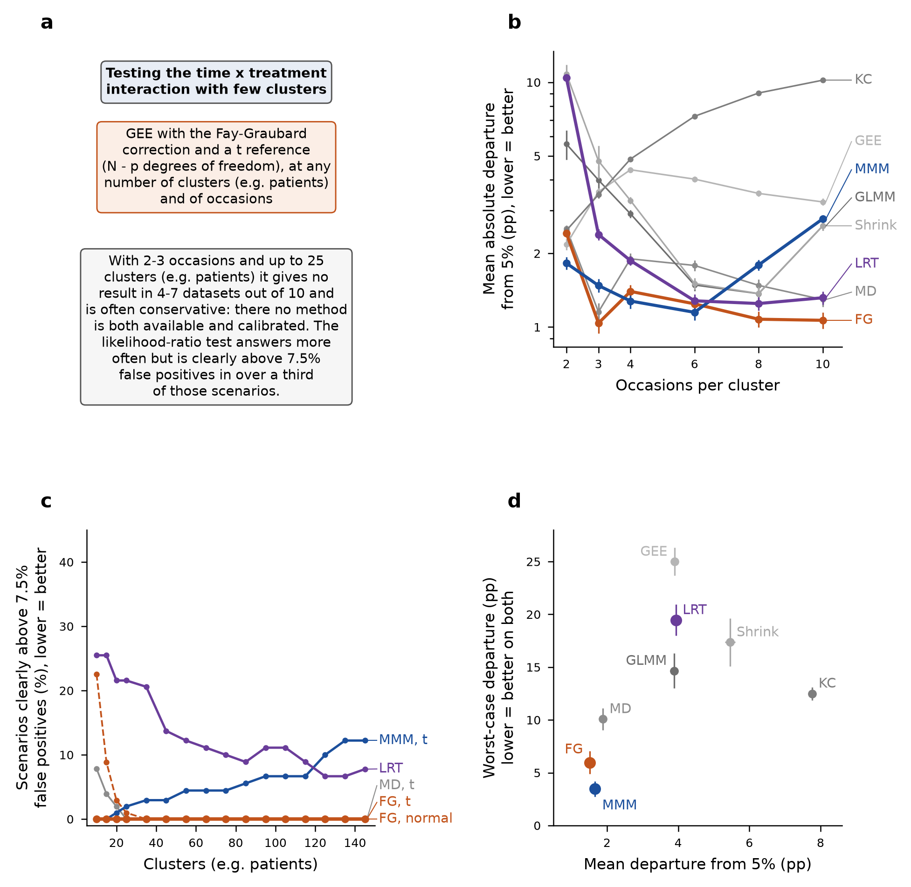
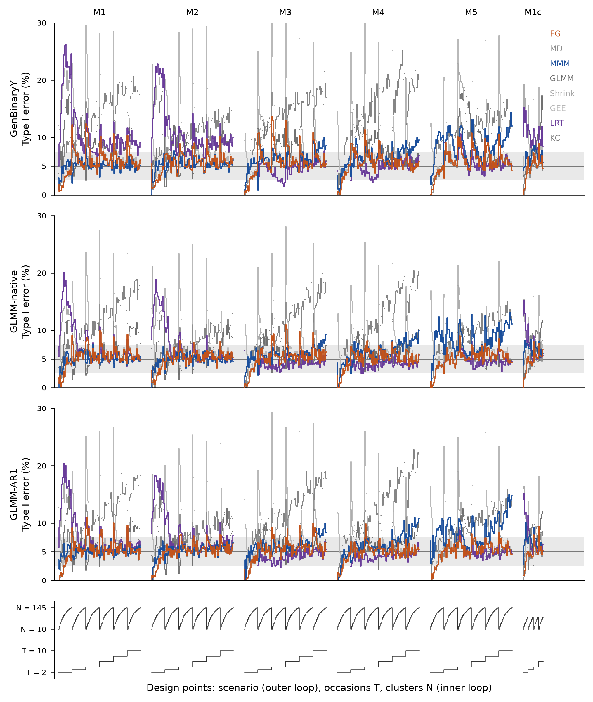

```{r setup}
.libPaths(path.expand("~/MMM/renv/library/linux-ubuntu-noble/R-4.6/x86_64-pc-linux-gnu"))
suppressMessages({ library(data.table) })
REPO <- path.expand("~/MMM"); TAB <- file.path(REPO, "tables")
m5 <- function(f) unname(tools::md5sum(file.path(REPO, f)))
rd <- function(f) fread(file.path(TAB, f))
TABC <- file.path(REPO, "tables/variant_cc"); rdc <- function(f) fread(file.path(TABC, f))   # D-32 variant: primary tables
it <- function(x, d = 2) formatC(x, format = "f", digits = d, big.mark = ".", decimal.mark = ",")
md <- function(D) { h <- paste0("| ", paste(names(D), collapse = " | "), " |"); s <- paste0("|", paste(rep("---", ncol(D)), collapse = "|"), "|")
  b <- apply(D, 1, function(r) paste0("| ", paste(gsub("|", "\\|", r, fixed = TRUE), collapse = " | "), " |")); cat(c(h, s, b, ""), sep = "\n") }
sec <- function(file, head) {           # one section of the step file, so the summary exists once
  x <- readLines(file.path(REPO, file)); i <- which(x == paste("#", head)); if (!length(i)) return("")
  nxt <- which(grepl("^# ", x) & seq_along(x) > i); j <- if (length(nxt)) min(nxt) - 1 else length(x)
  x <- x[(i + 1):j]; x <- x[!grepl("^\\[\\^", x)]
  x <- gsub("\\]\\(/", "](../../docs/", gsub("\\]\\((\\.\\./)+", "](../../docs/", x))
  gsub("\\]\\(S([0-9])\\.md", "](../../docs/steps/S\\1.md", x) }
VAL <- rd("V4_S6_values.csv"); CM <- rd("V4_S6_m1c_claims.csv"); G <- rd("V4_S6_gates.csv"); E <- rd("V4_S6_expectations.csv")
RB <- rd("V4_S6_rule_branches.csv"); RR <- rd("V4_S6_rule_rates.csv"); UR <- rd("V4_S6_m1c_unusable_reasons.csv"); GX <- rd("V4_S6_m1c_glmer_extreme.csv")
CL5 <- rd("V4_S5_claims.csv"); G3 <- rd("V4_S6_g3.csv"); TC <- rd("V4_S6_table_cells.csv")
v <- function(nm, var = "m1c") VAL[variant == var & name == nm]
bb <- jsonlite::fromJSON(file.path(REPO, "reports/morris/S6_figures/S6_figures_bbox.json"))
g1 <- function(tag) { x <- readLines(file.path(REPO, sprintf("reports/morris/S6_logs/S6_g1_%s.log", tag)))[-1]; paste(sub("^G1 ", "", x), collapse = "; ") }
```

```{r insummary, results='asis'}
cat(sec("docs/steps/S6.md", "In breve"), sep = "\n")
```

## Dubbi rinviati {.unnumbered}

```{r rinvii, results='asis'}
cat(sec("docs/steps/S6.md", "Dubbi rinviati"), sep = "\n")
```

Lo step ha ricevuto un dubbio da [inferenza per blocchi (S5)](../../docs/steps/S5.md), la classificazione delle affermazioni nello scenario M1c: e' chiuso in questo step (sez. 3 e Tabella A1).

## 1. Cancelli e previsioni

Pre-registrati in `docs/steps/S6.md`, commit `a6d335e` (2026-10-18), prima di ogni calcolo.

```{r gates, results='asis'}
gx <- function(id) G[gate == id]
g3t <- G3[kind == "table"]; g3f <- G3[kind == "figure"]
ov <- sapply(bb[c("S6_fig1", "S6_nestedloop", "S6_zip")], function(z) length(z$overlaps) + length(z$outside))
T1 <- data.table(
  voce = c("G1 integrita'", "G2a motore = S5 (griglia principale)", "G2b rietichettatura M1c", "G2c classificazione copiata", "G3 numeri dai file", "G4 figure leggibili", "G5 completezza",
           sprintf("%s %s", E$id, E$quantity)),
  atteso = c("md5 invariati prima e dopo", "2.001 x 560 valori entro 1e-12", "93 valori di S5 entro 1e-12", "classi di S5 identiche", "0 discrepanze", "0 sovrapposizioni, 0 testi fuori", "71 righe con esito o motivo; >= 1.990 replicati finiti",
             E$expected),
  osservato = c(sprintf("prima: %s || dopo: %s", g1("pre"), g1("post")), gx("G2a")$result, gx("G2b")$result, gx("G2c")$result,
                sprintf("celle di tabella %d, discrepanze %d; valori di figura %d, discrepanze %d", nrow(g3t), g3t[ok == FALSE, .N], nrow(g3f), g3f[ok == FALSE, .N]),
                sprintf("%s: %d; %s: %d; %s: %d", names(ov)[1], ov[1], names(ov)[2], ov[2], names(ov)[3], ov[3]), gx("G5")$result,
                sprintf("%s [%s; %s]", it(E$est, 3), it(E$lo, 3), it(E$hi, 3))),
  esito = c("superato", fifelse(c(gx("G2a")$pass, gx("G2b")$pass, gx("G2c")$pass), "superato", "non superato"),
            if (all(G3$ok)) "superato (dopo la correzione dello strumento)" else "non superato", if (all(ov == 0)) "superato (dopo la correzione dello strumento)" else "non superato",
            fifelse(gx("G5")$pass, "superato", "non superato"), E$outcome),
  spiegazione = c("", "", "", "", "sez. 3, punto 4", "sez. 3, punto 5", "", "sez. 3, punto 1", rep("sez. 3, punto 1", 3), "", rep("", 3)))
md(T1)
```

L'intervallo dei margini era stato confrontato con 2 MCSE prima del calcolo: nessuna previsione e' risultata indeterminata.

### Rianalisi di MMM con controllo di convergenza

Attese registrate prima del calcolo (commit d5886f3); strategia della decisione [Il modello marginalizzato si analizza con un controllo di convergenza negli scenari con pendenza della deviazione standard latente (D-32)](../../docs/decisions/D-32.md). Le tabelle e le figure principali di questo report vengono dalla variante con controllo (`tables/variant_cc/`, `reports/morris/variant_cc/`); la versione dello studio resta come analisi di sensibilita' (appendice A5).

```{r ccgates, results='asis'}
md(rd("V4_S6cc_gates.csv")[, .(cancello = gate, superato = fifelse(pass, "si'", "no"), dettaglio = detail)])
P <- rd("V4_S6cc_preds.csv")
md(P[, .(attesa = id, quantita = what, celle = n_cells, stima = it(est, 2), `2 MCSE` = it(2 * mcse, 2), intervallo = sprintf("%s / %s", it(lo, 1), it(hi, 1)), esito = outcome)])
md(rd("V4_S6cc_integrity.csv")[, .(controllo = check, superato = fifelse(pass, "si'", "no"))])
```

G6 (parita' H0/H1) e G7 (md5 di `results_full/` prima e dopo) sono nei log `reports/morris/S6_logs/S6cc_parity.log`, `S6_g1_S6cc_pre.log`, `S6_g1_S6cc_post.log`: 0 discordanze. P12 indeterminata, spiegata: con T = 2-6 la strategia riduce l'errore di I tipo di circa 1 punto verso il 5% (T = 3-6: da 6,4-6,6% a 5,5-5,7%), e i punti chiaramente sotto 2,5% passano da 13 a 10 (`tables/V4_S6cc_cells.csv`).

```{r cccmp, results='asis'}
SFc <- fread(file.path(REPO, "tables/variant_cc/V4_S6_rule_safety.csv"))
g <- SFc[strategy %in% c("gee_fg|t", "mmm|t", "mmm|n", "gee_fg|n") & !is.na(N)][, grp := fcase(N <= 25, "N <= 25", N <= 55, "N 35-55", default = "N >= 65")]
G <- g[band %in% c("T2-3", "all"), .(punti = sum(n_dp), sopra = sum(n_hi), sotto = sum(n_lo), usabile = it(sum(pu * n_dp) / sum(n_dp), 1), potenza = it(sum(upow * n_dp) / sum(n_dp), 1)), by = .(band, grp, strategy)]
md(G[order(band, grp, strategy)])
CD <- rd("V4_S6cc_claims_diff.csv")
cat(sprintf("\nSotto-affermazioni del manoscritto che cambiano classe con la strategia: %d su %d (`tables/V4_S6cc_claims_diff.csv`).\n\n", nrow(CD), nrow(fread(file.path(REPO, "tables/variant_cc/V4_S5_claims.csv")))))
md(CD[, .(sotto_affermazione = name, studio = class_study, con_controllo = class_cc, stima_studio = it(est_study), stima_cc = it(est_cc))])
```

## 2. Figure

). (a) Regola raccomandata (proposta, in attesa della scelta del PI); N = numero di cluster (per esempio pazienti), p = numero di coefficienti della media. (b) Deviazione assoluta media dal 5% nominale, in punti percentuali, per numero di occasioni per cluster; media su scenari M1-M5, numeri di cluster e tre meccanismi di generazione; asse logaritmico; barre = stima +/- 2 MCSE (per blocchi, S5). (c) Percentuale di punti di disegno (griglia principale e M1c, tutte le lunghezze di serie) in cui la strategia supera chiaramente il 7,5% di falsi positivi, per numero di cluster. Chiaramente sopra = tasso di rifiuto - 2 MCSE > 7,5%, con MCSE binomiale del punto di disegno (radice di p(1 - p)/n, n = replicati usabili); i punti con meno di 20 replicati usabili non sono valutati. FG = GEE con correzione di Fay-Graubard, MD = Mancl-DeRouen, t = riferimento t con N - p gradi di liberta', normale = riferimento normale; LRT = rapporto di verosimiglianza sul modello misto. (d) Deviazione nel caso peggiore contro deviazione media dal 5%, sui dati GenBinaryY: tasso di rifiuto aggregato sui cinque scenari in ciascuna delle 96 combinazioni di N e T, poi massimo e media dello scarto da 5; barre = stima +/- 2 MCSE.](variant_cc/S6_figures/S6_fig1.png)

Cosa guardare: nel pannello c la linea arancione piena (Fay-Graubard con la t) resta a zero a ogni N; la tratteggiata (stessa correzione con la normale) e' al 22% a 10 cluster.

![Figura 2. Errore di I tipo in ogni punto di disegno (nested-loop plot); MMM con controllo di convergenza in M3-M5. Un valore per punto di disegno, ordinati per scenario (ciclo esterno), poi numero di occasioni T, poi numero di cluster N (per esempio pazienti) (ciclo interno, pannello in basso); le tre righe sono i meccanismi di generazione; a destra lo scenario ancorato alla coorte (M1c). Banda grigia: 2,5-7,5% (criterio di Bradley); linea: 5% nominale. In colore: FG = GEE con Fay-Graubard e riferimento t, MMM = modello marginalizzato multilivello, LRT = rapporto di verosimiglianza sul modello misto; in grigio gli altri metodi. Non disegnati i punti con meno di 20 replicati usabili; asse troncato al 30% (4 valori sopra).](variant_cc/S6_figures/S6_nestedloop.png)

```{r nl, results='asis'}
cat(sprintf("Punti non disegnati (meno di 20 replicati usabili): %d su %d; valori sopra il 30%% troncati: %d.\n\n", bb$nestedloop_clipped_above_30_and_hidden_below_min_obs[2],
            nrow(rd("V4_S6_nestedloop.csv")), bb$nestedloop_clipped_above_30_and_hidden_below_min_obs[1]))
```

Cosa guardare: il GEE senza correzione e Kauermann-Carroll (grigi) escono dalla banda a ogni ciclo di N; il LRT (viola) esce in alto a T = 2-3 in M1-M2 e in M1c; MMM (blu), con il controllo di convergenza, resta nella banda anche in M3-M5 con serie lunghe; nella versione dello studio (Figura S3, appendice A5) ne usciva in alto in M3-M5 a T >= 8.

![Figura S1 (supplemento). Zip plot degli intervalli di confidenza al 95% per l'interazione tempo x trattamento: dati GLMM-native, scenario M1, T = 4, ipotesi alternativa; righe = numero di cluster (10, 45, 145), colonne = metodi. Ogni linea orizzontale e' l'intervallo di un replicato, ordinati per centile di |z| = |stima - valore vero| / SE; linea verticale = valore vero; arancione = l'intervallo non contiene il valore vero; linea punteggiata = 95%; banda grigia = copertura stimata con il suo intervallo Monte Carlo al 95%.](variant_cc/S6_figures/S6_zip.png)

## 3. Dubbi aperti durante il lavoro e come si sono chiusi

```{r dubbi, results='asis'}
ur <- UR[grid == "M1c"]; out10 <- ur[reason == "|estimate| >= 10" & method %in% c("mmm", "gee", "glmer", "shrink"), range(pct)]
err <- ur[reason == "error / not converged" & method %in% c("gee_fg", "gee_md", "gee_kc"), range(pct)]
gx1 <- GX[grid == "M1c" & method == "glmer"]; gx2 <- GX[grid == "M1c" & method == "glmer_bobyqa"]
c16 <- CM[grepl("^C16a", name)]
cat(sprintf("1. **P1 e P2 smentite (spiegate).** In M1c il LRT resta molto piu' usabile degli altri a N <= 20 (C14a %s punti) e ha ancora 20-23 punti di vantaggio in validita' incondizionata a N = 10 (C23c). Le cause di inutilizzabilita' a N <= 20 nel braccio H0 (`tables/V4_S6_m1c_unusable_reasons.csv`): stime con |stima| >= 10 per MMM, GEE, GLMM e shrinkage (%s-%s%%) ed errori di geesmv per le tre correzioni (%s-%s%%). Il filtro del LRT chiede solo un p-value finito, quindi non ne risente. La previsione aveva assunto che i fallimenti nascessero dagli eventi rari; con la varianza dell'intercetta di 3,5 nascono dalla separazione.\n",
            it(CM[name == "C14a|all", est], 1), it(out10[1], 1), it(out10[2], 1), it(err[1], 1), it(err[2], 1)))
cat(sprintf("2. **Potenza size-adjusted del GLMM sotto il 5%% in M1c (anomalia, spiegata).** Nel GLMM-native a T = 6 il p critico della regola di aggiustamento vale circa 0. Fra i fit usabili del braccio H0 di M1c, quelli con p < 1e-10 sono %s-%s%% con l'ottimizzatore di default (SE mediano %s contro %s-%s di tutti i fit; con warning di convergenza in almeno il %s%%) e %s-%s%% con bobyqa (`tables/V4_S6_m1c_glmer_extreme.csv`). Dove superano il 5%% il quantile nullo e' degenere. Calcolata la sensibilita' bobyqa su tutto M1c: la differenza di potenza size-adjusted GLMM - FG (C16a) passa da %s a %s punti; il verso non cambia, la rilevanza si.\n",
            it(min(gx1$pct_extreme), 1), it(max(gx1$pct_extreme), 1), it(median(gx1$med_se_extreme), 4), it(min(gx1$med_se_all), 2), it(max(gx1$med_se_all), 2), it(min(gx1$warn_extreme), 0),
            it(min(gx2$pct_extreme), 1), it(max(gx2$pct_extreme), 1), paste(it(range(c16$est), 1), collapse = " / "), paste(it(range(c16$est_bobyqa), 1), collapse = " / ")))
cat("3. **La regola del v3 applicata al v4 (scelta del PI).** Il criterio dichiarato nella sez. 4.2 del v3 (massima validita' incondizionata per N) sceglie metodi fuori dalla banda di Bradley in alcuni rami (Tabella A3, seconda parte). Una prima proposta (soglia di taratura sui rami mediati) e' stata giudicata poco chiara dal PI; la proposta attuale giudica ogni strategia punto di disegno per punto di disegno (Tabella A3, prima parte). La scelta cambia il testo: va al PI.\n")
cat("4. **G3, strumento corretto.** Al primo passaggio il controllo saltava in silenzio le 2 celle senza valore (GLMM su GenBinaryY in copertura, \"n.a.\"): 910 celle invece di 912. Corretto, ora le controlla esplicitamente.\n")
cat("5. **G4, strumento corretto.** Il controllo geometrico, chiamato dopo il salvataggio a 300 dpi, confrontava riquadri a due risoluzioni e segnalava falsi \"fuori figura\"; e le etichette con linea guida (annotate) includevano la linea nel riquadro. Ora il controllo ridisegna alla risoluzione della figura e le etichette sono testo piu' linea separata. Dopo la correzione restavano due difetti veri (pannello a sovrapposto all'etichetta dell'asse di b, etichette di b troppo vicine), corretti nel layout.\n")
cat("6. **Script dei rami della regola, strumento corretto.** La prima versione sommava `NA` nelle celle con zero replicati usabili ed escludeva cosi' il LRT dai rami a T = 2-3; ora le celle vuote contano come fallimenti, come nella validita' incondizionata di S5.\n")
MD <- rd("V4_S6_mmm_diag_summary.csv")[method == "mmm"]; PS <- rd("V4_S6_mmm_se_probe_summary.csv")
r35 <- MD[scen %in% c("M3", "M4", "M5") & ntime >= 8, range(se_ratio)]; b35 <- MD[scen %in% c("M3", "M4", "M5") & ntime >= 8, range(abs_z_bias)]; rt35 <- MD[scen %in% c("M3", "M4", "M5") & ntime >= 8, range(rate)]
p3 <- PS[model == 3]
PO <- rd("V4_S6_mmm_bnd_pooled.csv"); P8 <- PO[model %in% 3:5 & Tb == "T>=8"]; PR <- rd("V4_S6_mmm_bnd_preds.csv"); RP <- rd("V4_S6_mmm_bnd_repro.csv")
CV <- rd("V4_S6_mmm_mech_conv.csv"); IL <- rd("V4_S6_mmm_iterlim.csv"); DS <- rd("V4_S6_mmm_modes_disp_T8.csv"); RC <- rd("V4_S6_mmm_rule_P8_cells.csv"); CO <- rd("V4_S6_mmm_mech_codes.csv")
mc <- function(p, n) 100 * sqrt(p / 100 * (1 - p / 100) / n)
cv3 <- CV[model == 3]; c3 <- function(cvv, nn) { r <- cv3[conv == cvv & N == nn]; stopifnot(nrow(r) == 1); r }
co8 <- CO[Tb == "T>=8" & model %in% 3:5, .(pct = sum(pct[code %in% c(2, 3, 4, 5)])), by = model]
c5 <- CO[Tb == "T>=8" & model %in% 3:5 & code == 5, range(pct)]; c23 <- CO[Tb == "T>=8" & model %in% 3:5 & code %in% c(2, 3), .(p = sum(pct)), by = model][, range(p)]
RC[, hi := rRule - 2 * mc(rRule, n) > 7.5][, hiA := rA - 2 * mc(rA, n) > 7.5][, lo := rRule + 2 * mc(rRule, n) < 2.5]
cat(sprintf("7. **Perche' MMM sale dopo 6 occasioni (Figura 1 b) e supera la soglia piu' spesso al crescere di N (Figura 1 c) (domanda del PI, spiegata).** Nelle celle M3-M5 con T >= 8 la distorsione media e' %s-%s errori standard, il rapporto SE del modello / SE empirico e' %s-%s e i rifiuti vanno da %s a %s%% (`tables/V4_S6_mmm_diag_summary.csv`). Un primo controllo su una cella (M3, N = 145, T = 10) ha escluso la formula dell'errore standard: l'SE robusto restituito da `mm()` da' %s%% di rifiuti contro %s%% (`tables/V4_S6_mmm_se_probe_summary.csv`). Per cercare la causa: rianalisi dei primi 200 replicati esistenti in M1, M3, M4, M5 x tre meccanismi x T = 2, 4, 6, 8, 10 x N = 10, 25, 55, 145, braccio H0 (48.000 dataset rigenerati con il loro seme, nessun dato nuovo; stime identiche a quelle salvate in %s dataset su %s; `R/s6/s6_mmm_boundary.R`), con attese registrate prima del calcolo (P5-P8, `docs/steps/S6.md`).\n\n",
  it(b35[1], 2), it(b35[2], 2), it(r35[1], 2), it(r35[2], 2), it(rt35[1], 1), it(rt35[2], 1), it(p3$rej_rob, 1), it(p3$rej_mod, 1), format(sum(RP$same_est), big.mark = "."), format(sum(RP$n_stored), big.mark = ".")))
cat("   *Causa.* `MMLB::mm` esponenzia ogni coefficiente della deviazione standard latente: con `lv.formula = ~time` la deviazione standard vale exp(a0) + exp(a1) t, quindi la pendenza e' forzata positiva e il valore 0 e' il bordo dello spazio dei parametri (a1 -> -infinito). In tutti e tre i generatori la pendenza vera e' circa 0,01 per occasione: in M3 e M4 la deviazione standard latente e' 1 + 0,01 t (GenBinaryY) o quella di un'intercetta e pendenza casuali con varianza della pendenza 0,001 (GLMM-native e GLMM-AR1); in M5 c'e' anche una pendenza per la dose. Il valore vero sta quindi vicino al bordo, e in molti dataset il massimo della verosimiglianza e' sul bordo. (Avevo letto prima a1 come pendenza su scala logaritmica e concluso che la variabile latente spariva: era sbagliato. La pendenza stimata exp(a1) ha mediana 0,08-0,13 nei tre scenari, 0,05-0,06 nei fit che convergono, e quartili da circa 0 a circa 1: e' stimata con grande incertezza attorno a un valore vero vicino a 0.)\n\n")
cat(sprintf("   *Cosa succede ai fit.* Con T >= 8, `nlm` non dichiara convergenza (codici 2-5) nel %s%% dei fit in M3, %s%% in M4, %s%% in M5 (`tables/V4_S6_mmm_mech_codes.csv`). I codici non pesano allo stesso modo. Il codice 4 (limite di 100 iterazioni) e' innocuo: rifatti con 2.000 iterazioni, convergono in mediana dopo 105-140 iterazioni e la stima dell'interazione non cambia, ne' i rifiuti (`tables/V4_S6_mmm_iterlim.csv`). Il danno viene da due modi di guasto. *Stima spostata* (codice 5, \"passo massimo superato\", la funzione tende a un asintoto in qualche direzione; %s-%s%% dei fit): l'SE e' giusto, uguale a quello del fit senza pendenza sullo stesso dataset, ma la stima si allontana dal massimo. *SE crollato* (codici 2-3, %s-%s%%): la stima e' giusta, l'SE e' meno della meta' di quello del fit senza pendenza.\n\n",
  it(co8[model == 3, pct], 0), it(co8[model == 4, pct], 0), it(co8[model == 5, pct], 0), it(c5[1], 0), it(c5[2], 0), it(c23[1], 1), it(c23[2], 1)))
d3 <- DS[model == 3]; dA <- DS[N == 145]; d10 <- DS[N == 10]
cat(sprintf("   *Perche' peggiora con N.* Con T >= 8 lo spostamento assoluto della stima nei fit con codice 5 non dipende da N (90esimo percentile %s-%s su tutte le celle), mentre l'errore standard dell'interazione scende da %s-%s (N = 10) a %s-%s (N = 145). Lo stesso spostamento vale quindi meno di 1 errore standard a N = 10 e %s-%s errori standard a N = 145, e i rifiuti dentro quei fit salgono da %s-%s%% a %s-%s%% (`tables/V4_S6_mmm_modes_disp_T8.csv`). In M3 i fit convergenti restano tarati a ogni N (%s%% a N = 25, %s%% a N = 145), i non convergenti no (%s%% e %s%%) (`tables/V4_S6_mmm_mech_conv.csv`).\n\n",
  it(min(DS$q90_abs), 2), it(max(DS$q90_abs), 2), it(min(d10$med_seB), 2), it(max(d10$med_seB), 2), it(min(dA$med_seB), 3), it(max(dA$med_seB), 3), it(min(dA$q90_rel), 1), it(max(dA$q90_rel), 1),
  it(min(d10$rejA), 0), it(max(d10$rejA), 0), it(min(dA$rejA), 0), it(max(dA$rejA), 0), it(c3(TRUE, 25)$rej, 1), it(c3(TRUE, 145)$rej, 1), it(c3(FALSE, 25)$rej, 1), it(c3(FALSE, 145)$rej, 1)))
MO <- rd("V4_S6_mmm_modes.csv")[model %in% 3:5 & N >= 25 & mode == "displaced", .(share = weighted.mean(share, n), rej = weighted.mean(rej, k)), by = .(model, ntime)]
fm <- function(m, v) paste(it(MO[model == m & ntime %in% c(4, 6, 8, 10)][order(ntime)][[v]], 0), collapse = " -> ")
cat(sprintf("   *Perche' peggiora con T.* Non perche' i guasti siano piu' frequenti: a N >= 25 la quota di fit con codice 5 da T = 4 a T = 10 va %s%% in M3, %s%% in M4, %s%% in M5. Cresce invece il loro peso, per la stessa ragione di N: l'errore standard dell'interazione tempo x trattamento si restringe con serie piu' lunghe, lo spostamento no; i rifiuti dentro quei fit vanno %s%% in M3, %s%% in M4, %s%% in M5 (`tables/V4_S6_mmm_modes.csv`). Non ho spiegato perche' i guasti siano piu' frequenti a T = 2-4.\n\n",
  fm(3, "share"), fm(4, "share"), fm(5, "share"), fm(3, "rej"), fm(4, "rej"), fm(5, "rej")))
cat(sprintf("   *Prova per intervento.* Sugli stessi dataset, il modello senza i termini di pendenza della deviazione standard latente (`lv.formula = ~1`) da' rifiuti fra %s e %s%% nelle nove combinazioni scenario x meccanismo con T >= 8 (studio: %s-%s%%). La regola registrata prima del calcolo (P8: se `nlm` non converge o la pendenza stimata e' sotto 0,001, si usa il fit senza pendenza) non e' chiaramente sopra 7,5%% in nessuna delle %d celle (con il fit dello studio: %d); %d celle sono chiaramente sotto 2,5%%, tutte con N = 10-25 e T = 2, come per gli altri metodi (`tables/V4_S6_mmm_rule_P8_cells.csv`). La regola funziona qui perche' la pendenza vera e' circa 0; quanto valga con una pendenza vera grande, il disegno non lo dice.\n\n",
  it(min(P8$rej_B), 1), it(max(P8$rej_B), 1), it(min(P8$rej_all), 1), it(max(P8$rej_all), 1), nrow(RC), sum(RC$hiA), sum(RC$lo)))
cat(sprintf("   *Attese.* P5 smentita: anche nei fit non al bordo il tasso supera la banda in M4-M5, perche' il criterio \"al bordo\" includeva il codice 4, innocuo, e non separava i due modi di guasto. P6 smentita: la quota di fit al bordo scende con N in %s delle 45 combinazioni. P7 smentita: in M1, senza pendenza, i fit non convergenti sono %s; le celle fuori banda sono quasi tutte prudenti a N = 10-25. P8 confermata. (`tables/V4_S6_mmm_bnd_preds.csv`)\n",
  sub("^.*: ([0-9]+) of ([0-9]+)$", "\\1", PR[id == "P6", detail]) |> (\(x) 45L - as.integer(x))(), gsub(".", ",", sub("^M1 non-convergence ([0-9.]+)%.*$", "\\1%", PR[id == "P7", detail]), fixed = TRUE)))

cat("\n   *Correzione.* Su decisione del PI, MMM in M3-M5 e' stato rianalizzato su tutti i dataset con la regola di ricaduta; risultati nella sezione 1, \"Rianalisi di MMM con controllo di convergenza\". Il PI ha escluso di presentare il problema come limite del software.\n")
```

## 4. Cosa e' girato

```{r run, results='asis'}
F <- c("results_v4/S6/s6_boot.rds", "results_v4/S6/s6_boot_m1c_boby.rds", "tables/V4_S6_values.csv", "tables/V4_S6_m1c_claims.csv", "tables/V4_S6_table_cells.csv",
       "reports/morris/S6_tables.md", "tables/V4_S6_nestedloop.csv", "tables/V4_S6_zip.csv", "tables/V4_S6_rule_branches.csv", "reports/morris/S6_figures/S6_figures_data.csv",
       sprintf("results_v4/S6/mmm_boundary_%s.rds", c("GenBinaryY", "GLMM-native", "GLMM-AR1")), sprintf("results_v4/S6/mmm_iterlim_%s.rds", c("GenBinaryY", "GLMM-native", "GLMM-AR1")), "tables/V4_S6_mmm_bnd_preds.csv", "tables/V4_S6_mmm_rule_P8_cells.csv")
md(data.table(file = F, md5 = vapply(F, m5, "")))
```

Script (ramo `morris-v4`): `R/s6/s6_run.R` (motore di S5 e quantita' aggiuntive su 2.001 replicati bootstrap, 3,6 minuti con 45 processi), `R/s6/s6_run_boby.R` (sensibilita' bobyqa su M1c, 3,2 minuti), `R/s6/s6_checks.R` (G2, G5, classificazione di M1c, previsioni), `R/s6/s6_tables.R`, `R/s6/s6_figdata.R`, `R/s6/s6_rule.R`, `R/s6/s6_m1c_reasons.R`, `R/s6/s6_m1c_glmer_extreme.R`, `R/s6/s6_check_g3.R`, `py/s6/s6_figures.py` (stile `tools/s6_figure.mplstyle`), `R/s6/s6_g1.sh`. Diagnostica di MMM (post hoc, su replicati esistenti rigenerati con il loro seme): `R/s6/s6_mmm_diag.R`, `s6_mmm_tail.R`, `s6_mmm_se_probe.R` (+ `_sum`), `s6_mmm_outlier.R`, `s6_mmm_boundary.R` (48.000 dataset, 3 processi da 33 core, circa 8 minuti) e `s6_mmm_boundary_sum.R`, `s6_mmm_mechanism.R`, `s6_mmm_iterlim.R` (+ `_sum`), `s6_mmm_modes.R`. Rianalisi con controllo di convergenza: `R/s6/s6_mmm_cc_run.R` (17.280 blocchi, circa 4,4 ore con 50 processi), `R/s6/s6cc_build.R` (G8-G10 e righe della variante), `R/s6/s6cc_pipeline.sh` (catena S4-S6 con `MMM_VARIANT=cc`), `R/s6/s6cc_compare.R` (P9-P12 e integrita'), `R/s6/s6cc_claims_diff.R`. Il test di parita' H0/H1 non si applica: lo step non genera dati nuovi. Decisione tecnica: [Regole tecniche di tabelle e figure (D-28)](../../docs/decisions/D-28.md).

## Appendice

### A1. Affermazioni nello scenario M1c

```{r a1, results='asis'}
x <- CM[applicability == "applicabile", .(sotto_affermazione = name, stima = it(est), intervallo = sprintf("[%s; %s]", it(lo), it(hi)), margine = margin, classe_M1c = class, classe_griglia = class_main, bobyqa = fifelse(bobyqa_changes %in% TRUE, class_bobyqa, ""), n_req = fifelse(is.finite(n_req), it(n_req, 0), ""))]
md(x)
cat(sprintf("\nNon applicabili o escluse: %s.\n\n", paste(sprintf("%s (%s)", CM[applicability != "applicabile", name], CM[applicability != "applicabile", reason]), collapse = "; ")))
md(CM[applicability == "applicabile", .N, by = .(classe = class)][order(-N)])
```

### A2. Tabelle v4

Tutte le tabelle, griglia principale e M1c, con le MCSE: [`S6_tables.md`](S6_tables.md) (generato da `R/s6/s6_tables.R`).



### A3. Evidenza per la regola

**Strategie giudicate punto di disegno per punto di disegno**, con MMM con controllo di convergenza in M3-M5 (`tables/variant_cc/V4_S6_rule_safety.csv`, `R/s6/s6_rule_safety.R`): su 1.512 punti di disegno (griglia principale e M1c), quanti sono chiaramente sopra 7,5% (tasso - 2 MCSE > 7,5), chiaramente sotto 2,5%, non valutabili (meno di 20 replicati usabili); quota usabile media; potenza per tentativo (rifiuti nel braccio H1 sui replicati non degeneri).

```{r a3s, results='asis'}
SF <- rdc("V4_S6_rule_safety.csv"); RB <- rdc("V4_S6_rule_branches.csv"); RR <- rdc("V4_S6_rule_rates.csv")   # variant with convergence check (D-32)
x <- SF[is.na(N) & band == "all"][order(n_hi)]
md(x[, .(strategia = strategy, chiaramente_sopra = n_hi, chiaramente_sotto = n_lo, non_valutabili = n_na, stima_sopra_7.5 = n_point_above, tasso_max = it(max_rate, 1), usabile = it(pu, 1), potenza_per_tentativo = it(upow, 1))])
SD <- rdc("V4_S6_rule_safety_dp.csv")
g <- function(x) x[strategy %in% c("gee_fg|t", "gee_fg|n", "gee_md|t", "mmm|t", "glmer_lrt|n"), .(punti = .N, sopra = it(100 * mean(hi), 1), sotto = it(100 * mean(lo), 1), non_valutabili = it(100 * mean(!assess), 1), usabile = it(mean(pu), 1), potenza = it(mean(upow), 1)), by = strategy]
cat("\n**T = 2-3 e N <= 25** (percentuali dei punti di disegno)\n\n"); md(g(SD[N <= 25 & band == "T2-3"]))
cat("\n**N <= 25, tutte le T**\n\n"); md(g(SD[N <= 25]))
cat("\n**T = 2-3, tutte le N**\n\n"); md(g(SD[band == "T2-3"]))
```

**Rami del criterio del v3** (validita' incondizionata, pooled sui meccanismi), mantenuti per confronto:

Per ramo (N x serie corta T = 2-3 o lunga T >= 4), pooled sui meccanismi: metodo con la validita' incondizionata piu' alta, il suo margine sul secondo, il suo tasso di I tipo; metodo migliore fra quelli con tasso dentro 2,5-7,5% e quanto si rinuncia (`tables/V4_S6_rule_branches.csv`).

```{r a3, results='asis'}
md(RB[, .(griglia = grid, N, serie = fifelse(Tb == "T23", "T = 2-3", "T >= 4"), leader, margine = it(lead, 1), tasso = it(rate, 1), con_taratura = floor_best, tasso_taratura = it(rate_floor, 1), costo = it(cost, 1), meccanismi_concordi = n_mech_lead)])
```

### A4. Da dove vengono i numeri del riassunto

```{r a4, results='asis'}
PRc <- rd("V4_S6cc_preds.csv"); GTc <- rd("V4_S6cc_gates.csv"); CDc <- rd("V4_S6cc_claims_diff.csv")
VALc <- rdc("V4_S6_values.csv")[variant == "main"]; VALs <- VAL[variant == "main"]
mv <- function(V, nm) V[name == nm, est]
CL5c <- rdc("V4_S5_claims.csv"); SFc <- rdc("V4_S6_rule_safety.csv"); G3c <- rdc("V4_S6_g3.csv"); CMc <- rdc("V4_S6_m1c_claims.csv")
ovc <- function(st) SFc[strategy == st & is.na(N) & band == "all"]
grp <- function(st, bb, nlo, nhi) { x <- SFc[strategy == st & band == bb & !is.na(N) & N >= nlo & N <= nhi]; list(lo = sum(x$n_lo), n = sum(x$n_dp), pu = sum(x$pu * x$n_dp) / sum(x$n_dp)) }
cls <- function(D, pat) paste(D[grepl(pat, name), sprintf("%s %s", name, class)], collapse = "; ")
lrt25 <- rdc("V4_S6_rule_safety_dp.csv")[strategy == "glmer_lrt|n" & N <= 25]
fgs <- rdc("V4_S6_rule_safety_dp.csv")[strategy == "gee_fg|t" & band == "T2-3"]
hrs <- vapply(c("GenBinaryY", "GLMM-native", "GLMM-AR1"), function(g) { x <- readLines(file.path(REPO, sprintf("reports/morris/S6_logs/S6cc_run_%s.log", g))); x[length(x)] }, "")
S <- data.table(
  frase = c("1,69 milioni di dataset; il fit dello studio si riproduce esattamente",
            "nessuna delle 864 situazioni chiaramente sopra 7,5 (prima 138)",
            "con 8-10 visite lo scarto medio scende da 1,8-2,8 a 0,7 (Fay e Graubard 1,1)",
            "la capacita' di trovare un effetto vero resta praticamente la stessa",
            "cambiano 30 delle 156 frasi di confronto",
            "non regge piu': FG piu' vicina al 5% in media; FG meno situazioni fuori taratura; MMM piu' falsi positivi di FG",
            "resta e si rafforza: MMM sbaglia di meno nella situazione peggiore; con la t FG migliore nella peggiore (scala della popolazione)",
            "912 numeri delle tabelle e 12.261 valori delle figure riletti",
            "1.512 situazioni simulate",
            "dati reali: MMM non e' piu' il migliore nella situazione peggiore; circa 2 falsi positivi su 100 piu' di FG",
            "dati reali: 4-5 volte su 100 in piu'; 1,4-2,5 con bobyqa",
            "FG con t e MMM corretto con t: mai chiaramente sopra 7,5 in 1.512 situazioni",
            "FG risponde 92 dataset su 100, MMM 91",
            "2-3 visite, 35-55 soggetti: troppo prudente in 3 situazioni su 102 (MMM) contro 28 (FG)",
            "LRT chiaramente sopra in 216 situazioni; la regola del paper lo raccomanderebbe fino a 25 soggetti",
            "2-3 visite, fino a 25 soggetti: FG non da' risultato in 4-7 dataset su 10; MMM meno prudente ma risponde meno",
            "criterio del paper alla lettera: test sopra la soglia in quasi 1 situazione su 4",
            "12 confronti che nello scenario sui dati reali non si distinguono dal caso",
            "rianalisi circa 4,4 ore con 50 processori"),
  fonte = c("V4_S6cc_gates.csv, G8", "V4_S6cc_preds.csv, P10", "V4_S6_values.csv (studio e variant_cc), madT1 mmm 8, 10 e gee_fg", "V4_S6cc_preds.csv, P11",
            "V4_S6cc_claims_diff.csv; variant_cc/V4_S5_claims.csv", "variant_cc/V4_S5_claims.csv, C02, C10b, C03", "variant_cc/V4_S5_claims.csv, C01, C17c|GB",
            "variant_cc/V4_S6_g3.csv", "variant_cc/V4_S6_nestedloop.csv", "variant_cc/V4_S6_m1c_claims.csv, C01 e C03", "variant_cc/V4_S6_m1c_claims.csv, C16a",
            "variant_cc/V4_S6_rule_safety.csv, gee_fg|t e mmm|t, totale", "variant_cc/V4_S6_rule_safety.csv, pu, totale", "variant_cc/V4_S6_rule_safety.csv, T2-3, N 35-55",
            "variant_cc/V4_S6_rule_safety.csv, glmer_lrt|n; variant_cc/V4_S5_claims.csv, C23a", "variant_cc/V4_S6_rule_safety(_dp).csv, T2-3, N <= 25",
            "variant_cc/V4_S6_rule_safety_dp.csv, glmer_lrt|n, N <= 25", "variant_cc/V4_S6_m1c_claims.csv", "reports/morris/S6_logs/S6cc_run_*.log"),
  valore = c(GTc[gate == "G8", detail],
             PRc[id == "P10", sprintf("%s su %d; %s", est, n_cells, what)],
             sprintf("studio %s / %s; con controllo %s / %s; FG %s / %s", it(mv(VALs, "madT1|mmm|8")), it(mv(VALs, "madT1|mmm|10")), it(mv(VALc, "madT1|mmm|8")), it(mv(VALc, "madT1|mmm|10")), it(mv(VALc, "madT1|gee_fg|8")), it(mv(VALc, "madT1|gee_fg|10"))),
             PRc[id == "P11", sprintf("%s punti (MCSE %s)", it(est), it(mcse, 3))],
             sprintf("%d cambiate su %d", nrow(CDc), nrow(CL5c)),
             cls(CL5c, "^C02\\||^C10b\\||^C03\\|"), cls(CL5c, "^C01\\||^C17c\\|GB"),
             paste(G3c[, .(n = .N, fail = sum(!ok)), by = kind][, sprintf("%s %d controllati, %d falliti", kind, n, fail)], collapse = "; "),
             sprintf("%d punti di disegno", uniqueN(rdc("V4_S6_nestedloop.csv")[, .(dgp, scen, N, ntime)])),
             paste(CMc[grepl("^C01\\||^C03\\|", name), sprintf("%s %s (%s)", name, it(est), class)], collapse = "; "),
             paste(CMc[grepl("^C16a", name), sprintf("%s %s / bobyqa %s", name, it(est), it(est_bobyqa))], collapse = "; "),
             sprintf("FG t %d, MMM t %d chiaramente sopra su %d", ovc("gee_fg|t")$n_hi, ovc("mmm|t")$n_hi, ovc("mmm|t")$n_dp),
             sprintf("FG t %s%%, MMM t %s%%", it(ovc("gee_fg|t")$pu, 1), it(ovc("mmm|t")$pu, 1)),
             sprintf("MMM %d, FG %d su %d", grp("mmm|t", "T2-3", 35, 55)$lo, grp("gee_fg|t", "T2-3", 35, 55)$lo, grp("mmm|t", "T2-3", 35, 55)$n),
             sprintf("LRT %d; %s", ovc("glmer_lrt|n")$n_hi, paste(CL5c[grepl("^C23a\\|", name), sprintf("%s %s", name, est)], collapse = "; ")),
             sprintf("FG usabile %s%% (N 10-15), %s%% (N 20-25); prudenti FG %d, MMM %d su %d; usabile FG %s%%, MMM %s%%", it(mean(fgs[N %in% c(10, 15)]$pu), 1), it(mean(fgs[N %in% c(20, 25)]$pu), 1),
                     grp("gee_fg|t", "T2-3", 10, 25)$lo, grp("mmm|t", "T2-3", 10, 25)$lo, grp("mmm|t", "T2-3", 10, 25)$n, it(grp("gee_fg|t", "T2-3", 10, 25)$pu, 1), it(grp("mmm|t", "T2-3", 10, 25)$pu, 1)),
             sprintf("sopra %s%% di %d punti", it(100 * mean(lrt25$hi), 1), nrow(lrt25)),
             sprintf("%d non risolte su %d applicabili", CMc[applicability == "applicabile" & class == "non risolta", .N], CMc[applicability == "applicabile", .N]),
             paste(sub("^.*done: ", "", hrs), collapse = " | ")))
md(S)
```

Nota: "chiaramente" = tasso - 2 MCSE > 7,5 nel punto di disegno ([Regole tecniche di tabelle e figure (D-28)](../../docs/decisions/D-28.md), punto 8). La potenza per tentativo conta come mancata scoperta anche i dataset senza risultato.

### A5. Versione dello studio (analisi di sensibilita')

Le stesse figure con MMM analizzato come nello studio, senza controllo di convergenza.




