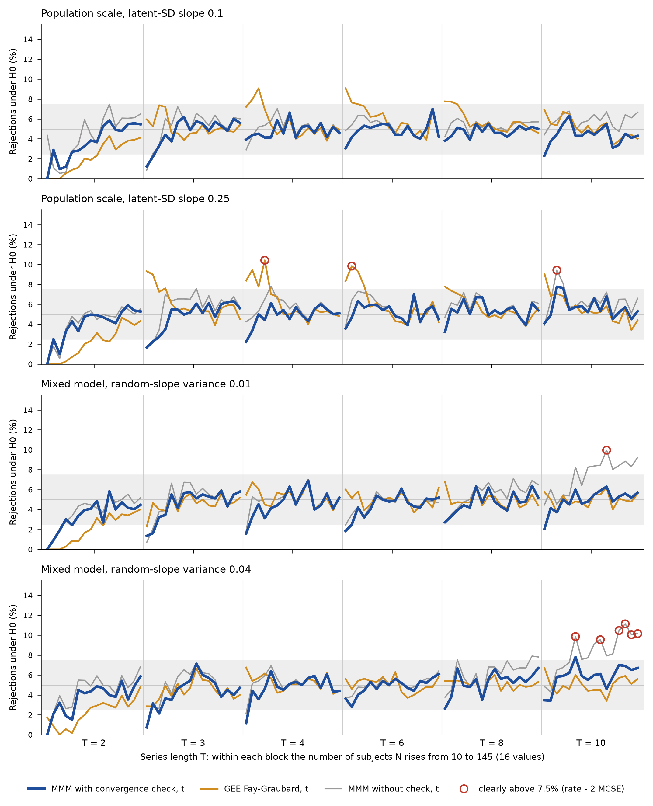

```{r setup}
.libPaths(path.expand("~/MMM/renv/library/linux-ubuntu-noble/R-4.6/x86_64-pc-linux-gnu"))
suppressMessages({ library(data.table) })
REPO <- path.expand("~/MMM"); TAB <- file.path(REPO, "tables")
rd <- function(f) fread(file.path(TAB, f))
it <- function(x, d = 2) formatC(x, format = "f", digits = d, big.mark = ".", decimal.mark = ",")
md <- function(D) { h <- paste0("| ", paste(names(D), collapse = " | "), " |"); s <- paste0("|", paste(rep("---", ncol(D)), collapse = "|"), "|")
  b <- apply(D, 1, function(r) paste0("| ", paste(gsub("|", "\\|", r, fixed = TRUE), collapse = " | "), " |")); cat(c(h, s, b, ""), sep = "\n") }
sec <- function(file, head) {
  x <- readLines(file.path(REPO, file)); i <- which(x == paste("#", head)); if (!length(i)) return("")
  nxt <- which(grepl("^# ", x) & seq_along(x) > i); j <- if (length(nxt)) min(nxt) - 1 else length(x)
  x <- x[(i + 1):j]; x <- x[!grepl("^\\[\\^", x)]
  x <- gsub("\\]\\(/", "](../../docs/", gsub("\\]\\((\\.\\./)+", "](../../docs/", x))
  gsub("\\]\\(S([0-9a-z]+)\\.md", "](../../docs/steps/S\\1.md", x) }
GA <- rd("V4_S6b_thr_gates.csv"); PA <- rd("V4_S6b_thr_preds.csv"); INV <- rd("V4_S6b_thr_inventory.csv"); FLP <- rd("V4_S6b_thr_flips.csv")
RUL <- rd("V4_S6b_thr_rule.csv"); INT <- rd("V4_S6b_thr_integrity.csv"); CEL <- rd("V4_S6b_thr_cells.csv")
GBp <- rd("V4_S6b_ns_gates_pre.csv"); GBq <- rd("V4_S6b_ns_gates_post.csv"); PB <- rd("V4_S6b_ns_preds.csv"); FB <- rd("V4_S6b_ns_fallback.csv")
RS <- rd("V4_S6b_ns_rule_safety.csv"); DP <- rd("V4_S6b_ns_dp.csv"); TR <- rd("V4_S6b_ns_truth.csv"); MD <- rd("V4_S6b_md5_check.csv")
scn <- function(d, s) paste0(fifelse(d == "GenBinaryY", "scala della popolazione", "modello misto"), ", ", fcase(d == "GenBinaryY" & s == "M6", "pendenza 0,1", d == "GenBinaryY" & s == "M7", "pendenza 0,25", d != "GenBinaryY" & s == "M6", "varianza 0,01", default = "varianza 0,04"))
```

```{r insummary, results='asis'}
cat(sec("docs/steps/S6b.md", "In breve"), sep = "\n")
```

## Dubbi rinviati {.unnumbered}

```{r rinvii, results='asis'}
cat(sec("docs/steps/S6b.md", "Dubbi rinviati"), sep = "\n")
```

Lo step ha ricevuto tre dubbi da [tabelle e figure (S6)](../../docs/steps/S6.md): la soglia "al bordo" (sez. 2), il nuovo scenario (sez. 3) e la regola della Figura 1 (riassunto).

## 1. Cancelli e previsioni

Parte A pre-registrata nel commit `9f298a3`, parte B nel commit `2ff6dae` (2026-10-19), prima di ogni calcolo della parte corrispondente.

```{r gates, results='asis'}
G <- rbind(GA[, .(voce = gate, esito = fifelse(pass, "superato", "FALLITO"), dettaglio = detail)],
           data.table(voce = "GA1", esito = "superato", dettaglio = "test_h0h1_parity.R: Q2 D-02 8/8 PASS (log S6b_logs/GA1_parity.log)"),
           data.table(voce = "GA2 e GB5 (md5)", esito = fifelse(all(MD$same), "superato", "FALLITO"), dettaglio = MD[, paste(sprintf("%s: %d file, %d diversi", group, n, n_diff), collapse = "; ")]),
           INT[, .(voce = paste("GA5", variant), esito = fifelse(pass, "superato", "FALLITO"), dettaglio = check)],
           GBp[, .(voce = gate, esito = fifelse(pass, "superato", "FALLITO"), dettaglio = detail)],
           GBq[, .(voce = gate, esito = fifelse(pass, "superato", "FALLITO"), dettaglio = detail)])
md(G)
P <- rbind(PA[, .(id, caso = fifelse(variant == "t4", "soglia 0,0001", "soglia 0,01"), atteso = it(expected, 1),
                  intervallo = paste(it(lo, 1), "a", it(hi, 1)), osservato = fifelse(mcse > 0, paste0(it(est, 3), " +/- ", it(2 * mcse, 3)), it(est, 0)), esito = outcome)],
           PB[, .(id, caso = scenario, atteso = it(expected, 1), intervallo = paste(it(lo, 1), "a", it(hi, 1)),
                  osservato = fifelse(!is.na(mcse) & mcse > 0, paste0(it(est, 2), " +/- ", it(2 * mcse, 2)), it(est, 1)), esito = outcome)])
md(P)
```

## 2. Parte A: la soglia della regola non conta

```{r partA, results='asis'}
md(INV[, .(voce = item, n = format(n, big.mark = "."))])
md(FLP[, .(cambio = change, braccio = fifelse(label == "manual", "H0", "H1"), fit = n, `mediana |stima A - stima B| / SE` = signif(med_abs_dz, 2),
           `99° percentile` = signif(q99_abs_dz, 2), `SE B / SE A (mediana)` = signif(med_se_ratio, 4), `rifiuti A` = rej_A, `rifiuti B` = rej_B,
           `solo A` = flip_A_only, `solo B` = flip_B_only)])
md(RUL[, .(soglia = fcase(variant == "t4", "0,0001", variant == "cc", "0,001 (principale)", default = "0,01"), strategia = strategy, `chiaramente sopra 7,5%` = n_hi,
           `chiaramente sotto 2,5%` = n_lo, `risponde (%)` = it(pu, 2), `potenza per tentativo (%)` = it(upow, 2), `tasso massimo (%)` = it(max_rate, 1))][order(strategia, soglia)])
```

## 3. Parte B: nuovo scenario con pendenza grande

```{r partB, results='asis'}
md(FB[band == "all", .(scenario = scn(dgp, scen), braccio = arm, fit = format(n, big.mark = "."), `al bordo (%)` = it(100 * at_boundary, 1), `regola usata (%)` = it(100 * used_B, 1),
       `non convergenti (%)` = it(100 * nonconv, 1), `pendenza < 0,001 (%)` = it(100 * small_slope, 1), `rifiuti con la regola usata (%)` = it(100 * rej_B, 1), `rifiuti con il fit dello studio tenuto (%)` = it(100 * rej_A_kept, 1))])
md(RS[is.na(band) & dgp != "all" & strategy %in% c("mmm|t", "mmm|n", "mmm_nocc|t", "mmm_nocc|n", "gee_fg|t", "gee_md|t", "glmer_lrt|n", "glmer|n"),
      .(strategia = strategy, scenario = scn(dgp, scen), punti = n_dp, `chiaramente sopra 7,5%` = n_hi, `chiaramente sotto 2,5%` = n_lo, `tasso massimo (%)` = it(max_rate, 1),
        `risponde (%)` = it(pu, 1), `potenza per tentativo (%)` = it(upow, 1))][order(strategia, scenario)])
md(TR[dgp == "GLMM-native", .(scenario = scn(dgp, scen), T = ntime, braccio = fifelse(label == "manual", "H0", "H1"), `valore vero marginale` = signif(tm, 3), `valore vero condizionato` = tc)])
```



Cosa guardare: la linea blu (MMM con controllo) resta nella banda o sotto in tutti i punti; la linea arancione (Fay e Graubard) esce con 10-25 soggetti nello scenario con pendenza 0,25; la linea grigia (MMM senza controllo) esce con 10 visite nel modello misto.

```{r partB2, results='asis'}
RA <- rd("V4_S6b_rule_all.csv")
md(RA[strategy %in% c("mmm|t", "gee_fg|t", "mmm|n", "gee_md|t", "glmer_lrt|n"), .(strategia = strategy, insieme = fifelse(sub == "all", src, paste(src, sub)), punti = n_dp,
      `chiaramente sopra 7,5%` = n_hi, `chiaramente sotto 2,5%` = n_lo, `tasso massimo (%)` = it(max_rate, 1), `risponde (%)` = it(pu, 1), `potenza per tentativo (%)` = it(upow, 1))])
FD <- rd("V4_S6b_ns_diag_fallback.csv")
md(FD[arm == "H0", .(scenario = scn(dgp, scen), N = Ng, T = band, `regola usata (%)` = it(used_B, 1), `non convergenti (%)` = it(nonconv, 1),
      `convergono con pendenza < 0,001 (%)` = it(small_slope_conv, 1), `codice 3 / 4 / 5 (%)` = paste(it(code3, 1), it(code4, 1), it(code5, 1), sep = " / "), `rifiuti con la regola usata (%)` = it(rej_B_H0, 1))])
```

## 4. Dubbi aperti durante il lavoro e come si sono chiusi

1. **Tre errori degli strumenti, corretti.** (a) Lo script di costruzione della parte A falliva su una colonna di join senza prefisso: corretto prima di ogni numero. (b) GB1 confrontava le formule con il loro ambiente, che e' diverso a ogni chiamata, e risultava sempre "diverso": ora le confronta come testo; il cancello passa con 32 confronti su 32. (c) GB4 non creava le combinazioni metodo-punto senza righe (n = 0), che lo studio invece ha: ora le crea; il cancello passa con 3.072 righe su 3.072.
2. **GB3 come scritto e' fallito; spiegato.** I 365 replicati senza una riga sono analisi che restituiscono un fit senza il termine testato (sez. 1, voce GB3b): il controllo non contava questo esito. Le misure non cambiano, perche' quei fit sono non utilizzabili in ogni caso.
3. **PB1 e PB3 smentite, PB4 indeterminata: spiegate** nella sezione "Esito delle attese" del file dello step e nelle tabelle della sezione 3.
4. **Temperatura del server.** Con circa 33 processi la CPU ha raggiunto 94 C; il run e' stato portato a 16 processi e poi regolato da un controllo automatico (sopra 90 C meno 4, sotto 82 C piu' 2, massimo 28). Nessun blocco interrotto, salvo i blocchi in corso al limite di tempo del primo lavoro (riscritti dal rilancio).
5. **Controllo del codice su dati parziali.** Prima della fine del run lo script di aggregazione e' stato provato su 300 blocchi; l'ultima riga stampata mostrava valori parziali delle previsioni. Le attese erano gia' committate e non sono cambiate.

## 5. Cosa e' girato

```{r ran, results='asis'}
md(data.table(cosa = c("Parte A: fit per la soglia 0,01", "Parte A: varianti e catena S4-S6", "Parte A: confronto", "Parte B: cancelli prima del run", "Parte B: run (768.000 dataset)", "Parte B: aggregazione e diagnostica"),
  script = c("R/s6b/s6b_thr_job.sh, s6b_thr_run.R", "R/s6b/s6b_thr_pipeline.sh, s6b_thr_build.R", "R/s6b/s6b_thr_compare.R, s6b_thr_flips.R", "R/s6b/s6b_ns_gates_pre.R",
             "R/s6b/s6b_ns_run.R, s6b_ns_common.R, s6b_thermal_guard.sh", "R/s6b/s6b_ns_agg.R, s6b_ns_agg_lib.R, s6b_ns_diag.R, s6b_rule_all.R"),
  durata = c("5,3 min (48 processi)", "circa 70 min", "pochi minuti", "circa 7 min", "23,1 h (16-28 processi)", "pochi minuti")))
```

Pre-registrazione: commit `9f298a3` (parte A), `2ff6dae` (parte B e decisione D-34). Risultati della parte A: commit `baf1a55`. md5: `tables/V4_S6b_md5_check.csv`.

## Appendice

### A1. Da dove vengono i numeri del riassunto

```{r sources, results='asis'}
src <- data.table(frase = c(
  "circa 20.000 dei 1,69 milioni di dataset", "si spostano al più di circa un millesimo di test su 100", "nessuna delle 156 frasi cambia",
  "768.000 dataset; 384 situazioni nuove", "deviazione standard latente da 1 a 1,9 o 3,25; 10 o 40 volte piu' variabile", "non supera mai chiaramente 7,5 (scenari nuovi)",
  "in media da 5,2 a 5,8 su 100", "senza correzione: 8 situazioni", "un dataset su tre fino a uno su due", "con molti soggetti e 8-10 visite 6-37 su 100",
  "dove interviene, falsi positivi 5 su 100", "capacita' cala meno di mezzo test su 100", "Fay e Graubard da 7 a 10 su 100 con fino a 25 soggetti",
  "due situazioni, 10 su 100", "unica strategia mai chiaramente sopra (1.896)", "91 contro 92; 77 contro 116; 21 contro 20,5", "2-3 visite, fino a 25 soggetti: 4 su 10, meno di 2 su 100",
  "valore vero fino a -0,008", "23 ore"),
  fonte = c("V4_S6b_thr_inventory.csv righe 2-3; cc_all.rds 1.685.204 fit", "V4_S6b_thr_preds.csv PA1-PA3, |est| massimo", "V4_S6b_thr_preds.csv PA6",
  "V4_S6b_ns_gates_post.csv GB3; V4_S6b_ns_rule_safety_dp.csv", "D-34; generatori: sigma = (1; 0,1), (1; 0,25), 1 + s*9; varianza 0,01 e 0,04 contro 0,001", "V4_S6b_ns_preds.csv PB2",
  "V4_S6b_ns_preds.csv PB4", "V4_S6b_ns_rule_safety_dp.csv, mmm_nocc|t, hi", "V4_S6b_ns_preds.csv PB1 (H0)", "V4_S6b_ns_diag_fallback.csv, H0, N65-145, T8-10",
  "V4_S6b_ns_fallback.csv rej_B (H0)", "V4_S6b_ns_preds.csv PB6", "V4_S6b_ns_rule_safety_dp.csv, gee_fg|t, GenBinaryY M7, N <= 25, T >= 3",
  "V4_S6b_ns_rule_safety_dp.csv, gee_fg|t, hi", "V4_S6b_rule_all.csv, tutti, all", "V4_S6b_rule_all.csv mmm|t e gee_fg|t, tutti, all", "V4_S6b_rule_all.csv, T2-3 N<=25",
  "V4_S6b_ns_truth.csv GLMM-native M7 T 10 manual", "run_progress.log: 16,7 h + 6,38 h"))
P <- rd("V4_S6b_ns_preds.csv"); TA <- rd("V4_S6b_thr_preds.csv"); FBa <- FB[band == "all" & arm == "H0"]; DPs <- rd("V4_S6b_ns_rule_safety_dp.csv"); RA <- rd("V4_S6b_rule_all.csv")
FD <- rd("V4_S6b_ns_diag_fallback.csv")
fgm <- DPs[strategy == "gee_fg|t" & dgp == "GenBinaryY" & scen == "M7" & N <= 25 & ntime >= 3]
ra <- function(s, sb = "all") RA[strategy == s & src == "tutti" & sub == sb]
src[, valore := c(
  sprintf("%d; %d", INV$n[2], INV$n[3]), it(TA[id %in% c("PA1", "PA2", "PA3"), max(abs(est))], 4), paste(TA[id == "PA6", est], collapse = "/"),
  sprintf("%s; %d punti", regmatches(GBq[gate == "GB3", detail], regexpr("[0-9]+ replicates with rows", GBq[gate == "GB3", detail])), DPs[strategy == "mmm|t", .N]), "1,9; 3,25; 10; 40", it(P[id == "PB2", est], 0),
  paste(it(range(P[id == "PB4", est]), 2), collapse = "-"), DPs[strategy == "mmm_nocc|t", sum(hi)], paste(it(range(P[id == "PB1", est]), 1), collapse = "-"),
  paste(it(range(FD[arm == "H0" & Ng == "N65-145" & band == "T8-10", used_B]), 1), collapse = "-"), paste(it(range(100 * FBa$rej_B), 2), collapse = "-"),
  paste(it(range(P[id == "PB6", est]), 2), collapse = " / "), paste(it(range(fgm$rate), 1), collapse = "-"), paste(it(DPs[strategy == "gee_fg|t" & hi == TRUE, rate], 1), collapse = "; "),
  sprintf("mmm|t %d; gee_fg|t %d", ra("mmm|t")$n_hi, ra("gee_fg|t")$n_hi), sprintf("%s/%s; %d/%d; %s/%s", it(ra("mmm|t")$pu, 1), it(ra("gee_fg|t")$pu, 1), ra("mmm|t")$n_lo, ra("gee_fg|t")$n_lo, it(ra("mmm|t")$upow, 1), it(ra("gee_fg|t")$upow, 1)),
  sprintf("risponde %s/%s; potenza %s/%s", it(ra("mmm|t", "T2-3 N<=25")$pu, 1), it(ra("gee_fg|t", "T2-3 N<=25")$pu, 1), it(ra("mmm|t", "T2-3 N<=25")$upow, 2), it(ra("gee_fg|t", "T2-3 N<=25")$upow, 2)),
  it(TR[dgp == "GLMM-native" & scen == "M7" & ntime == 10 & label == "manual", tm], 4), "23,1 h")]
md(src)
```
