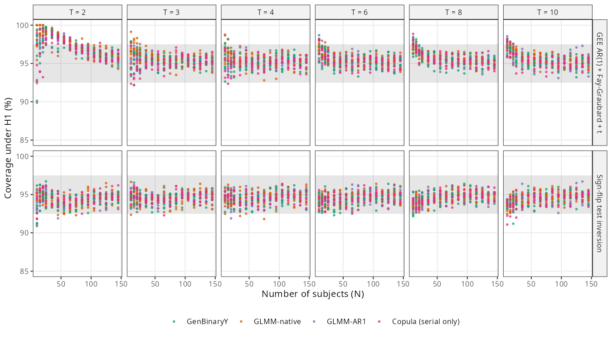
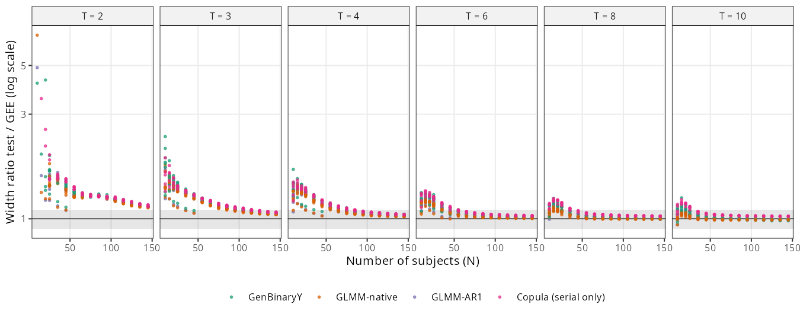
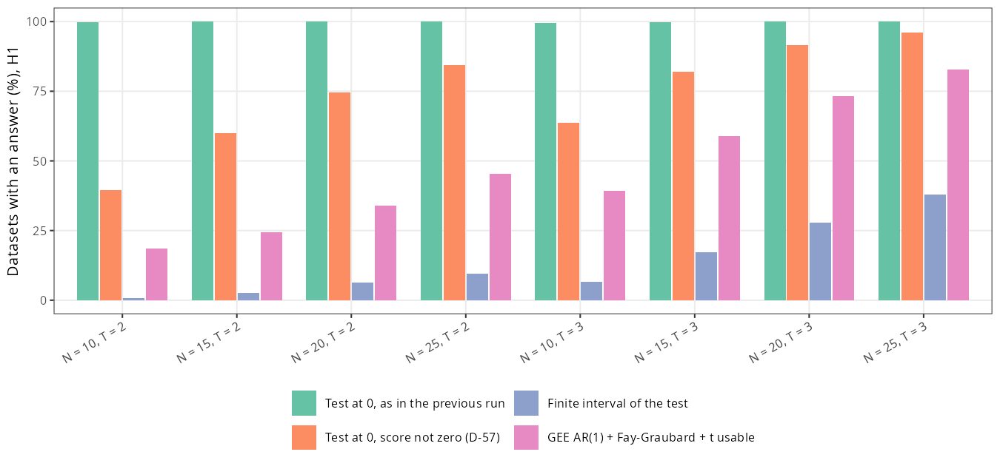

```{r setup}
.libPaths(path.expand("~/MMM/renv/library/linux-ubuntu-noble/R-4.6/x86_64-pc-linux-gnu"))
suppressMessages({ library(data.table) })
REPO <- path.expand("~/MMM"); TAB <- file.path(REPO, "tables")
md <- function(D) { D <- as.data.frame(D); for (j in seq_along(D)) if (is.numeric(D[[j]])) D[[j]] <- format(signif(D[[j]], 4), trim = TRUE, drop0trailing = TRUE)
  h <- paste0("| ", paste(names(D), collapse = " | "), " |"); s <- paste0("|", paste(rep("---", ncol(D)), collapse = "|"), "|")
  b <- apply(D, 1, function(r) paste0("| ", paste(gsub("|", "\\|", r, fixed = TRUE), collapse = " | "), " |")); cat(c(h, s, b, ""), sep = "\n") }
sec <- function(file, head, level = 1) {
  x <- readLines(file.path(REPO, file)); pat <- paste(strrep("#", level), head); i <- which(x == pat); if (!length(i)) return(""); i <- max(i)
  nxt <- which(grepl(paste0("^", strrep("#", level), " "), x) & seq_along(x) > i); j <- if (length(nxt)) min(nxt) - 1 else length(x)
  x <- x[(i + 1):j]; x <- x[!grepl("^\\[\\^", x)]
  x <- gsub("\\]\\(/", "](../../docs/", gsub("\\]\\((\\.\\./)+", "](../../docs/", x))
  gsub("\\]\\(S([0-9a-z]+)\\.md", "](../../docs/steps/S\\1.md", x) }
PR <- fread(file.path(TAB, "V4_S7d2_predictions.csv")); BM <- fread(file.path(TAB, "V4_S7d2_boot_means.csv")); GT <- fread(file.path(TAB, "V4_S7d2_gates.csv"))
G3 <- fread(file.path(TAB, "V4_S7d2_GG3.csv")); EF <- fread(file.path(TAB, "V4_S7d2_explain_finite.csv")); EW <- fread(file.path(TAB, "V4_S7d2_explain_width.csv"))
WG <- fread(file.path(TAB, "V4_S7d2_width_groups.csv")); FR <- fread(file.path(TAB, "V4_S7d2_flip_rules.csv")); FRD <- fread(file.path(TAB, "V4_S7d2_flip_rules_dp.csv"))
SM <- fread(file.path(TAB, "V4_S7d2_small.csv")); RS <- fread(file.path(TAB, "V4_S7d2_reasons.csv")); BT <- fread(file.path(TAB, "V4_S7d2_by_T.csv"))
G4 <- fread(file.path(TAB, "V4_S7d2_GG4_detail.csv")); DP <- fread(file.path(TAB, "V4_S7d2_dp.csv"))
```

```{r inbreve, results = "asis"}
cat(sec("docs/steps/S7d2.md", "In breve"), sep = "\n")
```

# Dubbi rinviati

```{r rinv, results = "asis"}
cat(sec("docs/steps/S7d2.md", "Dubbi rinviati"), sep = "\n")
```

# Cancelli e previsioni

Attese pre-registrate (commit `3235dbe`, prima di ogni calcolo):

```{r att, results = "asis"}
cat(sec("docs/steps/S7d2.md", "Disegno dell'intervallo (fissato prima del calcolo)"), sep = "\n"); cat("\n")
cat(sec("docs/steps/S7d2.md", "Attese pre-registrate (scritte prima di ogni calcolo)"), sep = "\n")
```

Esito (calcolo del 2026-10-25):

```{r esito, results = "asis"}
cat(sec("docs/steps/S7d2.md", "Esito del calcolo (2026-10-25)"), sep = "\n")
```

Valori calcolati (`tables/V4_S7d2_predictions.csv`) e medie con bootstrap per blocchi (`tables/V4_S7d2_boot_means.csv`):

```{r pred, results = "asis"}
md(PR); md(BM)
```

# Correzioni e controlli prima del run

```{r corr, results = "asis"}
cat(sec("docs/steps/S7d2.md", "Correzioni e controlli prima del run (2026-10-24, dopo la pre-registrazione)"), sep = "\n")
```

Controprova sul codice finale (`tables/V4_S7d2_GG3.csv`):

```{r g3, results = "asis"}
md(G3)
```

La decisione tecnica sulle quattro correzioni, con la storia delle quattro versioni della controprova, e' in `docs/decisions/D-57.md`; i log di ogni versione in `reports/morris/S7d2_logs/`.

# Risultati



Cosa guardare: i punti del test restano nella fascia a ogni T e N; quelli della GEE salgono sopra 97,5% con 2 visite e pochi soggetti.



Cosa guardare: il rapporto scende verso 1 al crescere di N e di T; resta sopra 1,1 solo con poche visite o pochi soggetti.



Cosa guardare: la distanza fra la prima barra (test come nel run precedente) e la seconda (test con le regole) sono i p-value fatti di errore di arrotondamento; la terza barra (intervallo finito) resta sotto quella della GEE in ogni disegno.

## Perche' l'intervallo non e' finito (H1)

`tables/V4_S7d2_explain_finite.csv`, percentuali sui dataset con disegno stimabile:

```{r ef, results = "asis"}
md(EF)
```

## Ampiezza

`tables/V4_S7d2_width_groups.csv` (stessa base di PG7) e `tables/V4_S7d2_explain_width.csv` (dataset in cui sono finiti l'intervallo del test e quelli della GEE indipendente e AR(1); punti con almeno 20 dataset):

```{r ew, results = "asis"}
md(WG); md(EW)
```

## Il test a b0 = 0 con e senza le regole

`tables/V4_S7d2_flip_rules.csv`:

```{r fr, results = "asis"}
md(FR)
```

Situazioni piccole, senza effetto, test con le regole, per N e T (`tables/V4_S7d2_flip_rules_dp.csv`):

```{r frd, results = "asis"}
md(FRD[label == "manual" & small == TRUE, .(pu_as_S7d = mean(pu[version == "as in S7d"]), pu_rules = mean(pu[version == "with D-57 rules"]), rate_rules = mean(rate[version == "with D-57 rules"], na.rm = TRUE)), by = .(N, ntime)][order(ntime, N)])
```

# Cosa e' girato

- Commit: pre-registrazione `3235dbe`; codice, controlli e aggregazione prima del run `b431042`; correzione di un conteggio in D-57 `68309d6`.
- Script: `R/s7d2/s7d2_ci.R` (intervallo), `s7d2_common.R`, `s7d2_run.R`, `s7d2_thermal_guard.sh`, `s7d2_md5.sh`, `s7d2_gate_check.R`, `s7d2_timing.R`, `s7d2_agg.R`; diagnosi prima del run `s7d2_islands.R`, `s7d2_diag17.R`, `s7d2_coefgap.R`, `s7d2_ugap.R`, `s7d2_fuzzy.R`, `s7d2_onecase.R`; dopo il run `s7d2_explain.R`, `s7d2_flip_rules.R`, `s7d2_width_groups.R`, `s7d2_zerowidth.R`, `s7d2_figs.R`.
- Run: 47.520 chunk, 4.752.000 dataset, 7,98 ore, 22-26 processi, 0 falliti (`reports/morris/S7d2_logs/run.txt`, `results_v4/S7d2/run_progress.log`).
- md5 di `results_full/`: 28.800 file, prima = dopo = lista di S7b (`reports/morris/S7d2_logs/md5_before.txt`, `md5_after.txt`).

# Appendice

## Cancelli calcolati nel run (`tables/V4_S7d2_gates.csv`)

```{r gt, results = "asis"}
md(GT)
```

Intervalli di GG4 con un punto non calcolabile subito oltre l'estremo (`tables/V4_S7d2_GG4_detail.csv`):

```{r g4, results = "asis"}
md(G4[, .N, by = .(why_beyond, p_rej_below_005 = p_rej < 0.05, end_accepted = is.na(p_end) | p_end >= 0.05)])
```

## Motivi di dati mancanti (`tables/V4_S7d2_reasons.csv`)

```{r rs, results = "asis"}
md(RS)
```

## Medie per meccanismo, braccio e T (`tables/V4_S7d2_by_T.csv`)

```{r bt, results = "asis"}
md(BT)
```

## Da dove vengono i numeri del riassunto

| frase del riassunto | tabella o file, riga | valore letto |
|---|---|---|
| contiene il valore vero in 94,5 simulazioni su 100 | `V4_S7d2_predictions.csv`, PG1 | 94,50 |
| la GEE raccomandata in 95,8 | `V4_S7d2_predictions.csv`, PG8 | 95,80 |
| in nessuna situazione fuori taratura | `V4_S7d2_predictions.csv`, PG2 e PG3 | 0 e 0 |
| finiti in 14 su 100 con 2-3 visite e fino a 25 soggetti | `V4_S7d2_predictions.csv`, PG6 | 13,61 |
| la GEE dà un intervallo in 47 | `V4_S7d2_small.csv`, mmlb, small, pu_g | 47,03 |
| finito in 79 su 100 sull'intera griglia | `V4_S7d2_predictions.csv`, PG5 | 78,99 |
| più largo in media del 17% | `V4_S7d2_predictions.csv`, PG7 | 1,167 |
| 6% con almeno 75 soggetti, 3% con 10 visite | `V4_S7d2_width_groups.csv`, N 75-145 e T = 10 | 1,06 e 1,03 |
| quasi il doppio con 2-3 visite e fino a 25 soggetti | `V4_S7d2_width_groups.csv`, small designs | 1,95 |
| GEE indipendente 2% più larga della AR(1) | `V4_S7d2_explain_width.csv`, all points, ind_over_ar1 | 1,02 |
| 28 su 100 con 2-3 visite e fino a 25 soggetti | `V4_S7d2_flip_rules.csv`, H0, small: 99,88 - 72,27 | 27,6 |
| circa 6 su 10 con 10 soggetti e 2 visite | `V4_S7d2_flip_rules_dp.csv`, H0, N 10, T 2: 99,92 - 38,01 | 61,9 |
| 3,5 su 100 sull'intera griglia | `V4_S7d2_flip_rules.csv`, H0, all: 99,98 - 96,51 | 3,47 |
| il test risponde in 72 su 100 | `V4_S7d2_flip_rules.csv`, H0, small, with rules | 72,27 |
| la GEE raccomandata in 46 | `V4_S7d2_small.csv`, manual, small, pu_g | 45,94 |
| 5,2 falsi positivi su 100 in quelle situazioni | `V4_S7d2_flip_rules.csv`, H0, small, with rules | 5,211 |
| 5,4 sull'intera griglia | `V4_S7d2_flip_rules.csv`, H0, all, with rules | 5,445 |
| mai fuori taratura | `V4_S7d2_flip_rules.csv`, H0, with rules, n_hi e n_lo | 0 e 0 |
| il run è durato 8,0 ore | `results_v4/S7d2/run_progress.log`, riga DONE | 7,98 h |
| 0,14 secondi per dataset | `results_v4/S7d2/timing_pilot.csv`, media di wall_per_rep | 0,139 |
