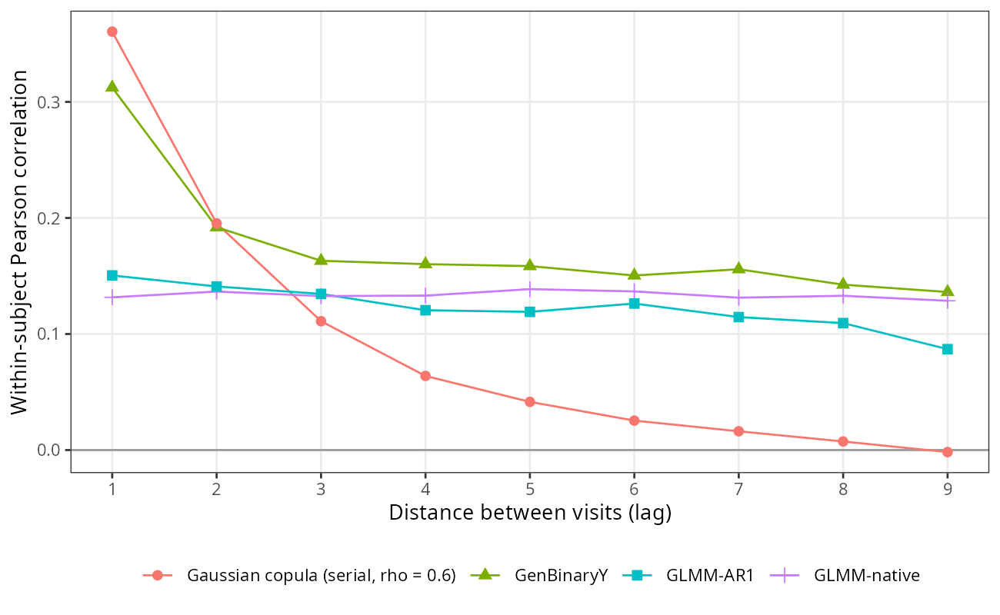
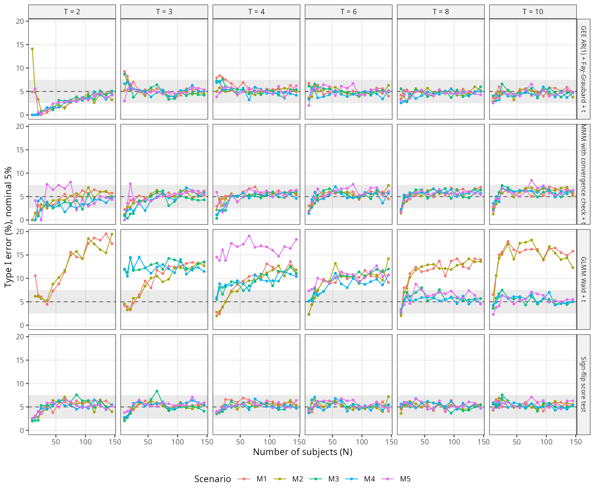
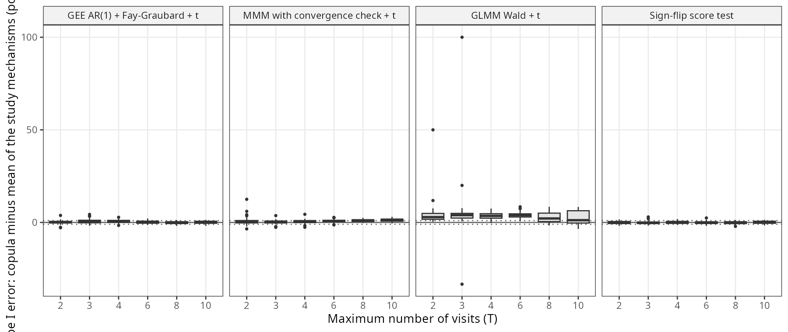

```{r setup}
.libPaths(path.expand("~/MMM/renv/library/linux-ubuntu-noble/R-4.6/x86_64-pc-linux-gnu"))
suppressMessages({ library(data.table) })
REPO <- path.expand("~/MMM"); TAB <- file.path(REPO, "tables")
md <- function(D) { D <- as.data.frame(D); for (j in seq_along(D)) if (is.numeric(D[[j]])) D[[j]] <- format(signif(D[[j]], 4), trim = TRUE, drop0trailing = TRUE)
  h <- paste0("| ", paste(names(D), collapse = " | "), " |"); s <- paste0("|", paste(rep("---", ncol(D)), collapse = "|"), "|")
  b <- apply(D, 1, function(r) paste0("| ", paste(gsub("|", "\\|", r, fixed = TRUE), collapse = " | "), " |")); cat(c(h, s, b, ""), sep = "\n") }
sec <- function(file, head, level = 1) {
  x <- readLines(file.path(REPO, file)); pat <- paste(strrep("#", level), head); i <- which(x == pat); if (!length(i)) return(""); i <- max(i)
  nxt <- which(grepl(paste0("^", strrep("#", level), " "), x) & seq_along(x) > i); j <- if (length(nxt)) min(nxt) - 1 else length(x)
  x <- x[(i + 1):j]; x <- x[!grepl("^\\[\\^", x)]
  x <- gsub("\\]\\(/", "](../../docs/", gsub("\\]\\((\\.\\./)+", "](../../docs/", x))
  gsub("\\]\\(S([0-9a-z]+)\\.md", "](../../docs/steps/S\\1.md", x) }
PR <- fread(file.path(TAB, "V4_S7e_predictions.csv")); BM <- fread(file.path(TAB, "V4_S7e_boot_means.csv")); RU <- fread(file.path(TAB, "V4_S7e_rule.csv"))
SM <- fread(file.path(TAB, "V4_S7e_summary.csv")); BS <- fread(file.path(TAB, "V4_S7e_bias_summary.csv")); DP <- fread(file.path(TAB, "V4_S7e_dp_rates.csv"))
G1 <- fread(file.path(TAB, "V4_S7e_GF1.csv")); G1M <- fread(file.path(TAB, "V4_S7e_GF1_missing.csv")); G4 <- fread(file.path(TAB, "V4_S7e_GF4.csv")); G4a <- fread(file.path(TAB, "V4_S7e_GF4a.csv"))
G2 <- fread(file.path(TAB, "V4_S7e_GF2.csv")); G3 <- fread(file.path(TAB, "V4_S7e_GF3.csv")); DS <- fread(file.path(TAB, "V4_S7e_dependence_summary.csv"))
SR <- fread(file.path(TAB, "V4_S7e_glmm_se_ratio.csv")); PT <- fread(file.path(TAB, "V4_S7e_glmm_pseudotrue.csv")); GT <- fread(file.path(TAB, "V4_S7e_glmm_by_scen_T.csv"))
UR <- fread(file.path(TAB, "V4_S7e_usable_reasons.csv"))
```

```{r inbreve, results = "asis"}
cat(sec("docs/steps/S7e.md", "In breve"), sep = "\n")
```

# Dubbi rinviati

```{r rinv, results = "asis"}
cat(sec("docs/steps/S7e.md", "Dubbi rinviati"), sep = "\n")
```

# Cancelli e previsioni

Attese pre-registrate (commit `9e4c8ae`, prima di ogni analisi sui dati del nuovo meccanismo):

```{r gates, results = "asis"}
cat(sec("docs/steps/S7e.md", "Cancelli", 2), sep = "\n"); cat("\n")
cat(sec("docs/steps/S7e.md", "Previsioni", 2), sep = "\n")
```

Esito:

```{r esito, results = "asis"}
cat(sec("docs/steps/S7e.md", "Esito del calcolo (2026-10-24)"), sep = "\n")
```

Valori calcolati (`tables/V4_S7e_predictions.csv`):

```{r pred, results = "asis"}
md(PR[, .(code, obs, lo, hi, a, b, verdict, extra)])
```

Medie sui 480 punti con bootstrap per blocchi (`tables/V4_S7e_boot_means.csv`):

```{r bm, results = "asis"}
md(BM)
```

# Scelta del meccanismo e controlli prima del run

```{r scelta, results = "asis"}
cat(sec("docs/steps/S7e.md", "Scelta del meccanismo (2026-10-23, prima di ogni analisi su dati del nuovo meccanismo)"), sep = "\n")
cat(sec("docs/steps/S7e.md", "Disegno del run (fissato prima del calcolo)"), sep = "\n")
cat(sec("docs/steps/S7e.md", "Controlli prima del run (2026-10-23)"), sep = "\n")
```



Cosa guardare: le tre curve dello studio restano sopra 0,09 anche a distanza 9 (componente costante per soggetto); la copula parte piu' in alto e scende a zero.

Profili riassunti (`tables/V4_S7e_dependence_summary.csv`):

```{r ds, results = "asis"}
md(DS)
```

# Risultati sul nuovo meccanismo



Cosa guardare: la GEE AR(1) con Fay e Graubard, il modello marginalizzato con controllo e il test a inversione di segno restano nella fascia; il modello misto ne esce negli scenari con la sola intercetta casuale (M1, M2) a ogni T e in M3-M5 con 3-6 visite.



Cosa guardare: le scatole delle tre strategie tarate stanno attorno a zero entro un punto; quella del modello misto sta sopra.

## Riassunto per strategia e meccanismo

Griglia principale (480 punti per meccanismo), riferimento t a N - p; `tables/V4_S7e_summary.csv`. Righe senza valore per i meccanismi dello studio: strategia non disponibile nelle tabelle salvate.

```{r sm, results = "asis"}
x <- copy(SM); x[, dgp := sub("GLMM-", "", dgp)]
for (v in c("mean_type1", "clearly_above", "mean_usable", "mean_power")) {
  cat("\n**", v, "**\n\n", sep = ""); md(dcast(x, label ~ dgp, value.var = v)) }
```

## Regola della Figura 1

Strategie con stima e intervallo; idonee = mai chiaramente sopra 7,5%; scelta = la idonea con la quota usabile media piu' alta (`tables/V4_S7e_rule.csv`).

```{r rule, results = "asis"}
for (s in unique(RU$set)) { cat("\n**", s, "**\n\n", sep = ""); md(RU[set == s][order(-eligible, -mean_pu)][1:8, .(strategy, n_dp, n_hi, n_lo, mean_pu, mean_rate, mean_upow, eligible, chosen)]) }
```

## Distorsione e copertura delle strategie marginali (H1, valore vero esatto)

`tables/V4_S7e_bias_summary.csv`; copertura con riferimento normale e t; ultima colonna: punti con copertura (normale) + 2 MCSE sotto 92,5%.

```{r bs, results = "asis"}
md(BS[, .(label, strategy, points, mean_bias_rel, max_abs_bias_rel, mean_relerr_modse, mean_cov_n, mean_cov_t, cov_n_below_92.5)])
```

## Modello misto: perche' e' liberale

Valore limite sotto H0 su 20.000 soggetti (`tables/V4_S7e_glmm_pseudotrue.csv`):

```{r pt, results = "asis"}
md(PT)
```

Errore standard del modello / dispersione delle stime e rifiuti implicati, media sui punti con N >= 85 (`tables/V4_S7e_glmm_se_ratio.csv`):

```{r sr, results = "asis"}
md(SR[N >= 85, .(ratio = mean(ratio), rate_implied = mean(rate_implied), bias_rel = mean(mean_est / empse)), by = .(scen, ntime)][order(scen, ntime)])
```

Errore di I tipo medio del modello misto per scenario e T, nei quattro meccanismi (`tables/V4_S7e_glmm_by_scen_T.csv`; medie che includono punti con pochi replicati usabili, come M3 con T = 2):

```{r gt, results = "asis"}
md(GT)
```

# Cosa e' girato

- Pre-registrazione: commit `9e4c8ae` (2026-10-23); controlli prima del run, script di aggregazione e prova su 6 chunk: `8fbe6de`.
- Codice: generatore `R/v4/rundir/copula/` (`gen_copula_data.R`, `generation_models_copula.R`, `copula_params.R`); `R/s7e/s7e_common.R`, `s7e_run.R` (9.600 chunk, 26,4 ore, 20-25 processi, guardia `s7e_thermal_guard.sh`), `s7e_agg.R`, `s7e_summary.R`, `s7e_gates_pre.R`, `s7e_gate_reprod.R`, `s7e_md5.sh`, `s7e_profiles.R`, `s7e_timing.R`; spiegazioni `s7e_explain.R`, `s7e_glmm_pseudotrue.R`, `s7e_glmm_se_ratio.R`, `s7e_glmm_singular.R`, `s7e_glmm_by_scen_T.R`.
- Risultati: `results_v4/S7e/rows/` (9.600 file, fuori da git); md5 di `results_full/` in `results_v4/S7e/md5_results_full_{before,after}.txt` (0 differenze); log in `reports/morris/S7e_logs/`.
- Software: R 4.6.1, libreria del progetto (MMLB, lme4, geepack, geesmv 1.3, clubSandwich 0.7.0); fewclust 0.2.0, commit `8538cad`.

# Appendice

## Controlli

```{r app, results = "asis"}
cat("\n**Completezza (GF1)**\n\n"); md(G1)
cat("\n**Righe mancanti per tecnica (GF1)**\n\n"); md(G1M[, .(missing = sum(missing), degenerate = sum(degenerate)), by = method])
cat("\n**Coincidenze (GF4 b, c)**\n\n"); md(G4); cat("\n**Riproduzione (GF4 a)**\n\n"); md(G4a)
cat("\n**Parita' e disegno (GF2)**\n\n"); md(G2); cat("\n**Calibrazione (GF3)**\n\n"); md(G3)
cat("\n**Motivi di non usabilita' (prime 25 righe)**\n\n"); md(head(UR, 25))
```

## Da dove vengono i numeri del riassunto

```{r fonti, results = "asis"}
rt <- function(s, d = "Copula-AR1") SM[strategy == s & dgp == d]
ch <- RU[set == "all four mechanisms (2,376 points)"]
F <- rbindlist(list(
  data.table(frase = "GEE AR(1) e modello marginalizzato mai fuori taratura verso l'alto", fonte = "V4_S7e_summary.csv, clearly_above, Copula-AR1", valore = paste(rt("gee_ar1_fg")$clearly_above, rt("mmm_cc")$clearly_above)),
  data.table(frase = "in media 4,6 e 5,1 falsi positivi su 100", fonte = "V4_S7e_summary.csv, mean_type1", valore = paste(round(rt("gee_ar1_fg")$mean_type1, 2), round(rt("mmm_cc")$mean_type1, 2))),
  data.table(frase = "2.376 situazioni: 92,1% e 90,9%", fonte = "V4_S7e_rule.csv, all four mechanisms", valore = paste(ch[strategy == "gee_ar1_fg"]$n_dp, round(ch[strategy == "gee_ar1_fg"]$mean_pu, 2), round(ch[strategy == "mmm_cc"]$mean_pu, 2), ch[chosen == TRUE]$strategy)),
  data.table(frase = "la regola la sceglieva gia' con i tre modi dello studio", fonte = "V4_S7e_rule.csv, study mechanisms", valore = RU[set == "study mechanisms (1,896 points)" & chosen == TRUE]$strategy),
  data.table(frase = "17-19 tentativi su 100 invece di 20-22", fonte = "V4_S7e_summary.csv, mean_power, strategie marginali", valore = paste(range(round(SM[dgp == "Copula-AR1" & strategy %in% c("gee_ar1_fg", "mmm_cc", "gee_exch_fg", "gee_exch_md", "gee_ind_fg", "flip")]$mean_power, 1)), collapse = "-") ),
  data.table(frase = "  (altri meccanismi)", fonte = "idem", valore = paste(range(round(SM[dgp != "Copula-AR1" & strategy %in% c("gee_ar1_fg", "mmm_cc", "gee_exch_fg", "gee_exch_md", "gee_ind_fg", "flip")]$mean_power, 1)), collapse = "-")),
  data.table(frase = "distorsione trascurabile del modello marginalizzato", fonte = "V4_S7e_bias_summary.csv, mmm_cc", valore = paste(round(BS[strategy == "mmm_cc"]$mean_bias_rel, 3), "max", round(BS[strategy == "mmm_cc"]$max_abs_bias_rel, 3))),
  data.table(frase = "copertura 94% (95% con la t)", fonte = "V4_S7e_bias_summary.csv, mmm_cc", valore = paste(round(BS[strategy == "mmm_cc"]$mean_cov_n, 2), round(BS[strategy == "mmm_cc"]$mean_cov_t, 2))),
  data.table(frase = "meno di un falso positivo su 100 in piu'", fonte = "V4_S7e_boot_means.csv, MMM cc copula - study", valore = round(BM[q == "MMM cc t rate H0, copula - study mechanisms"]$est, 3)),
  data.table(frase = "senza controllo fuori taratura in 59 situazioni", fonte = "V4_S7e_summary.csv, mmm_study", valore = rt("mmm_study")$clearly_above),
  data.table(frase = "modello misto 10 su 100 in media, 3 in piu'", fonte = "V4_S7e_summary.csv; V4_S7e_boot_means.csv", valore = paste(round(rt("glmer")$mean_type1, 2), round(BM[q == "GLMM Wald t rate H0, copula - study mechanisms"]$est, 2))),
  data.table(frase = "219 situazioni su 480 (altri 38-100)", fonte = "V4_S7e_summary.csv, glmer clearly_above", valore = paste(SM[strategy == "glmer"]$dgp, SM[strategy == "glmer"]$clearly_above, collapse = "; ")),
  data.table(frase = "errore standard fra due terzi e quattro quinti", fonte = "V4_S7e_glmm_se_ratio.csv, M1-M2, N >= 85", valore = paste(round(range(SR[scen %in% c("M1", "M2") & N >= 85, .(r = mean(ratio)), by = .(scen, ntime)]$r), 3), collapse = "-")),
  data.table(frase = "quasi 20 falsi positivi su 100", fonte = "V4_S7e_dp_rates.csv, glmer t, M1-M2, n >= 20", valore = round(DP[ref == "t" & strategy == "glmer" & scen %in% c("M1", "M2") & n >= 20, max(rate)], 2)),
  data.table(frase = "stima centrata", fonte = "V4_S7e_glmm_se_ratio.csv, M1-M2, N >= 85, bias / SE empirico", valore = round(max(abs(SR[scen %in% c("M1", "M2") & N >= 85, mean_est / empse])), 3)),
  data.table(frase = "con pendenze casuali e 8-10 visite vicino a 5", fonte = "V4_S7e_glmm_by_scen_T.csv", valore = paste(round(range(GT[scen %in% c("M3", "M4", "M5") & ntime >= 8][["Copula-AR1"]]), 2), collapse = "-")),
  data.table(frase = "test a inversione di segno 5,2, mai sopra, almeno 98 su 100", fonte = "V4_S7e_summary.csv; V4_S7e_dp_rates.csv", valore = paste(round(rt("flip")$mean_type1, 2), rt("flip")$clearly_above, round(DP[ref == "t" & strategy == "flip", min(pu)], 2))),
  data.table(frase = "GEE exchangeable con Fay e Graubard: 5 situazioni, 4 visite, 10-25 soggetti, circa 10", fonte = "V4_S7e_dp_rates.csv, gee_exch_fg, hi", valore = DP[ref == "t" & strategy == "gee_exch_fg" & hi == TRUE, paste(scen, N, ntime, round(rate, 1), collapse = "; ")]),
  data.table(frase = "con gli altri modi non succedeva mai", fonte = "V4_S7e_summary.csv, gee_exch_fg", valore = paste(SM[strategy == "gee_exch_fg"]$dgp, SM[strategy == "gee_exch_fg"]$clearly_above, collapse = "; ")),
  data.table(frase = "344 dataset su 960.000, tutti con disegno non stimabile", fonte = "V4_S7e_GF1.csv", valore = paste(G1$study4_missing, G1$study4_missing_nondeg, G1$recs))))
md(F)
```

Tempi: 26,4 ore da `results_v4/S7e/run_progress.log` (riga DONE); stima di 23 ore nel file dello step, sezione dei controlli prima del run.
