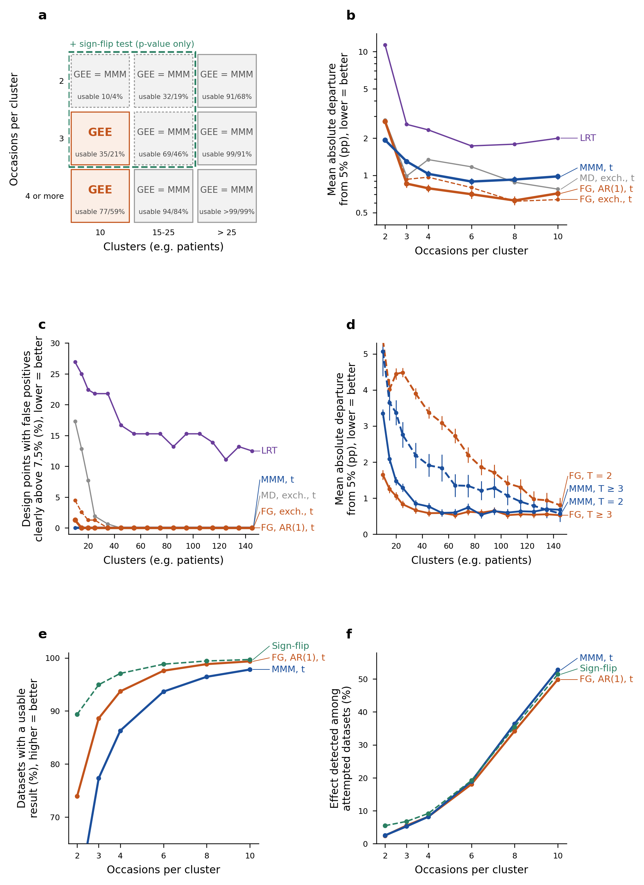

```{r setup}
.libPaths(path.expand("~/MMM/renv/library/linux-ubuntu-noble/R-4.6/x86_64-pc-linux-gnu"))
suppressMessages({ library(data.table) })
REPO <- path.expand("~/MMM"); TAB <- file.path(REPO, "tables"); LOGS <- file.path(REPO, "reports/morris/S7f_logs")
md <- function(D) { D <- as.data.frame(D); for (j in seq_along(D)) if (is.numeric(D[[j]])) D[[j]] <- format(signif(D[[j]], 4), trim = TRUE, drop0trailing = TRUE)
  h <- paste0("| ", paste(names(D), collapse = " | "), " |"); s <- paste0("|", paste(rep("---", ncol(D)), collapse = "|"), "|")
  b <- apply(D, 1, function(r) paste0("| ", paste(gsub("|", "\\|", r, fixed = TRUE), collapse = " | "), " |")); cat(c(h, s, b, ""), sep = "\n") }
sec <- function(file, head, level = 1) {
  x <- readLines(file.path(REPO, file)); pat <- paste(strrep("#", level), head); i <- which(x == pat); if (!length(i)) return(""); i <- max(i)
  nxt <- which(grepl(paste0("^", strrep("#", level), " "), x) & seq_along(x) > i); j <- if (length(nxt)) min(nxt) - 1 else length(x)
  x <- x[(i + 1):j]; x <- x[!grepl("^\\[\\^", x)]
  x <- gsub("\\]\\(/", "](../../docs/", gsub("\\]\\((\\.\\./)+", "](../../docs/", x))
  gsub("\\]\\(S([0-9a-z]+)\\.md", "](../../docs/steps/S\\1.md", x) }
rl <- function(f) readLines(file.path(LOGS, f))
T4 <- fread(file.path(TAB, "V5_S7f_table4.csv")); HB <- fread(file.path(TAB, "V5_S7f_h2h_boot.csv")); PFt <- fread(file.path(TAB, "V5_S7f_PF.csv"))
KG <- fread(file.path(TAB, "V5_S7f_kcfc_gate.csv")); G3c <- fread(file.path(TAB, "V5_S7f_GF3c.csv")); CPG <- fread(file.path(TAB, "V5_S7f_cp_gates.csv"))
CD <- fread(file.path(TAB, "V5_S7f_claims_diff.csv")); RO <- fread(file.path(TAB, "V5_S7f_review_outcomes.csv")); IB <- fread(file.path(TAB, "V5_S7f_inbreve_sources.csv"))
FC <- fread(file.path(TAB, "V5_S7f_fewclust_condition.csv"))
m5 <- function(t) length(readLines(file.path(REPO, sprintf("results_v4/S7f/md5_results_full_%s.txt", t))))
same_rf <- identical(readLines(file.path(REPO, "results_v4/S7f/md5_results_full_before.txt")), readLines(file.path(REPO, "results_v4/S7f/md5_results_full_after.txt")))
same_in <- identical(readLines(file.path(REPO, "results_v4/S7f/md5_inputs_before.txt")), readLines(file.path(REPO, "results_v4/S7f/md5_inputs_after.txt")))
n_in <- length(readLines(file.path(REPO, "results_v4/S7f/md5_inputs_after.txt")))
g3a <- grep("^GF3a:", rl("S7f_GF3a.log"), value = TRUE)[1]; gf2 <- grep("^GF2:", rl("S7f_GF2.log"), value = TRUE)[1]
gf4 <- grep("^GF4:", rl("S7f_GF4.log"), value = TRUE)[1]; pf <- rl("S7f_PF1PF2.log"); fmt <- rl("S7f_format.log")
words <- as.numeric(sub(".*= ", "", grep("^P1", pf, value = TRUE)[1])); med <- as.numeric(sub(".*median ([0-9.]+),.*", "\\1", grep("^P2", pf, value = TRUE)[1]))
dash <- grep("^em dashes", pf, value = TRUE)[1]
```

```{r inbreve, results = "asis"}
cat(sec("docs/steps/S7f.md", "In breve"), sep = "\n")
```

# Dubbi rinviati

```{r rinv, results = "asis"}
cat(sec("docs/steps/S7f.md", "Dubbi rinviati"), sep = "\n")
```

# Cancelli e previsioni

Attese pre-registrate nel commit `c19c84e` (2026-10-25), prima di costruire il registro v5 e di scrivere il testo. Valori letti dai log e dalle tabelle nel momento del render.

```{r esiti, results = "asis"}
pf4 <- PFt[code == "PF4"]
E <- data.table(
  attesa = c("GF1 integrita'", "GF2 cifre attestate", "GF3a registro riletto", "GF3b variante kcfc", "GF3c Tabella 4", "GF4 affermazioni", "GF5 completezza",
             "PF1 lunghezza (parole + 200 per display)", "PF2 mediana parole per frase", "PF3 cambi di classe senza Kauermann-Carroll", "PF4 Kauermann-Carroll fewclust - geesmv (punti)", "Condizione citazione fewclust"),
  atteso = c("md5 identici", "0 cifre fuori classe", "0 discordanze", "0 differenze fuori da gee_kc", "coincide", "0 frasi senza etichetta", "render, formato, abstract <= 200",
             "7.800", "19", "0", "< -1", "fallisce (sceglie mmm)"),
  intervallo = c("", "", "", "", "", "", "", "7.000-9.000", "14-24", "[0, 0]", "sotto -1", ""),
  osservato = c(sprintf("results_full %d = %d file, identici %s; righe lette %d file, identici %s", m5("before"), m5("after"), same_rf, n_in, same_in),
                gf2, g3a, sprintf("%s: %s", KG$check[1], KG$value[1]), sprintf("%d strategie, %s mismatch; controlli Wald dei flag %d/%d", G3c$value[1], G3c$value[2], sum(CPG$ok), nrow(CPG)),
                gf4, paste(grep("exit|departing", fmt, value = TRUE), collapse = "; "),
                format(words, big.mark = "."), format(med), sprintf("%s (%d righe cambiano classe, tutte con Kauermann-Carroll)", PFt[code == "PF3", est], sum(CD$class_change)),
                sprintf("%.2f (%.2f; %.2f)", pf4$est, pf4$lo, pf4$hi), paste(FC$dataset, FC$chosen, sep = ": ", collapse = "; ")),
  esito = c("superato", "superato", "superato", "superato", "superato", "superato", "superato", "confermata", "confermata", "confermata", "confermata", "fallita come atteso"),
  spiegazione = c("", "", "", "stima uguale, SE da fewclust", "conteggi sopra/sotto cambiati dal passaggio agli intervalli esatti di Clopper-Pearson (D-63), controllati prima della sostituzione", "", "",
                  "sopra le circa 8.000 di SMMR: rinviato alla revisione finale", dash, "", "la frase 'most anticonservative' del v4 non c'e' piu'", "fewclust citato solo come software (decisione del PI D-65)"))
md(E)
```

```{r att, results = "asis"}
cat(sec("docs/steps/S7f.md", "Esito delle attese (2026-10-31)"), sep = "\n")
```

# Esito dei dubbi

```{r dub, results = "asis"}
cat("## Dubbi ricevuti\n\n"); cat(sec("docs/steps/S7f.md", "Esito dei dubbi ricevuti"), sep = "\n")
cat("\n## Dubbi emersi durante lo step\n\n"); cat(sec("docs/steps/S7f.md", "Dubbi emersi durante lo step"), sep = "\n")
cat("\n## Decisioni tecniche dell'agente\n\n"); cat(sec("docs/steps/S7f.md", "Decisioni tecniche dell'agente"), sep = "\n")
```

# Cosa e' girato

- Ramo `morris-v4`, pre-registrazione nel commit `c19c84e`; il commit di chiusura e' riportato in `docs/log.md`.
- Pipeline `R/s7f/s7f_pipeline.sh` (flag con intervalli esatti, Tabella 4, bootstrap del confronto diretto, valori aggiuntivi, serie della Figura 1, tabelle cliniche, figure, specifica e registro dei numeri, controlli GF2-GF4, render, formato Word); ultimo giro il 2026-10-27, pochi minuti per giro. Variante `kcfc` della catena S4-S6 con `R/s7f/s7f_kcfc_pipeline.sh`.
- Ricostruzioni: `R/s7f/s7f_table2_recompute.R`, `s7f_table3_recompute.R`, `s7f_table5_recompute.R`, `s7f_lus_draws_check.R`, `s7f_fewclust_condition.R`, `s7f_inbreve_sources.R`.
- Software: R 4.6.1, lme4 2.0.6, fewclust 0.2.0 (commit 8538cad, `~/R/s7d_lib`), geesmv, geepack, clubSandwich, MMLB (versioni in `results_v4/S7f/sessionInfo.txt`).
- Integrita': md5 in `results_v4/S7f/md5_*_{before,after}.txt` (`R/s7f/s7f_md5.sh`).
- Revisioni: revisore avversariale (artifact `revisione_n2_report.md`, `revisione_n2_rilievi.csv`, script `~/MMM_rev2_v5/rev2_v5_recompute.R`) e revisore di stile (75 modifiche, punti F1-F33).

# Appendice

## Figura 1 del manoscritto



Cosa guardare: nel pannello a, "GEE" solo nelle due caselle con 10 cluster e 3 o piu' occasioni; nei pannelli b e d le due strategie della regola si sovrappongono quasi ovunque.

## Le due strategie della regola (Tabella 4, intervalli esatti)

```{r t4, results = "asis"}
md(T4[strategy %in% c("gee_ar1_fg", "mmm_cc", "flip"), .(strategy, n_dp, hi_all, lo_all, lo_N10, pu, upow, pu_small, chosen)])
```

## Confronto diretto per regione (bootstrap per blocchi, B = 2.000)

```{r hb, results = "asis"}
md(HB[q %in% c("mad_gee_minus_mmm", "pu_gee_minus_mmm", "upow_mmm_minus_gee"), .(region, n_dp, q, est, mcse, lo = est - 2 * mcse, hi = est + 2 * mcse, margin, class)])
```

## Esito dei rilievi della revisione avversariale

```{r ro, results = "asis"}
md(RO)
```

## Condizione per la citazione di fewclust

```{r fc, results = "asis"}
md(FC)
```

## Da dove vengono i numeri del riassunto

Ogni valore e' riletto da `R/s7f/s7f_inbreve_sources.R`, che fallisce se un valore differisce da quello scritto.

```{r ib, results = "asis"}
md(IB)
```
